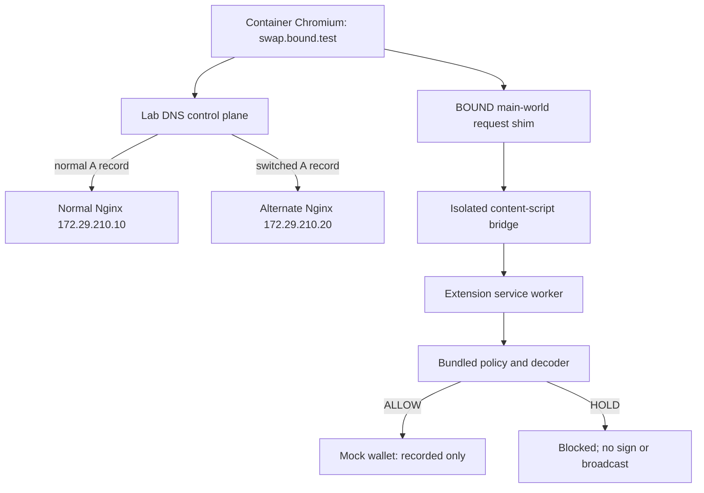

# BOUND — CoW Swap-Style DNS Hijack: Complete Local Demo Implementation Guide

**Audience:** ETHGlobal Mumbai 2026 hackathon team  
**Status:** Implementable, defensive **lab** scaffold + separately identified production/partner integrations  
**Target platform:** Windows 10/11 + PowerShell + Docker Desktop/WSL2; Node.js 22+; a disposable Chromium browser profile  
**Revision:** 2026-11-06  
**Companion artifact:** `bound-lab-starter.zip` contains the complete source files reproduced below.

> **Scope and safety:** This is an authorized, private `.test` domain lab. It neither impersonates CoW Swap nor compromises a third-party registrar. No seed phrases, private keys, real funds, wallet drainers, malicious token-transfer code, or live network redirections are used. The demo intercepts synthetic Ethereum-shaped requests and never signs or broadcasts transactions. **Do not point this test DNS service at other people's devices or networks.**

## Executive summary

The real April 2026 CoW Swap event illustrates a failure boundary: a user can visit a legitimate domain and still receive attacker-controlled frontend code when the underlying domain administration or DNS path is compromised. Secure on-chain smart contracts do not authenticate the frontend asking a wallet to sign. BOUND's proposed answer is a browser-side, **origin-aware policy check** on the actual spender/recipient/chain/amount, based on an independently authenticated policy, with an independent recovery interface.

This guide builds a **minimal replayable demo** in which:

1. `swap.bound.test` normally resolves to a legitimate test site.
2. An administrator of this *lab only* changes the authoritative DNS A record to the alternate test server.
3. The browser hostname remains the same and the two sites can look nearly identical.
4. The alternate frontend generates a synthetic ERC-20 `approve` request for a new spender with a very large allowance.
5. The BOUND test extension decodes the calldata and **holds** the request, recording a reason.
6. A local test freeze overrides previously approved actions.
7. An extension-owned offline Safe Mode page remains available after the two website servers shut down.

**What this actually proves:** same-origin content substitution, DNS-based rerouting, deterministic spender/allowance classification, and a mediated request path with observable hold evidence. **What it does not prove:** security against hostile provider bypasses, real MetaMask interception, registrar compromise, actual on-chain fund theft, a completed Swarm recovery transaction, or real ENSv2/Arkiv/Anon-RPC integrations. Those require the separately defined follow-on milestones in this guide.

**Important design choice:** The guaranteed-to-bootstrap core runs over **HTTP inside the dedicated test browser**. A complete optional local HTTPS overlay is included in §11. Use the HTTPS overlay for the strongest stage demo; however, local CA trust can require extra container configuration. Do **not** claim an HTTPS proof unless Chromium shows a valid trusted certificate during the demo. DNS rerouting is separately proven whether HTTP or HTTPS is used.

## 1. Acceptance criteria and threat model

### Success requirements (core lab)

| ID | Observable outcome | How to prove |
|---|---|---|
| D01 | DNS resolves the local test domain to `172.29.210.10` initially | `nslookup` inside `bound_labnet` |
| D02 | Normal synthetic approval is allowed | dApp response + extension trace `APPROVED_TEST_SPENDER` |
| D03 | DNS switches to `172.29.210.20` after an authorized test operation | second `nslookup` and CoreDNS log |
| D04 | Browser still displays `swap.bound.test` | address-bar screenshot |
| D05 | Alternate page requests approval of an unknown spender | decoded extension trace with spender `0x…b2` |
| D06 | Request is held; no mock-wallet forwarding takes place | `UNKNOWN_SPENDER` log, no success receipt |
| D07 | Local freeze holds even an otherwise approved request | `LAB_FREEZE_ACTIVE` trace |
| D08 | Safe Mode opens with both frontends stopped | stop both nginx services; extension Safe Mode still displays |
| D09 | Policy negative tests pass | `node --test tests/policy.test.mjs` |

### Assumptions

- Everything runs on infrastructure you control. `bound.test` is deliberately **not** `cow.fi`.
- IPs `172.29.210.10`, `.20`, and `.53` are private *example* addresses on the dedicated Docker network. If that subnet conflicts with a VPN/LAN, change **all** occurrences consistently.
- The browser is running **inside** the container and uses the CoreDNS server; your normal Windows browser does not automatically use this test DNS.
- The trusted policy is bundled with the extension and is independent of the website. An advanced version retrieves a signed/root-anchored snapshot from Swarm/Arkiv/ENSv2.
- All on-page and signed-transaction values are dummy test constants; no credential collection is involved.

### Relevant threat boundaries



**Threat-model truth:** Chromium `MAIN` world is controlled by the page, and a malicious page can bypass, confuse, or imitate an injected provider. The demo *only* claims mediation for the specific `window.boundEthereum` flow used by the fixture. A wallet-native enforcement point is a future architectural improvement. Neither a trusted TLS icon nor an origin match proves contract authorization.

## 2. Prerequisites and time-saving checks

Install and launch:

- [Docker Desktop](https://docs.docker.com/desktop/setup/install/windows-install/) with WSL2 enabled and Linux containers selected.
- [Node.js](https://nodejs.org/) **22 or later** on Windows for the deterministic switch tool and unit tests.
- PowerShell (already installed on Windows).
- An editor such as VS Code; optional [Foundry](https://book.getfoundry.sh/) for later on-chain experiments.
- Sufficient RAM for browser container (at least ~1 GiB shared-memory allocation; more headroom is preferable).
- For optional HTTPS: [mkcert](https://github.com/FiloSottile/mkcert) installed on Windows.

Check from PowerShell:

```powershell
node --version
docker --version
docker compose version
```

Unzip `bound-lab-starter.zip` into a folder named `bound-lab-starter`, or recreate **every file** from §5. Run the remainder in PowerShell from that folder:

```powershell
cd .\bound-lab-starter
```

**Precautions:** Do not use your daily wallet/browser profile. Never add a real wallet seed or API token to the repo. The containerized browser's published UI port is bound to `127.0.0.1` to avoid remote access. The CoreDNS server has **no published host port**; it is reachable only by containers on the lab Docker network. The default CoreDNS config forwards unrelated names to a public resolver and therefore is not air-gapped—use a restricted network if stronger isolation is required.

## 3. Repo layout and build sequence

```text
bound-lab-starter/
├── compose.yaml                  # CoreDNS + 2 sites + container browser
├── compose.https.yaml            # optional TLS overlay
├── dns/
│   ├── Corefile
│   └── db.bound.test              # mutable SOA serial + test-domain A record
├── scenarios/
│   ├── normal.js                  # approved spender, small amount
│   └── hijacked.js               # unknown spender, excessive amount
├── site/
│   ├── index.html                # identical base UI
│   └── app.js                    # ERC-20 approve encoder, BOUND entrypoint
├── scripts/
│   └── switch-dns.mjs            # safe, explicit lab-only switch
├── extension/
│   ├── manifest.json             # MV3; test-domain-only matches
│   ├── main.js                   # MAIN-world request()-shaped shim
│   ├── bridge.js                 # ISOLATED content script ↔ extension
│   ├── policy.mjs                # bundled test policy + calldata decoder
│   ├── background.js             # origin check, policy, decision log
│   ├── popup.html
│   ├── popup.js
│   ├── safe-mode.html             # extension-owned offline lab page
│   └── safe-mode.js
├── nginx/
│   └── https.conf                # optional same-origin HTTPS stage
├── tests/
│   └── policy.test.mjs
└── .gitignore
```

Core build dependency: **decoder tests → extension request bridge → two UIs → DNS switch → HTTPS (optional) → Arkiv/ENSv2/Swarm (advanced)**. Keeping the policy pure and independently testable saves time when the browser environment has problems.

## 4. Constants used throughout

| Constant | Value | Reason |
|---|---|---|
| Test hostname | `swap.bound.test` | Reserved `.test` namespace; not CoW Swap |
| Normal server | `172.29.210.10` | Legitimate site |
| Alternate server | `172.29.210.20` | Locally controlled compromised-site fixture |
| DNS server | `172.29.210.53` | CoreDNS authoritative for `bound.test` |
| Local chain ID | `31337` / `0x7a69` | Dummy Ethereum-shaped request; no chain required for core |
| Token address | `0x00000000000000000000000000000000000000a1` | Dummy token target |
| Approved spender | `0x00000000000000000000000000000000000000b1` | Bundled-policy allowlist |
| Unauthorized spender | `0x00000000000000000000000000000000000000b2` | Expected hold |
| Dummy account | `0x00000000000000000000000000000000000000c1` | Synthetic request sender |
| Max allowed test approval | `1000` raw units | Allows legitimate fixture with value `100` |
| ERC-20 selector | `0x095ea7b3` | `approve(address,uint256)` |

**Do not confuse the symbolic dummy addresses with deployed contracts.** The starter deliberately does not use `anvil` or a live signer: this prevents the demo from accidentally authorizing or moving real tokens.

## 5. File-by-file source code (copyable)

Create the following files at the exact relative paths. All JavaScript snippets were syntax-checked with Node 22, and the unit tests were executed. The Docker runtime and GUI browser couldn't be exercised in the authoring environment, so perform the manual checks in §7 on your machine.

### `compose.yaml`

```yaml
name: bound-lab
services:
  dns:
    image: coredns/coredns:1.12.4
    command: ["-conf", "/etc/coredns/Corefile"]
    volumes:
      - ./dns/Corefile:/etc/coredns/Corefile:ro
      - ./dns/db.bound.test:/zones/db.bound.test:ro
    networks:
      labnet:
        ipv4_address: 172.29.210.53

  normal:
    image: nginx:alpine
    volumes:
      - ./site:/usr/share/nginx/html:ro
      - ./scenarios/normal.js:/usr/share/nginx/html/scenario.js:ro
    networks:
      labnet:
        ipv4_address: 172.29.210.10

  hijacked:
    image: nginx:alpine
    volumes:
      - ./site:/usr/share/nginx/html:ro
      - ./scenarios/hijacked.js:/usr/share/nginx/html/scenario.js:ro
    networks:
      labnet:
        ipv4_address: 172.29.210.20

  browser:
    image: lscr.io/linuxserver/chromium:latest
    environment:
      PUID: "1000"
      PGID: "1000"
      TZ: "Asia/Kolkata"
    volumes:
      - ./browser-profile:/config
      - ./extension:/config/bound-extension:ro
    ports:
      - "127.0.0.1:3000:3000"
    dns:
      - 172.29.210.53
    shm_size: "1gb"
    depends_on:
      - dns
      - normal
      - hijacked
    networks:
      labnet:

networks:
  labnet:
    name: bound_labnet
    driver: bridge
    ipam:
      config:
        - subnet: 172.29.210.0/24
```

### `dns/Corefile`

```text
bound.test:53 {
    errors
    log
    file /zones/db.bound.test bound.test {
        reload 2s
    }
}

.:53 {
    errors
    forward . 1.1.1.1
}
```

### `dns/db.bound.test`

```dns
$ORIGIN bound.test.
$TTL 5
@ IN SOA ns.bound.test. hostmaster.bound.test. (
    2026110601 ; serial
    60         ; refresh
    60         ; retry
    300        ; expire
    5          ; minimum
)
@    IN NS ns.bound.test.
ns   IN A 172.29.210.53
swap IN A 172.29.210.10
```

### `scenarios/normal.js`

```javascript
window.BOUND_SCENARIO = Object.freeze({
  mode: "normal",
  title: "Normal application",
  spender: "0x00000000000000000000000000000000000000b1",
  amount: "100"
});
```

### `scenarios/hijacked.js`

```javascript
window.BOUND_SCENARIO = Object.freeze({
  mode: "hijacked",
  title: "Compromised application (lab fixture)",
  spender: "0x00000000000000000000000000000000000000b2",
  amount: "115792089237316195423570985008687907853269984665640564039457584007913129639935"
});
```

### `site/index.html`

```html
<!doctype html>
<html lang="en">
<head>
  <meta charset="utf-8">
  <meta name="viewport" content="width=device-width, initial-scale=1">
  <title>BOUND DNS Lab — Synthetic Swap</title>
  <style>
    body { font: 16px system-ui,sans-serif; background:#10151b; color:#e7edf5; max-width:720px; margin:50px auto; padding:0 18px; }
    .card { background:#1a222e; padding:24px; border:1px solid #394457; border-radius:18px; }
    button { background:#8be1bb; color:#062319; padding:12px 20px; border:0; border-radius:9px; font-weight:700; cursor:pointer; }
    .muted { color:#a7b2c2; } pre { white-space:pre-wrap; overflow-wrap:anywhere; background:#0d1218; padding:16px; border-radius:10px; }
    .banner { font-weight:700; color:#ffe1a1; margin-bottom:18px; }
  </style>
</head>
<body>
  <h1>BOUND synthetic trading demo</h1>
  <p class="banner">LOCAL LAB ONLY · no genuine CoW branding · no wallet credentials</p>
  <div class="card">
    <p id="mode"></p>
    <p class="muted">You are visiting <strong id="hostname"></strong>.</p>
    <p class="muted">This button requests a mock token approval. Nothing is signed or broadcast.</p>
    <button id="trade">Simulate approval</button>
    <pre id="output">Select “Simulate approval” to begin.</pre>
  </div>
  <script src="/scenario.js"></script>
  <script src="/app.js"></script>
</body>
</html>
```

### `site/app.js`

```javascript
(() => {
  const cfg = window.BOUND_SCENARIO;
  const token = "0x00000000000000000000000000000000000000a1";
  const account = "0x00000000000000000000000000000000000000c1";
  const $ = (id) => document.getElementById(id);
  $("hostname").textContent = location.origin;
  $("mode").textContent = `${cfg.title} — ${cfg.mode.toUpperCase()}`;

  function encodeApprove(spender, amount) {
    if (!/^0x[0-9a-fA-F]{40}$/.test(spender)) throw Error("Invalid test address");
    const n = BigInt(amount);
    if (n < 0n || n >= (1n << 256n)) throw Error("Invalid uint256 amount");
    return "0x095ea7b3" + spender.slice(2).padStart(64, "0") + n.toString(16).padStart(64, "0");
  }

  $("trade").addEventListener("click", async () => {
    try {
      if (!window.boundEthereum?.request) throw Error("Load the BOUND Lab extension and refresh");
      const tx = {
        from: account,
        to: token,
        chainId: "0x7a69",
        data: encodeApprove(cfg.spender, cfg.amount),
        value: "0x0"
      };
      const result = await window.boundEthereum.request({method: "eth_sendTransaction", params: [tx]});
      $("output").textContent = JSON.stringify(result, null, 2);
    } catch (e) {
      $("output").textContent = `HELD / ERROR: ${e.message}`;
    }
  });
})();
```

### `scripts/switch-dns.mjs`

```javascript
import {readFileSync, writeFileSync} from "node:fs";
import {fileURLToPath} from "node:url";
import {dirname, resolve} from "node:path";
const here = dirname(fileURLToPath(import.meta.url));
const path = resolve(here, "../dns/db.bound.test");
const targets = {
  normal: "172.29.210.10",
  hijacked: "172.29.210.20",
  recovered: "172.29.210.10"
};
const mode = process.argv[2];
if (!Object.hasOwn(targets, mode)) {
  console.error("Usage: node scripts/switch-dns.mjs normal|hijacked|recovered");
  process.exit(1);
}
let zone = readFileSync(path, "utf8");
if (!/^swap\s+IN\s+A\s+\d+\.\d+\.\d+\.\d+\s*$/m.test(zone)) throw Error("DNS record missing");
if (!/\b\d{10}(?=\s*;\s*serial)/m.test(zone)) throw Error("SOA serial missing");
zone = zone.replace(/^(swap\s+IN\s+A\s+)(\d+\.\d+\.\d+\.\d+)(\s*)$/m, (_full,prefix,_ip,suffix) => prefix+targets[mode]+suffix);
zone = zone.replace(/\b(\d{10})(?=\s*;\s*serial)/, (_full, n) => String(Number(n)+1));
writeFileSync(path, zone);
console.log(`LAB scenario=${mode}; swap.bound.test -> ${targets[mode]}`);
console.log("Check: docker run --rm --network bound_labnet busybox:1.36 nslookup swap.bound.test 172.29.210.53");
```

### `extension/manifest.json`

```json
{
  "manifest_version": 3,
  "name": "BOUND DNS Lab (mock-wallet only)",
  "version": "0.1.0",
  "description": "Defensive approval policy demonstration. Never signs or broadcasts transactions.",
  "permissions": ["storage"],
  "background": {"service_worker": "background.js", "type": "module"},
  "action": {"default_popup": "popup.html"},
  "content_scripts": [
    {
      "matches": ["http://swap.bound.test/*", "https://swap.bound.test/*"],
      "js": ["bridge.js"], "run_at": "document_start", "world": "ISOLATED"
    },
    {
      "matches": ["http://swap.bound.test/*", "https://swap.bound.test/*"],
      "js": ["main.js"], "run_at": "document_start", "world": "MAIN"
    }
  ]
}
```

### `extension/main.js`

```javascript
(() => {
  const pending = new Map();
  const marker = "BOUND_LAB_BRIDGE_V1";
  window.addEventListener("message", (event) => {
    const m = event.data;
    if (event.source !== window || event.origin !== location.origin ||
        m?.marker !== marker || m.direction !== "RESPONSE") return;
    const task = pending.get(m.id);
    if (!task) return;
    pending.delete(m.id);
    if (m.error) task.reject(new Error(m.error));
    else task.resolve(m.result);
  });
  const provider = {
    request({method, params = []} = {}) {
      if (typeof method !== "string") return Promise.reject(Error("Missing RPC method"));
      return new Promise((resolve, reject) => {
        const id = crypto.randomUUID();
        pending.set(id, {resolve, reject});
        window.postMessage({marker, direction: "REQUEST", id, method, params}, location.origin);
      });
    }
  };
  Object.defineProperty(window, "boundEthereum", {value: provider, configurable: false});
})();
```

### `extension/bridge.js`

```javascript
(() => {
  const marker = "BOUND_LAB_BRIDGE_V1";
  window.addEventListener("message", (event) => {
    const m = event.data;
    if (event.source !== window || event.origin !== location.origin ||
        m?.marker !== marker || m.direction !== "REQUEST") return;
    if (typeof m.id !== "string" || m.id.length > 100) return;
    chrome.runtime.sendMessage({type: "BOUND_EVALUATE", method: m.method, params: m.params},
      (answer) => {
        const error = chrome.runtime.lastError?.message;
        window.postMessage({marker, direction: "RESPONSE", id: m.id,
          ...(error || !answer ? {error: error || "BOUND service unavailable"} :
             answer.decision === "ALLOW" ? {result: answer} :
             {error: `BOUND HOLD: ${answer.reason}`})}, location.origin);
      });
  });
})();
```

### `extension/policy.mjs`

```javascript
// Pure, offline, read-only policy logic. Addresses are meaningless lab constants.
export const POLICY = Object.freeze({
  origins: ["http://swap.bound.test", "https://swap.bound.test"],
  chainId: 31337,
  token: "0x00000000000000000000000000000000000000a1",
  allowedSpender: "0x00000000000000000000000000000000000000b1",
  maxApproval: 1000n,
  version: 1
});
const address = (value) => typeof value === "string" && /^0x[0-9a-fA-F]{40}$/.test(value);
const hex = (value) => typeof value === "string" && /^0x(?:[0-9a-fA-F]{2})*$/.test(value);
const hold = (reason, decoded = null) => ({decision: "HOLD", reason, decoded});

export function evaluate({origin, method, params, frozen = false}) {
  if (frozen) return hold("LAB_FREEZE_ACTIVE");
  if (!POLICY.origins.includes(origin)) return hold("UNTRUSTED_ORIGIN");
  if (method === "eth_chainId") return {decision: "ALLOW", reason: "LOCAL_CHAIN_ID", value: "0x7a69"};
  if (method !== "eth_sendTransaction") return hold("UNSUPPORTED_METHOD");
  const tx = Array.isArray(params) ? params[0] : null;
  if (!tx || typeof tx !== "object") return hold("INVALID_TRANSACTION");
  if (tx.chainId !== "0x7a69") return hold("CHAIN_MISMATCH");
  if (!address(tx.to) || tx.to.toLowerCase() !== POLICY.token) return hold("UNRECOGNIZED_TOKEN");
  if (tx.value !== "0x0") return hold("UNEXPECTED_ETH_VALUE");
  if (!hex(tx.data) || tx.data.length !== 138 || !tx.data.toLowerCase().startsWith("0x095ea7b3")) {
    return hold("UNSUPPORTED_CALLDATA");
  }
  const encodedSpender = tx.data.slice(10, 74).toLowerCase();
  if (!encodedSpender.startsWith("0".repeat(24))) return hold("INVALID_ADDRESS_ENCODING");
  const spender = "0x" + encodedSpender.slice(24);
  const amount = BigInt("0x" + tx.data.slice(74, 138));
  const decoded = {type: "ERC20_APPROVE", spender, amount: amount.toString(), token: POLICY.token};
  if (spender !== POLICY.allowedSpender) return hold("UNKNOWN_SPENDER", decoded);
  if (amount > POLICY.maxApproval) return hold("EXCESSIVE_ALLOWANCE", decoded);
  return {decision: "ALLOW", reason: "APPROVED_TEST_SPENDER", decoded,
          mockWallet: "RECORDED_ONLY_NOT_SIGNED_OR_BROADCAST", policyVersion: POLICY.version};
}
```

### `extension/background.js`

```javascript
import {evaluate} from "./policy.mjs";
chrome.runtime.onMessage.addListener((message, sender, sendResponse) => {
  if (message?.type !== "BOUND_EVALUATE") return false;
  (async () => {
    let origin = "";
    try { origin = new URL(sender.url || sender.tab?.url || "").origin; } catch {}
    const {localFreeze = false} = await chrome.storage.local.get({localFreeze: false});
    const decision = evaluate({origin, method: message.method, params: message.params, frozen: localFreeze});
    const {history = []} = await chrome.storage.local.get({history: []});
    const entry = {time: new Date().toISOString(), origin, method: message.method,
                   decision: decision.decision, reason: decision.reason,
                   decoded: decision.decoded ?? null};
    await chrome.storage.local.set({history: [...history.slice(-49), entry]});
    sendResponse(decision);
  })().catch((error) => sendResponse({decision: "HOLD", reason: "INTERNAL_ERROR"}));
  return true;
});
```

### `extension/popup.html`

```html
<!doctype html><html><head><meta charset="utf-8"><style>
body{font:13px system-ui;width:365px;padding:12px;background:#131a23;color:#e7edf5}
pre{max-height:420px;overflow:auto;white-space:pre-wrap;overflow-wrap:anywhere}
button{margin:5px 0;padding:7px} h2{margin-top:0}
</style></head><body>
<h2>BOUND — Local Lab</h2>
<p>Mock-wallet only. Entries are observations, not signed transactions.</p>
<button id="clear">Clear log</button>
<button id="freeze">Toggle LOCAL test freeze</button>
<a href="safe-mode.html" target="_blank" style="color:#8be1bb">Open extension-owned Safe Mode</a>
<p id="freezeStatus"></p>
<pre id="logs">Loading…</pre>
<script src="popup.js"></script></body></html>
```

### `extension/popup.js`

```javascript
async function render() {
  const {localFreeze = false} = await chrome.storage.local.get({localFreeze: false});
  document.querySelector("#freezeStatus").textContent = localFreeze ? "LAB FREEZE ACTIVE" : "LAB FREEZE OFF";
  const {history = []} = await chrome.storage.local.get({history: []});
  document.querySelector("#logs").textContent = history.length ?
    JSON.stringify(history.slice().reverse(), null, 2) : "No requests yet";
}
document.querySelector("#clear").onclick = async () => {
  await chrome.storage.local.set({history: []});
  await render();
};
document.querySelector("#freeze").onclick = async () => {
  const {localFreeze = false} = await chrome.storage.local.get({localFreeze: false});
  await chrome.storage.local.set({localFreeze: !localFreeze});
  await render();
};
render();
```

### `extension/safe-mode.html`

```html
<!doctype html><html><head><meta charset="utf-8"><title>BOUND Safe Mode — local lab</title>
<style>body{font:16px system-ui;max-width:740px;margin:50px auto;background:#10151b;color:#e7edf5;padding:0 18px} pre{white-space:pre-wrap;background:#1a222e;padding:20px;border-radius:10px} .warning{color:#ffd186}</style>
</head><body><h1>BOUND Safe Mode — LAB</h1>
<p class="warning">Extension-owned offline interface. Not a Swarm deployment. No real recovery transactions are supported in this starter.</p>
<p>This page remains available when both test frontends are shut down.</p>
<pre id="info">Loading locally bundled policy…</pre>
<script type="module" src="safe-mode.js"></script></body></html>
```

### `extension/safe-mode.js`

```javascript
import {POLICY} from "./policy.mjs";
const {history = [], localFreeze = false} = await chrome.storage.local.get({history: [], localFreeze: false});
document.querySelector("#info").textContent = JSON.stringify({
  origin: POLICY.origins[0], chainId: POLICY.chainId, token: POLICY.token,
  approvedSpender: POLICY.allowedSpender, maxApproval: POLICY.maxApproval.toString(),
  policyVersion: POLICY.version, localFreeze, recentLabRequests: history.slice(-5),
  status: "OFFLINE_READ_ONLY; not a transaction or revocation tool"
}, null, 2);
```

### `tests/policy.test.mjs`

```javascript
import test from "node:test";
import assert from "node:assert/strict";
import {evaluate, POLICY} from "../extension/policy.mjs";
const origin = POLICY.origins[0];
function approve(spender, amount, overrides = {}) {
  return {origin, method: "eth_sendTransaction", params: [{
    chainId: "0x7a69", to: POLICY.token, value: "0x0",
    data: "0x095ea7b3" + spender.slice(2).padStart(64, "0") +
      BigInt(amount).toString(16).padStart(64, "0"), ...overrides
  }]};
}
const unknown = "0x00000000000000000000000000000000000000b2";
test("normal approved spender passes", () => {
  assert.equal(evaluate(approve(POLICY.allowedSpender, 100)).decision, "ALLOW");
});
test("same-origin unknown spender is held", () => {
  assert.equal(evaluate(approve(unknown, 100)).reason, "UNKNOWN_SPENDER");
});
test("unlimited approval is held even for the trusted spender", () => {
  assert.equal(evaluate(approve(POLICY.allowedSpender, (1n << 256n) - 1n)).reason, "EXCESSIVE_ALLOWANCE");
});
test("wrong chain is held", () => {
  assert.equal(evaluate(approve(POLICY.allowedSpender, 100, {chainId: "0x1"})).reason, "CHAIN_MISMATCH");
});
test("wrong token is held", () => {
  assert.equal(evaluate(approve(POLICY.allowedSpender, 100, {to: unknown})).reason, "UNRECOGNIZED_TOKEN");
});
test("unknown selector is held", () => {
  assert.equal(evaluate(approve(POLICY.allowedSpender, 100, {data: "0xdeadbeef"})).reason, "UNSUPPORTED_CALLDATA");
});
test("wrong origin is held", () => {
  assert.equal(evaluate({...approve(POLICY.allowedSpender, 100), origin: "https://untrusted.test"}).reason, "UNTRUSTED_ORIGIN");
});
test("empty params are held", () => {
  assert.equal(evaluate({origin,method: "eth_sendTransaction",params: []}).reason, "INVALID_TRANSACTION");
});

test("mock guardian freeze overrides valid approval", () => {
  assert.equal(evaluate({...approve(POLICY.allowedSpender, 100), frozen: true}).reason, "LAB_FREEZE_ACTIVE");
});
```

### `.gitignore`

```text
/browser-profile/
/certs/
node_modules/
.DS_Store
```

### `compose.https.yaml`

```yaml
# Optional overlay: use with -f compose.yaml -f compose.https.yaml.
# Generate local certificates first (see implementation guide).
services:
  normal:
    volumes:
      - ./nginx/https.conf:/etc/nginx/conf.d/default.conf:ro
      - ./certs:/etc/nginx/certs:ro
  hijacked:
    volumes:
      - ./nginx/https.conf:/etc/nginx/conf.d/default.conf:ro
      - ./certs:/etc/nginx/certs:ro
  browser:
    volumes:
      - ./certs/bound-root-ca.pem:/config/bound-root-ca.pem:ro
```

### `nginx/https.conf`

```nginx
server {
    listen 80;
    server_name swap.bound.test;
    return 308 https://$host$request_uri;
}
server {
    listen 443 ssl;
    server_name swap.bound.test;
    ssl_certificate /etc/nginx/certs/swap.bound.test.pem;
    ssl_certificate_key /etc/nginx/certs/swap.bound.test-key.pem;
    root /usr/share/nginx/html;
    index index.html;
    location / { try_files $uri $uri/ /index.html; }
}
```

## 6. Start the lab (PowerShell)

From the directory containing `compose.yaml`:

```powershell
# Reset DNS to approved site before boot.
node .\scripts\switch-dns.mjs normal

# Unit-test the policy first; this should report 9 passing tests.
node --test .\tests\policy.test.mjs

# Launch CoreDNS, normal site, alternate site, browser.
docker compose up -d

# Confirm all four containers are running.
docker compose ps

# Show DNS startup and any parsing errors.
docker compose logs dns --tail 40
```

**If you edit JS/HTML:** The sites are bind-mounted; refresh the browser. **If you edit extension code:** reload the unpacked extension at `chrome://extensions` and refresh the page. **If you edit `compose.yaml`:** recreate with `docker compose up -d --force-recreate`.

### 6.1 Verify DNS outside the browser

The following ephemeral BusyBox container joins the **lab Docker network** and asks CoreDNS directly:

```powershell
docker run --rm --network bound_labnet busybox:1.36 nslookup swap.bound.test 172.29.210.53
```

Expected A answer: `172.29.210.10`. In the DNS logs, the query should be for `swap.bound.test`. Do not confuse the DNS *server* IP (`.53`) with the requested *answer* (`.10`).

### 6.2 Open the containerized browser

Browse on **Windows** to:

```text
http://127.0.0.1:3000
```

That address opens the LinuxServer Chromium graphical session. Inside **that Chromium session**, not your ordinary Windows Chrome:

1. Open `chrome://extensions`.
2. Turn on **Developer mode**.
3. Choose **Load unpacked**.
4. Select the folder `/config/bound-extension` from the container's file picker. This is the mounted extension directory.
5. Confirm the `BOUND DNS Lab (mock-wallet only)` extension appears, then open `http://swap.bound.test`.
6. If the Chrome browser has Secure DNS enabled, disable it **for this disposable profile** so your lab's DNS resolver is used. Avoid putting the test site into your everyday browser profile.

The page should show `Normal application — NORMAL`. Select **Simulate approval**. A success object must include `"decision": "ALLOW"`, `"reason": "APPROVED_TEST_SPENDER"` and `"mockWallet": "RECORDED_ONLY_NOT_SIGNED_OR_BROADCAST"`.

Click the BOUND toolbar icon. Its popup should show the approved request with the same policy decision. **No wallet transaction occurs.** The `mockWallet` field is deliberately explicit about that.

### 6.3 Switch the test DNS record

Back in Windows PowerShell:

```powershell
node .\scripts\switch-dns.mjs hijacked
# CoreDNS polls the SOA serial about every 2 seconds.
docker run --rm --network bound_labnet busybox:1.36 nslookup swap.bound.test 172.29.210.53
```

Expected A answer: `172.29.210.20`. If the query still says `.10`, check `docker compose logs dns --tail 60`, ensure the zone file was updated, and retry after the file-plugin reload interval. The script increments the SOA serial on every switch; CoreDNS's file plugin reloads based on that serial.

Return to the **container browser**, clear its host cache or restart the container if needed, then navigate to `http://swap.bound.test` again. Chromium DNS caching can mean a simple refresh continues to use the earlier address. A deterministic fallback is:

```powershell
docker compose restart browser
```

Re-open `http://127.0.0.1:3000` if the browser UI session was restarted. Your extension profile remains in the `browser-profile` bind-mounted directory. Then open `http://swap.bound.test` again.

The page should now show `Compromised application (lab fixture) — HIJACKED` while the **hostname is unchanged**. Click **Simulate approval**. Expected visible text includes:

```text
HELD / ERROR: BOUND HOLD: UNKNOWN_SPENDER
```

Open the BOUND popup and verify the full decoded spender is `0x00000000000000000000000000000000000000b2`. The request is blocked *before any mock wallet forwarding*; because the extension has no signer, this test does not establish actual MetaMask interposition.

### 6.4 Restore and simulate the emergency freeze

```powershell
node .\scripts\switch-dns.mjs recovered
# Verify it resolves to .10 again.
docker run --rm --network bound_labnet busybox:1.36 nslookup swap.bound.test 172.29.210.53
```

Reopen/restart the container browser as needed. In the BOUND popup, select **Toggle LOCAL test freeze**, then click **Simulate approval** on the normal page. The request should be held with `LAB_FREEZE_ACTIVE`. Toggle it off to restore normal behavior.

This is a **local policy-state demonstration**, not an ENSv2 guardian transaction. The actual ENSv2/PolicyAnchor implementation milestone is in §12.

### 6.5 Test independent offline Safe Mode

```powershell
docker compose stop normal hijacked
```

The test domain should no longer serve application content. But click the extension toolbar icon and select **Open extension-owned Safe Mode**. The offline page displays the bundled policy and recent request records.

**Caveat:** This is an extension-owned **read-only** continuity demo, not yet a Swarm deployment and not a token revocation service. A genuine Swarm recovery proof requires the additional steps in §12. Restart the sites when done:

```powershell
docker compose start normal hijacked
```

### 6.6 Reset and teardown

```powershell
node .\scripts\switch-dns.mjs normal
docker compose down
```

Delete the `browser-profile` folder if you want to discard the disposable browser state. Do not commit that folder, generated certificates, or any real account-related data. The `.gitignore` in §5 excludes them.

## 7. Why the extension detects this example

When the button is pressed, the app builds **actual ERC-20 ABI-shaped calldata**:

```text
0x095ea7b3  (method selector)
[32-byte left-padded spender address]
[32-byte uint256 approval amount]
```

The decoder first checks the exact `eth_sendTransaction` method, chain, token contract address, zero ETH value, `0x095ea7b3` selector, total calldata length, properly padded spender and amount. It then compares the spender against a **bundled allowlist** and the amount against a fixed maximum. Unknown methods and unrecognized calldata are held. The attempted request is evaluated using the **content script sender URL**, not a client-supplied `origin` string.

**Normal:** `0x…a1.approve(0x…b1, 100)` → approved.  
**Compromised:** `0x…a1.approve(0x…b2, max_uint256)` → `UNKNOWN_SPENDER` hold.  
**Unknown spender but small amount:** still held.  
**Approved spender with too-large amount:** `EXCESSIVE_ALLOWANCE` hold.  
**Wrong chain:** `CHAIN_MISMATCH` hold.  
**Unknown method/selector:** `UNSUPPORTED_METHOD` or `UNSUPPORTED_CALLDATA` hold.  
**Local freeze active:** `LAB_FREEZE_ACTIVE` overrides every request.

**Definition of 'BLOCKED' in this lab:** the BOUND-mediated shim rejects the Promise instead of resolving to a mock receipt, and the extension records `HOLD`. There is **no real injected MetaMask request** to compare against and no signer in the demo. The popup is evidence of the tested mediation path, not proof against other wallet request paths.

### Trust boundaries and limitations to state to judges

- The **app-controlled MAIN-world script** can bypass or spoof this provider-style bridge. `window.postMessage` is a messaging mechanism, not cryptographic authorization. An attacker can call other unmediated providers if present. You must report this limitation.
- The bundled policy cannot be changed by the compromised web server, but that **does not** make it independently reviewable or decentralized. Real BOUND should verify a curator-authenticated policy snapshot and governance root.
- The current parser handles **only direct ERC-20 approvals**, not Permit2, EIP-712 signed permits, EIP-7702, batch transactions, nested execution, proxy routing, or malicious recipient substitution inside approved routers.
- The script's chain ID is a test constant, not independently read from a live wallet. A real wallet adapter must use trusted wallet/network state and reject mismatches.
- A token spender allowlist is not enough to prove every call to an allowed contract is safe. Function selectors, recipient semantics, amount bounds and simulation must also be considered.
- The DNS A-record switch reproduces the **visitor's resolution outcome**, not the real CoW incident's social-engineering/registrar authorization path. Do not describe the local script as 'hacking the registrar'.
- The read-only offline page does not revoke a genuine allowance or demonstrate actual Swarm availability until the later integrations are implemented.

## 8. Validation matrix and evidence package

### Automated tests

```powershell
node --test .\tests\policy.test.mjs
```

The included tests cover:

1. Approved spender with small allowance → ALLOW.
2. Unknown spender at the same origin → HOLD.
3. Unlimited allowance to approved spender → HOLD.
4. Wrong chain ID → HOLD.
5. Unknown token destination → HOLD.
6. Unrecognized function selector → HOLD.
7. Wrong origin → HOLD.
8. Missing transaction params → HOLD.
9. Local emergency freeze → HOLD.

### Manual integration test matrix

| Run | DNS answer | UI variant | Request | Expected trace | Evidence |
|---|---|---|---|---|---|
| T1 | `.10` | Normal | approve `b1,100` | ALLOW | address bar + popup log |
| T2 | `.20` | Hijacked | approve `b2,max` | HOLD `UNKNOWN_SPENDER` | DNS query + popup decoded spender |
| T3 | `.10` | Normal + freeze | approve `b1,100` | HOLD `LAB_FREEZE_ACTIVE` | popup state + trace |
| T4 | `.10`/`.20` | Either | unknown selector (unit test) | HOLD | Node test output |
| T5 | server stopped | unavailable | open Safe Mode | extension page loads | stopped containers + page screenshot |

### Minimum demo evidence artifacts to save

```text
evidence/
├── 01-normal-dns.txt
├── 02-normal-app.png
├── 03-normal-allow.png
├── 04-switched-dns.txt
├── 05-hijacked-same-origin.png
├── 06-spender-hold.png
├── 07-freeze-hold.png
├── 08-frontends-stopped.png
├── 09-offline-safe-mode.png
├── 10-policy-tests.txt
└── environment.md   # Docker image digests, versions, date, test scope
```

Capture the actual values from your run, not hypothetical transaction hashes. For each case include site URL, DNS answer, policy version, requested chain/token/spender/amount, classification, extension-mediated status, and timestamp. Do not log sensitive wallet credentials.

## 9. Four-minute judge demo script

**0:00–0:40 — Establish normal.** Show `swap.bound.test` with CoreDNS answering `.10`; press Simulate approval. Show the BOUND popup trace: correct token, approved spender, small amount, `ALLOW`.

**0:40–1:35 — DNS takeover.** In PowerShell run the authorized `switch-dns.mjs hijacked` script, then query DNS. Refresh the container browser (clear cache/restart if needed). The URL remains `swap.bound.test`, but CoreDNS answers `.20`. Briefly describe why the real CoW incident was possible without altering smart contracts.

**1:35–2:25 — Defense.** Click Simulate approval. Show `BOUND HOLD: UNKNOWN_SPENDER` and the decoded `b2` address. Explain that an origin-only allowlist is insufficient because the origin itself is now serving untrusted JS.

**2:25–3:05 — Emergency freeze.** Restore DNS; toggle *local test* freeze. Show that even a previously accepted request is now held. Distinguish this from the later on-chain governance version.

**3:05–3:40 — Continuity.** Stop nginx servers, open extension Safe Mode; show the policy and evidence remain accessible. State that the starter's continuity proof is **extension-local**, while a separately deployed Swarm version is the hackathon target.

**3:40–4:00 — Limitations and roadmap.** Briefly acknowledge provider bypass risk, lack of signing/broadcast, and the planned Arkiv/ENSv2/Swarm trust anchors. Show the 9 green unit tests.

**Core talk track:** “The URL did not change. The DNS answer did. The compromised frontend requested a spender not in the separately bundled policy. BOUND decoded the actual request and refused to forward it through the instrumented provider.”

## 10. Common problems and fixes

| Symptom | Likely cause | Fix |
|---|---|---|
| `compose up` errors on subnet | VPN or Docker IPAM conflict | Choose an unused private /24 and update compose, DNS zone, switch script, test commands |
| `swap.bound.test` fails inside browser | Browser DNS configuration not using CoreDNS | Check `docker compose exec browser cat /etc/resolv.conf`, then CoreDNS logs; avoid DoH in the lab profile |
| DNS query still returns `.10` | SOA serial unchanged/reload delay/old file mount | Confirm file contents, logs, and wait for file reload; script increments serial |
| Browser still shows previous frontend | Chromium DNS cache / open socket | Clear host cache, close tab, or restart `browser`; check new `nslookup` first |
| `nslookup` fails from BusyBox | `bound_labnet` absent or DNS failed | `docker compose ps`; `docker compose logs dns` |
| Browser UI at port 3000 fails | image not ready, port collision, browser container crash | `docker compose logs browser`; free local port or change only host-side mapping |
| `window.boundEthereum` undefined | Extension missing/not active; wrong browser; no match | Load unpacked in **container** Chromium; reload extension and page |
| Normal request unexpectedly held | policy constant mismatches app, freeze on, HTTP/HTTPS origin mismatch | inspect popup reason; verify `b1`, `a1`, `0x7a69`; reset freeze |
| `Cannot import module` in MV3 service worker | old Chromium or extension load issue | Check extension errors, ensure MV3 `"type": "module"` and `.mjs` present |
| Chrome stores old extension | Profile cache/unpacked source changed | Click **Reload** on `chrome://extensions`, then refresh tab |
| HTTPS shows certificate warning | Lab CA not trusted inside container | Follow §11 trust steps; do **not** claim successful TLS demonstration until validated |
| Local freeze is on after restarting | `chrome.storage.local` persists | Toggle freeze off in popup or delete disposable profile |
| Offline Safe Mode still works but site 404s | Expected after stopping servers | This is the intended continuity test |

**Diagnostics:**

```powershell
docker compose ps
docker compose logs dns --tail 80
docker compose logs normal --tail 40
docker compose logs hijacked --tail 40
docker compose logs browser --tail 60
docker run --rm --network bound_labnet busybox:1.36 nslookup swap.bound.test 172.29.210.53
node --test .\tests\policy.test.mjs
```

## 11. Optional HTTPS upgrade for higher CoW incident fidelity

**Rationale:** CoW's real visitors could type the legitimate hostname and see HTTPS while the frontend was compromised. To model that user-visible property, serve the same locally trusted certificate from both controlled nginx services. A certificate validates the **hostname and cryptographic connection**, not the smart contract's intended semantics.

### 11.1 Generate a lab-only certificate on Windows

With `mkcert` installed, from repo root:

```powershell
New-Item -ItemType Directory -Force .\certs | Out-Null
mkcert -install
mkcert -cert-file .\certs\swap.bound.test.pem `
       -key-file .\certs\swap.bound.test-key.pem swap.bound.test
$caDir = (& mkcert -CAROOT).Trim()
Copy-Item (Join-Path $caDir 'rootCA.pem') .\certs\bound-root-ca.pem
```

The root CA's private key remains in your mkcert CA directory. **Never copy `rootCA-key.pem` into the project, Docker container, screenshots or repository.** Generated leaf private keys in `certs/` are not production credentials; still keep the whole directory gitignored.

### 11.2 Start the HTTPS overlay

The `compose.https.yaml` overlay mounts nginx's optional `nginx/https.conf` on **both** servers, including the same locally valid certificate for `swap.bound.test`.

```powershell
docker compose -f compose.yaml -f compose.https.yaml up -d --force-recreate
```

This overlay redirects port 80 traffic to `https://swap.bound.test` and serves both frontends over port 443. `swap.bound.test` still switches at the DNS layer; `https://` and the hostname can remain unchanged between scenarios.

### 11.3 Trust the lab CA inside container Chromium

`mkcert -install` on Windows **does not** automatically trust that CA inside the separate Linux browser container. Copy its certificate to the Linux trust store and, where required by the container's Chromium/NSS build, to Chromium's NSS database.

```powershell
docker compose -f compose.yaml -f compose.https.yaml exec -u root browser `
  sh -lc 'cp /config/bound-root-ca.pem /usr/local/share/ca-certificates/bound-root-ca.crt && update-ca-certificates'
```

Some Chromium images additionally require NSS trust. Check whether `certutil` is installed in this image:

```powershell
docker compose exec -u root browser sh -lc 'command -v certutil || true'
```

If present, initialize/import into the *actual browser user's NSS database* (inspect the browser's home/profile path; this example assumes `/config/.pki/nssdb`):

```powershell
docker compose exec -u root browser sh -lc 'mkdir -p /config/.pki/nssdb; certutil -N -d sql:/config/.pki/nssdb --empty-password 2>/dev/null || true; certutil -A -d sql:/config/.pki/nssdb -n BOUND-LAB-CA -t "C,," -i /config/bound-root-ca.pem'
```

If `certutil` is absent, install the distribution's `libnss3-tools` package **inside the disposable container**, or use Chromium's certificate import UI for the disposable profile. The NSS database path and browser trust-store behavior vary by image/version; validate rather than assuming these commands have made the certificate trusted. Restart browser after changes:

```powershell
docker compose restart browser
```

Open `https://swap.bound.test` inside the container Chromium. Confirm: the browser considers the certificate trusted, it is issued for `swap.bound.test`, and no error interstitial appears. **Do not bypass the warning using `--ignore-certificate-errors`: that would undermine the TLS demonstration.**

After the HTTPS overlay works, repeat the DNS switch and verify that the **same HTTPS origin** loads the alternate site. The extension matches both test schemes, but a production policy should authorize only the exact expected scheme/host and reject unexpected downgrade.

If this TLS step blocks the demo close to judging time, return to the functioning HTTP lab rather than fabricating a TLS result:

```powershell
docker compose down
docker compose up -d
```

## 12. Extending from a lab proof to an ETHGlobal-grade BOUND submission

This section describes **separate implementation work**. The supplied scaffold does **not** already include real Arkiv/ENSv2/Swarm deployments, a live wallet or a recovery contract. Do not claim partner integrations until deployed and verified. Integrate in this order, with measurable exit conditions.

### Milestone P1 — Real wallet observation and transaction decoding

1. Replace the mock response with a test-only wallet adapter in a separate adapter module. Use a disposable wallet on Anvil or Sepolia with no real assets; never capture or export private keys to the webpage or extension.
2. Query chain ID and account via the actual wallet provider. Normalize them from trusted provider state, not page-supplied strings.
3. Ensure the **selected** request path reaches BOUND before forwarding. Distinguish `MEDIATED`, `NOT_MEDIATED`, `UNDECODABLE` and `BLOCKED` in logs.
4. Add `eth_sendTransaction` decoding for `approve`, `increaseAllowance`, NFT `setApprovalForAll`; handle standard and nonstandard ABI variants carefully.
5. Add `eth_signTypedData_v4` parsing for EIP-2612 permits and Permit2. Validate typed-data domain separator fields, chain, token, actual spender, value, expiration and replay parameters; reject unsupported/missing recipients.
6. For batches or smart-account `execute`, recursively decode nested calls. An unrecognized nested call should hold the entire batch, not silently pass it.
7. For a local real-chain verification, use a minimal test-only ERC-20 and demonstrate a small authorization followed by a separate `approve(spender,0)` recovery **in a disposable chain**. Save actual tx hashes only for real broadcasts. Keep the synthetic unknown-spender attack request held and never submit it to the chain.

**Exit evidence:** an instrumented wallet shows the legitimate request was received, whereas a hostile fixture request in the *same mediated path* was not forwarded to the wallet. A standalone extension provider wrapper is **not** a universal interception guarantee.

### Milestone P2 — Versioned, curator-reviewed policy model

Define a canonical schema. One example:

```json
{
  "schema": "bound.policy.v1",
  "origin": "https://swap.bound.test",
  "chainId": 31337,
  "token": "0x00000000000000000000000000000000000000a1",
  "authorizedSpenders": [{
    "address": "0x00000000000000000000000000000000000000b1",
    "allowedMethods": ["approve(address,uint256)"],
    "maxAmountRaw": "1000"
  }],
  "epoch": 1,
  "expiry": "2026-12-31T00:00:00Z",
  "sourceEvidence": ["CURATOR_REVIEWED_LAB_FIXTURE"]
}
```

Build a **deterministic canonicalizer** (e.g., explicitly sorted fields, addresses lowercased, stable number representation, no JS floating-point amounts); derive a cryptographic snapshot digest. The extension must compare the downloaded bytes to an independently authenticated root. A raw Arkiv metadata row, website-hosted JSON or unauthenticated ENS text field **must not** silently grant permissions.

Recommended verifier checks: expected schema version; expected publisher/owner and policy root; exact origin and chain; validity window; epoch monotonicity; signer/curator authorization; guardian freeze; contract codehash when applicable; exact decoded call arguments; and failure mode if policy state cannot be confirmed.

### Milestone P3 — Arkiv evidence mirror

Purpose: searchable provenance, not a public allowlist anyone can forge.

1. Pin an upstream ERC-7730 registry commit, record its Git SHA and data license.
2. Import only descriptors with usable addresses, chain context and explicit provenance.
3. Normalize records into `bound.binding.v1` entities, retaining `sourceCommit`, `sourcePath`, `chainId`, `contract`, optional `origin`, `publisher` and `reviewStatus`.
4. Publish via an account whose address the client can verify, and support queries by `(origin, chainId)` and `(chainId, contract)`.
5. Hash the curated policy snapshot separately, and bind the verified Arkiv entity set to that root. Ignore a forged record created by another publisher even if its display fields look official.
6. Demo an unrelated publisher submitting a **benign fake test row**; BOUND must reject it based on owner/root mismatch.

**Exit evidence:** working Arkiv write/query code, entity keys, verified owner, sample query, source commit and a screenshot/log of ignored unauthorized data. Consult the current [Arkiv documentation](https://docs.arkiv.network/) for version-specific SDK calls instead of inventing endpoints.

### Milestone P4 — ENSv2 resolver + separate PolicyAnchor governance

Your whitepaper proposes the resolver for publishing authenticated configuration and role separation, plus a separate PolicyAnchor contract for root/epoch/freeze. This distinction matters because **ENSv2 resolver EAC isn't itself a guardian-freeze mechanism**.

- Register/control a dedicated ENSv2 name for the demo, not someone else's name.
- Use an ENSv2 Permissioned Resolver text key such as `bound.policy.root` pointing at the policy root/descriptor reference.
- Grant a curator a **key-scoped** setter role using the resolver's `grantSetterRoles(setter, account)` flow (not an overly broad root role). Current resolver interfaces use DNS-encoded name arguments for `setText`.
- Deploy a small role-controlled PolicyAnchor with `publisher`, `guardian`, `root`, `epoch`, and `frozenEntry` fields. Enforce root freshness, monotonic epochs and a guardian veto.
- When a policy is frozen, the extension must hold formerly allowed requests even if a cached snapshot matches the old root. Cache positive policy **data**, not previously cached `ALLOW` verdicts.

Example contract **interface**, not a ready-to-deploy audited implementation:

```solidity
interface IBOUNDPolicyAnchor {
    function root() external view returns (bytes32);
    function epoch() external view returns (uint64);
    function frozenEntry(bytes32 entryId) external view returns (bool);
    function publishRoot(bytes32 newRoot, uint64 newEpoch) external;
    function freezeEntry(bytes32 entryId) external;
}
```

Keep guardian and curator keys separate. The demo should contain real explorer URLs for root publication and freeze only once those transactions exist. ENSv2's record roles can apply across every name sharing one resolver, so use a dedicated resolver when necessary and carefully scope the role to the text key.

**Exit evidence:** role grant, curator update, root/epoch proof, guardian freeze transaction, and observable browser policy refresh to `HOLD`. Reference: [ENSv2 Permissioned Resolver](https://docs.ens.domains/ensv2/permissioned-resolver/) and [Enhanced Access Control](https://docs.ens.domains/ensv2/enhanced-access-control/).

### Milestone P5 — Real Swarm Safe Mode and testnet revocation

The starter's `extension/safe-mode.html` is just an offline illustration. For a genuine Swarm deliverable:

1. Build a **static, immutable, independently hosted** recovery UI (no runtime asset fetched from compromised `swap.bound.test`).
2. Bundle an independently checked manifest with file hashes and trusted policy-root reference. Pin the expected Swarm reference or verified content digest in the extension.
3. Upload the static bundle through a Bee node using a funded postage stamp batch. Swarm's current documentation recommends `bee-js`; the underlying API supports `POST /bzz` and `GET /bzz/{reference}`. Never expose Bee's administrative API publicly.
4. Fetch from a **different** Bee gateway, verify the returned file/bundle bytes, and reject any hash mismatch before execution.
5. In Safe Mode, independently read known test-ERC-20 allowances from an approved RPC path and offer only tightly allowlisted `approve(knownSpender,0)` operations via the user's wallet. Do not promise to revoke unseen Permit2 signatures, EIP-7702 delegations or all signatures through an ERC-20 allowance reset.
6. With the primary sites stopped, display the trusted Swarm page and complete one testnet-only revocation; then verify `allowance(owner,spender) == 0` on-chain and save the real tx hash.
7. If Anon-RPC is implemented, demonstrate that actual `eth_call`/read transport travels through the real worker, not an ordinary fetch under a privacy label. Record bootstrap/direct fallback behavior and residual metadata leakage.

**Exit evidence:** accessible Swarm reference, reproducible file hashes, trust verifier logs, frontends-down recovery screen, a testnet approval-revocation transaction, and measured read-path transport. Docs: [Swarm Upload & Download](https://docs.ethswarm.org/docs/develop/upload-and-download/).

### Milestone P6 — Adversarial negative tests

Run separate tests for (1) wrong-chain spender, (2) oversized allowance, (3) forged Arkiv metadata, (4) stale root, (5) active guardian freeze, (6) corrupt Swarm bundle, (7) unsupported Permit2 or batch call, and (8) a **known provider mediation bypass**. Explicitly display `NOT_MEDIATED` for the last case; a false claim of universal coverage would be worse than an honest negative test.

## 13. What belongs in the submission

- CoreDNS proof: two A answers under the same `.test` hostname and corresponding browser views.
- Policy proof: before/after decoded request bytes and decisions, replayable unit tests, stable extension code.
- Security claim: **“BOUND holds unauthorized approval requests that pass through our mediated provider”**, not “all DNS attacks are automatically prevented.”
- Provenance proof: for Arkiv/ENSv2 work, actual entity keys, on-chain resolver/anchor addresses, owner/curator evidence and hashes.
- Availability proof: explicit distinction between extension-local offline page and a real Swarm-hosted, hash-verified Safe Mode.
- Known-limitations section: hostile main-world bypass, unsupported wallet transports, cache freshness, proxy/complex calldata, ENSv2 role scope, DNS/HTTPS CA trust.
- Track evidence: sponsor-specific screenshots, reproducible commands, testnet transaction links, source SHA, build digest, license and AI-use disclosure where required.

## 14. Sources and verification links

These references informed the guide. Follow versioned documentation before shipping; upstream interfaces and images can change.

1. [CoW DAO incident and recovery proposal (CIP-86)](https://forum.cow.fi/t/cip-86-discretionary-grants-program-for-victims-of-the-cow-fi-domain-hijacking/3431) — first-party incident context.
2. [CoreDNS `file` plugin](https://coredns.io/plugins/file/) — SOA-based reload behavior and zone syntax.
3. [Docker Compose networking](https://docs.docker.com/compose/how-tos/networking/) — custom networks and static IPv4 settings.
4. [LinuxServer Chromium container](https://github.com/linuxserver/docker-chromium) — browser UI on ports 3000/3001 and `/config` persistence.
5. [Chrome extensions: content scripts](https://developer.chrome.com/docs/extensions/develop/concepts/content-scripts) — MAIN versus ISOLATED worlds and injection timing.
6. [Chrome extensions: message passing](https://developer.chrome.com/docs/extensions/develop/concepts/messaging) — content script ↔ service worker messages.
7. [EIP-1193](https://eips.ethereum.org/EIPS/eip-1193) — standard provider request API; this starter implements a deliberately incomplete mock `request()`-shaped shim.
8. [ENSv2 permissioned resolver](https://docs.ens.domains/ensv2/permissioned-resolver/) — resolver text permissions.
9. [ENSv2 EAC](https://docs.ens.domains/ensv2/enhanced-access-control/) — role grants and scopes.
10. [Swarm uploads and downloads](https://docs.ethswarm.org/docs/develop/upload-and-download/) — Bee, postage batch and content references.
11. [mkcert](https://github.com/FiloSottile/mkcert) — locally trusted development certificates.

## 15. Final stop/go checklist

- [ ] `node --test` passes nine policy tests.
- [ ] CoreDNS is running in Docker and has no host-published port.
- [ ] Normal A record returns `.10`, alternate returns `.20`.
- [ ] BOUND extension loaded in the **container browser**, not only host Chrome.
- [ ] Normal request produces `ALLOW` and mock recording only.
- [ ] Switched DNS produces the other frontend at the same hostname.
- [ ] New spender and unlimited-allowance fixture produces `HOLD`.
- [ ] Local freeze overrides the normal approval.
- [ ] Extension Safe Mode is accessible with both sites stopped.
- [ ] No real wallet credentials, seed phrases, funds or signing actions are involved in the core.
- [ ] If HTTPS is claimed, the container browser actually trusts the lab CA.
- [ ] Limitations are visible; no universal wallet interception claim.
- [ ] Sponsor tracks are claimed **only** when their real on-chain/off-chain integrations are demonstrated.

---

**Recommended build order:** Make §§5–8 pass exactly as specified before touching ENSv2 or Arkiv. This establishes the security primitive. Add the HTTPS overlay, and only then wire the public policy registry/anchors and Swarm recovery flow. The resulting video will show the exact distinction BOUND is meant to prove: **website identity is not sufficient; independently authenticated authorization semantics matter.**

