# BOUND — Browser-Origin–Aware Wallet Policy & Emergency Recovery

## Architecture, Security Protocol, Data Plane, and Implementation Bible

**Version:** 1.0 (proposed design)  
**Research cut-off:** 6 November 2026  
**Status:** Architecture and implementation plan; **not** a claim of implemented, audited, or universally enforced protection  
**Primary ecosystem:** EVM / Ethereum; Chromium desktop extension MVP  
**Target event:** ETHGlobal Mumbai 2026  
**Target tracks:** Arkiv — *Mirror something Ethereum depends on* (+ Arkiv × Swarm bonus); ENS — *Best Use of ENSv2*; Ethereum Foundation — *Best CROPS App* or *Best Use of Anon-RPC* (one EF prize per project).  
**Design motto:** *Know where your signature is going before you sign.*

> **How to read this document:** **[DOC]** denotes a claim established by the cited official documentation; **[DESIGN]** is a proposed BOUND architecture; **[ASSUMPTION]** is a condition the implementation must validate; **[MVP]** is intended hackathon scope; **[FUTURE]** is not promised for the MVP. Diagrams are native Mermaid fenced blocks designed to render on GitHub, Mermaid Live, and compatible Markdown viewers. Code is illustrative unless marked runnable; check ABIs, SDK versions, deployed addresses, and chain configuration before deployment.

---

## Abstract

BOUND proposes an **origin-aware transaction policy layer** between browser dApps and Ethereum wallets, with an independent emergency interface for the day a legitimate website is compromised. The problem is not only phishing to fake domains: an attacker may control the HTML/JavaScript served by a legitimate origin while the smart contracts remain uncompromised. BOUND aims to identify sensitive signing requests, normalize the actual authorization targets and embedded spenders, and compare the requested action against a **versioned, curated, independently anchored policy for that origin and chain**. When trust cannot be established, the request should be held with an explainable reason rather than misclassified as malicious. The recovery surface is a hash-pinned application published on Swarm; it allows users to inspect and revoke supported approvals and execute narrowly allowlisted protocol calls, with read RPC traffic routed through an actual anonymizing Anon-RPC worker.

BOUND draws candidate contract/owner/website metadata from the community ERC-7730 clear-signing corpus, mirrors queryable projections into Arkiv, anchors reviewed policy roots and governance identity through ENSv2, and applies decisions locally in a browser extension. **ERC-7730 metadata is evidence, not authorization; ENS names do not prove websites are uncompromised; Arkiv is a public mirror, not a trust oracle; and a page-level provider wrapper does not universally enforce wallet behavior.** These limits are central to the technical design.

**Primary research contribution:** a reproducible separation between **descriptor observation**, **curator-attested site association**, **effective address-level authorization**, **transaction semantics**, and **emergency recovery**, with explicit fail-closed behavior where the implementation can actually enforce it.

**Keywords:** browser wallet security, compromised frontend, ERC-7730, EIP-1193, EIP-6963, Permit2, EIP-7702, ENSv2, Arkiv, Swarm, Anon-RPC, provenance, revocation, CROPS.

### Scope statement

The architecture below can detect many **site-to-unapproved-contract** substitutions for requests that BOUND actually mediates. It **cannot** prove that an allowed contract call is safe, guarantee interception across every wallet or WalletConnect integration, prevent a malicious website from learning an address already revealed, or guarantee emergency access if all RPC gateways are censored. A wallet-native integration is the strongest long-term enforcement boundary. No production security certification, measured accuracy, or verified live contract deployment is implied.

---

## Table of contents

1. Executive summary and defensible product claim
2. Problem, adversary and non-goals
3. Official partner tracks and compliance requirements
4. Design principles, assumptions and trust boundaries
5. Architecture and component responsibilities
6. Canonical registry and policy model
7. ERC-7730 importer, provenance and Arkiv mirror
8. ENSv2 governance, on-chain anchors and emergency revocation
9. Browser extension interception and enforcement
10. Decoder library and nested authorization semantics
11. Policy engine and deterministic decision process
12. Safe Mode, Swarm delivery and Anon-RPC
13. End-to-end data flow, security flow and user journeys
14. Contracts, APIs, message schemas and repo layout
15. Threat model and attack trees
16. Technical limitations and mitigation roadmap
17. Security invariants and test framework
18. Hackathon execution, demo and acceptance criteria
19. Partner submission evidence and traceability
20. Performance, privacy, operations and incident response
21. Competitive positioning and future research
22. Claims that must not be made
23. Glossary
24. Official sources and implementation references
25. Final architecture verdict

---

## 1. Executive summary and defensible product claim

### 1.1 Problem in one paragraph

A DeFi UI can lie even when the domain's TLS certificate is valid and the smart contracts are audited. If the origin's CDN, DNS, deployment pipeline, third-party script, or web server is compromised, malicious JavaScript may ask the wallet to sign an ERC-20 unlimited approval, EIP-712 typed permit, Permit2 authorization, EIP-7702 delegation, or seemingly innocent call that forwards control to an attacker. Traditional wallet UI can show what is requested, but usually does not prove whether that request is an authorized operation for the **site the user intended to use**. Reputation feeds and blocklists are useful but inherently reactive.

### 1.2 The proposed product

BOUND has **four security-relevant planes**, not one all-powerful extension:

| Plane | Purpose | Trust anchor | Failure behavior |
|---|---|---|---|
| Observation | Extract ERC-7730 descriptions and candidate associations | Versioned upstream content + source provenance | Untrusted/unresolved; never auto-approve |
| Publication | Query candidate and reviewed bindings on Arkiv; deliver immutable snapshot via Swarm | Arkiv entity owner **plus** authenticated snapshot hash | Never trust Arkiv's index alone |
| Authorization | ENSv2-governed publisher roles and a small policy-anchor contract | Finalized EVM chain, pinned contracts, curator signatures, guardian freezes | Stale or conflicting roots cause hold |
| Enforcement/recovery | Decode and decide locally; open independently served Safe Mode | Installed extension code, policy root, hash-pinned Safe Mode bundle, wallet confirmation | Hold on unsupported sensitive actions; only limited safe recovery |

### 1.3 Defensible differentiation

- **Origin–contract mismatch:** warns on a wallet request to a previously unapproved spender or destination while visiting a registered protocol origin.
- **Provenance-aware policy:** every approved binding has a source descriptor, manual evidence, reviewer, validity window, chain and policy-root version.
- **Emergency independence:** Safe Mode does not rely on the original dApp's web server, CDN, JavaScript or backend for its allowlisted contract calls.
- **Auditable governance:** curator publication and guardian emergency freezes are separate powers; stale root snapshots cannot silently become current.
- **Privacy by default for Safe Mode reads:** real Anon-RPC transport, not a renamed direct RPC endpoint.

### 1.4 Explicit non-goals

1. Do not claim arbitrary transaction **safety** from an approved target address.
2. Do not silently turn missing ERC-7730 descriptors into malicious verdicts.
3. Do not claim that reading an ENS text record proves domain ownership or authenticates arbitrary metadata.
4. Do not make ENSv2's built-in EAC pretend to offer a guardian freeze primitive it does not offer; add a separate contract/policy status if required.
5. Do not promise universal injection coverage in hostile same-origin JavaScript.
6. Do not intercept private keys, seed phrases, raw wallet signing operations outside the documented mediation boundary, or unrelated web browsing.
7. Do not promise to revoke existing signatures or revoke everything simply by revoking an ERC-20 allowance: Permit2, signatures already issued, and account delegations require distinct handling.
8. Do not claim that Anon-RPC hides an on-chain transaction sender/recipient from chain observers.

---

## 2. Problem, adversary and non-goals

### 2.1 Attack scenario

The user intentionally visits `https://swap.cow.fi/`. An attacker takes control of what the browser receives at that legitimate origin (for example through compromised deployment credentials or a poisoned CDN). HTTPS still shows a valid secure connection **to that origin**; it does not mean the served JavaScript is trustworthy. The attacker prompts `approve(attackerSpender, 2^256−1)` or an EIP-712 permit naming a malicious spender. A wallet could present the call for signature. BOUND, **if on the enforced request path**, examines the *token contract, signer, spender, chain, amount and owner-to-site association* instead of relying on the displayed site's branding.

### 2.2 Attacker capabilities and defender assets

**Attacker may:** edit all scripts and markup at one legitimate dApp origin; create contracts and domains; request injected-provider calls; alter nested calldata; impersonate ERC-7730 submitters; inject forged Arkiv entities; attempt role compromise; exploit stale ENS records; manipulate RPC responses; trigger approval requests; and block access to the original frontend.

**Assume attacker cannot (MVP):** compromise browser/extension binaries, the user's wallet signing key, Ethereum consensus, an uncompromised governance signer quorum, or the hash-pinned build of Safe Mode. Separate tests must investigate these stronger adversaries.

**Assets protected:** user assets and allowances, user comprehension of the request, policy integrity and freshness, emergency access to legitimate functions, limited metadata privacy, and reproducible warnings.

### 2.3 Why domain matching alone fails

`swap.cow.fi` as an exact browser origin is **just context**. The attacker who hijacks the same origin still owns that page's JavaScript during the incident. BOUND must get protocol trust evidence from **outside** the page: an audited/pinned policy tied to curator trust. The first-party website cannot authorize a new contract merely by returning JSON to the extension. Conversely, an unknown new contract might be a legitimate deployment, so mismatches should be held, not declared criminal.

### 2.4 Threat model summary

| Threat | Example | Possible BOUND protection | Residual risk |
|---|---|---|---|
| Unauthorized spender | `approve(attacker, max)` | Decode spender and hold | Only on mediated wallet paths |
| Compromised approved router | Allowed router has malicious implementation | Codehash/implementation monitoring + simulations | Same address may remain dangerous |
| Legitimate router, malicious recipient | Swap outputs to attacker | Decode recipient and intent constraints | Deep routing may obscure recipient |
| Poisoned registry | Attacker publishes fake `owner` field | Attestation + curation + policy root | Curator compromise |
| ENS governance compromise | Attacker repoints resolver | Pinned anchor + roles + monitoring | Privileged on-chain upgrade |
| Browser wrapper bypass | Page retained wallet provider reference | Flag unenforced paths; wallet-native future | Cannot promise all-wallet blocking |
| Fake Safe Mode gateway | Gateway serves different JS | Immutable reference + local hash check | Bootstrap implementation flaws |
| Privacy leak | Direct read calls reveal address and IP to RPC | Anon-RPC for reads | Browser gateway metadata; on-chain public data |

---

## 3. Official partner tracks and compliance requirements

**Source of truth for track rules:** [ETHGlobal Mumbai prizes](https://ethglobal.com/events/mumbai/prizes). The page was consulted on 6 November 2026. Prize descriptions and eligibility can change; check again at submission.

### 3.1 Arkiv — Mirror something Ethereum depends on

**[DOC]** The track asks for publicly useful, redistributable Ethereum data mirrored into **queryable Arkiv entities**. The mirror must not be Sourcify data. The importer must be reproducible, the app must write to the current Arkiv testnet using `@arkiv-network/sdk` or JSON-RPC, and someone must actually read/query the mirrored entities. Arkiv describes four 25% rubric categories: feedback, reach, why Arkiv, and data quality. The required repo evidence is not optional: `/arkiv/friction.md`, `/arkiv/reach.md`, `/arkiv/why-arkiv.md`, `/arkiv/data-quality.md`, plus `/arkiv/schema.md`. README must disclose writing wallet(s) and a runnable query. Public open-source repo and AI-use disclosure are required. [Track source](https://ethglobal.com/events/mumbai/prizes).

**BOUND mapping:** mirror the community ERC-7730 corpus as searchable contract/owner/site candidates, source and descriptor fingerprints, descriptor-to-chain deployment associations, with approved policy snapshots as a separate derived layer. The upstream [community registry](https://github.com/ethereum/clear-signing-erc7730-registry) advertises **CC0-1.0**; pin the relevant `LICENSE.md` and source commit in the importer report and verify all vendored auxiliary materials' terms before mirroring. **Do not import Sourcify records for this prize.** If needed, use Sourcify *for verification* without copying its indexed dataset into the prize mirror.

**Hackathon infrastructure [DOC]:** Arkiv Rabdi testnet `chainId=7794095`; examples in current docs use `https://rpc.rabdi.db-chain.testnet.arkiv.network` and optionally an access key. Arkiv records have wallet owner, attributes, and expiration. Query APIs filter on indexed attributes. A named `arkiv.schema` tag **does not authenticate publishers**; filter `$owner` or verify a trusted signature. [Arkiv overview](https://docs.arkiv.network/start-here/introduction/), [schema](https://docs.arkiv.network/schemas/define/), [query](https://docs.arkiv.network/reference/query-language/).

### 3.2 Arkiv × Swarm bonus

**[DOC]** Use **both** Arkiv and Swarm in a way a user can demonstrate. The event specifically requires `/arkiv/swarm.md` documenting which bytes are on Swarm, the Arkiv entity key pointing to a Swarm reference, a working public link, postage batch ID, funding wallet or batch source, Bee node/service, upload/read code, reproducible steps and demo timestamp. **Encrypted Swarm references can include decryption keys; never publicly put a secret-bearing reference in Arkiv.** [Prize source](https://ethglobal.com/events/mumbai/prizes).

**BOUND mapping:** upload the **generic Safe Mode immutable build** and the **snapshot/proof bundle** to Swarm; Arkiv policy or publication records contain the safe, public Swarm content reference and hash. Show `getEntity(...) -> swarmReference -> fetch/verify rendered Safe Mode` on-screen. The same Safe Mode must continue when the original dApp server is shut down. Swarm uploads need a **postage stamp batch**; upload a directory via `@ethersphere/bee-js` and access its manifest reference. [Swarm hosting](https://docs.ethswarm.org/docs/develop/host-your-website/).

### 3.3 ENS — Best Use of ENSv2

**[DOC]** The event calls for actual ENSv2 usage on **Ethereum mainnet or Sepolia**, not hard-coded UI labels. ENSv2's relevant innovations are hierarchical registries, Enhanced Access Control (EAC), role-based permissions, Permissioned Resolvers, and record/namespace aliasing. Source and demo links must be public. [Track source](https://ethglobal.com/events/mumbai/prizes), [ENSv2 overview](https://docs.ens.domains/ensv2/overview/).

**BOUND mapping:** an ENSv2-controlled policy namespace with **real records and delegated resolver EAC roles**; a curator authorized for *one data/text key* publishes the latest approved policy root; a separate operator controls risk notification/status; a guardian can activate the BOUND application-specific `PolicyAnchor` freeze. The role separation must be enforced by live ENSv2 contracts and `PolicyAnchor`, not a database toggle. See §§8, 18.

**Vital semantics [DOC]:** ENSv2 resolver `ROLE_SET_TEXT` can be granted for a specific **text key**, but that grant applies to every name served by that resolver instance—**not a single name**. Use a dedicated resolver for BOUND's governance namespace if required. Registry roles, resolver roles and custom guardian-contract roles are distinct. [ENSv2 Permissioned Resolver](https://docs.ens.domains/ensv2/permissioned-resolver/).

### 3.4 Ethereum Foundation — Best CROPS App or Best Use of Anon-RPC

**[DOC]** CROPS means **Censorship Resistant, Open Source, Private, Secure**. For Best CROPS App, README must contain a `CROPS` section with the dependency/failure story, license/rebuildability, third-party disclosures, and key/data protection. A **3-minute maximum** demo showing the failure/continuity moment is required. No third-party tracking/analytics in the client. A public free/open-source repo and run instructions are mandatory. A single project can be considered for **at most one EF prize**, even if submitted under more than one EF category. [Track source](https://ethglobal.com/events/mumbai/prizes).

For the **Anon-RPC-specific** prize, an application is expected to route its RPC reads through Anon-RPC **by default**, demonstrate meaningful traffic coverage and explain excluded traffic. It must use the actual Anon-RPC harness plus an anonymizing worker/network; the example worker performing normal `fetch` is **not anonymous**. [EF rules](https://ethglobal.com/events/mumbai/prizes), [Anon-RPC integration guide](https://ethereum.github.io/anon-rpc/wallets/), [draft spec v0.4.0, 23 October 2026](https://ethereum.github.io/anon-rpc/spec/).

**BOUND placement recommendation [DESIGN]:** lead with **CROPS** because independent recovery after a domain/frontend outage is the core story; implement Anon-RPC honestly and submit it as an alternate EF category if read coverage is demonstrably high. Do **not** add alt-mempool solely for prize count: it is a distinct technical system and one EF prize per project.

### 3.5 Track-to-feature-to-proof matrix

| Track | Concrete feature | Required live proof | Required repo artifact |
|---|---|---|---|
| Arkiv Mirror | ERC-7730 -> queryable Arkiv deployment/site records | Query by `(chainId, address)` and `(normalized origin)` from public RPC | importer, entity keys, query, `schema`, friction, reach, why, data quality |
| Arkiv × Swarm | Arkiv record references immutable Swarm Safe Mode/snapshot | Read Arkiv key, fetch Swarm manifest, integrity check | `/arkiv/swarm.md`, batch and Bee details |
| ENSv2 | Curator EAC + resolver policy-root record + dedicated guardian | Two real accounts; curator publishes, guardian freezes, extension refreshes | contract addresses, tx hashes, resolver permission proof |
| EF CROPS | Original dApp goes offline; independent Safe Mode survives | Disable origin and backend live; revoke approval on Sepolia | `README#CROPS`, ≤3 min video, open-source build |
| EF Anon-RPC | Safe Mode `eth_call` / `eth_getLogs` / `eth_getBalance` through true anonymous transport | Network trace/read coverage and worker hash | harness config, test proof, privacy disclosure |

---

## 4. Design principles, assumptions and trust boundaries

1. **Observe != authorize.** A descriptor or Arkiv entity is not itself permission to sign.
2. **Origin is request context, not a source of truth.** Read the browser-verified origin; never accept `window.location` strings or a website-supplied brand name as signed policy input.
3. **Address tuple, not name alone.** Compare `(chainId, address, action, spender/recipient, proxy state)` rather than visual ENS names.
4. **No implicit trust transitivity.** `ERC-7730 owner -> URL -> all contracts` is not a secure proof chain.
5. **Snapshot integrity and freshness.** Verify policy digest, signature quorum, validity window, monotonic epoch, freeze state and finality.
6. **Fail closed only at an enforceable boundary.** If the page bypasses the wrapped provider, the extension cannot credibly promise a block.
7. **Permission to call != semantic safety.** A known router may transfer funds to attacker-chosen recipients.
8. **Never accept unknown action selectors as benign.** If not fully decoded, classify as unsupported/unknown.
9. **No central backend in the safety critical path.** A backend may help build, import, and monitor; the installed extension uses independently retrievable, verifiable artifacts.
10. **Build reversible governance.** Guardian may freeze quickly; removing a freeze needs stronger authorization and a delay. Avoid allowing a compromised curator to remove the guardian's action.
11. **Preserve evidence.** Show exact chain, address, selector, type of request, policy epoch, and why it was held.
12. **Keep privacy claims narrow.** Anon-RPC protects some network linkage, not public ledger contents or data leaked by the compromised page.
13. **No third-party analytics inside protected client.** Local diagnostics are opt-in and stripped of wallet addresses by default.

### 4.1 Trust-boundary diagram

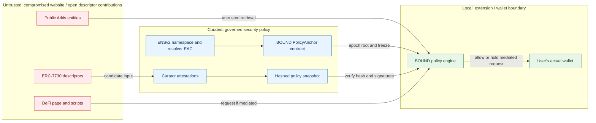

### 4.2 Trust assumptions ledger

| Assumption | If false | Detection / mitigation |
|---|---|---|
| Ethereum/Sepolia finalized anchor is authentic | Attacker can fake root/freeze state | Multiple verified RPC providers, finalized block hash, wallet chain verification; do not claim full light-client proof |
| Installed extension is unmodified | Host page might not control decision engine | Publish reproducible builds; compare install hash; harden extension messaging |
| Curator quorum uncompromised | Malicious policy approval | Multi-party approval, separate guardian, timelock, incident freeze |
| Guardian uncompromised | Malicious freezes | Multi-sig, audit trail, rate limits, time delay on unfreeze |
| Swarm content bytes are verified | Gateway serves swapped UI | Verify against pinned exact reference/hash using trusted bootstrap |
| Anon-RPC network genuinely anonymous | Network operator may correlate requests | Worker hash verification, documented anonymity model, traffic audits, honest fallback |

---

## 5. Architecture and component responsibilities

### 5.1 Full architecture / system context

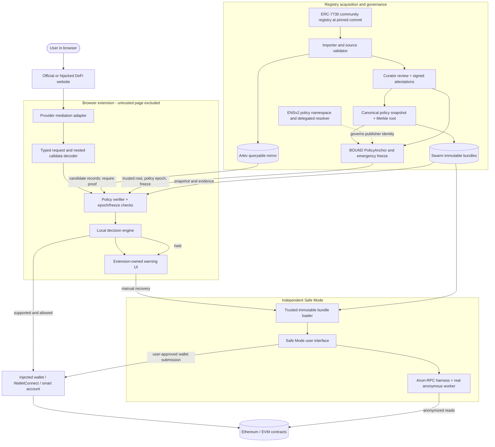

**Critical interpretation:** the `Decide -> Wallet` green edge is present **only** when the actual wallet call flows through BOUND. The drawing is not a claim that Chrome can intercept all extension-to-extension wallet calls.

### 5.2 Internal services / modules

| Module | Input | Output | Where it lives | Security invariant |
|---|---|---|---|---|
| `erc7730-importer` | Git commit, descriptor JSON, schema version | normalized candidates, hash, source metadata | CI/worker | Never treat `metadata.owner` as verified owner |
| `arkiv-publisher` | normalized candidate/review batch | Arkiv entity keys and tx hashes | publisher worker | Immutable source/provenance fields; owner filter on reads |
| `policy-compiler` | candidates, curator votes, origin rules | canonical snapshot, Merkle leaves/root | build/review service | Deterministic output and reproducible ordering |
| `ens-policy-controller` | approved root + named role | ENSv2 resolver write | chain transaction | EAC scope checked; do not bypass by admin |
| `PolicyAnchor` | root, epoch, freeze requests | `activeRoot`, `frozen` | Ethereum/Sepolia | Freeze dominates approve; no unilateral curator unfreeze |
| `snapshot-verifier` | root, snapshot, signatures, time | trusted site policy | extension | Validate bytes, expiry, chain and signer set |
| `provider-adapter` | EIP-1193/EIP-6963 calls | normalized `WalletRequest` | extension page context + trusted runtime | Adversarial page data never becomes authority |
| `decoder` | method, calldata/typed data | `Action[]` with completeness | isolated extension runtime | Unsupported nested action never silently allowed |
| `policy-engine` | trusted site policy + normalized action | allow / hold / explicit deny | isolated extension runtime | ALL authorization-relevant fields checked |
| `alert-ui` | decision/evidence | extension-owned explanation | extension popup/side panel | Page cannot alter warning text/action |
| `safe-mode` | user-selected trusted actions | wallet request and confirmed receipts | Swarm + extension bootstrap | No generic arbitrary transaction composer in MVP |
| `anon-rpc` | read JSON-RPC | anonymized read responses | sandbox worker | Default reads use actual anonymizing network |

### 5.3 Deployment topology

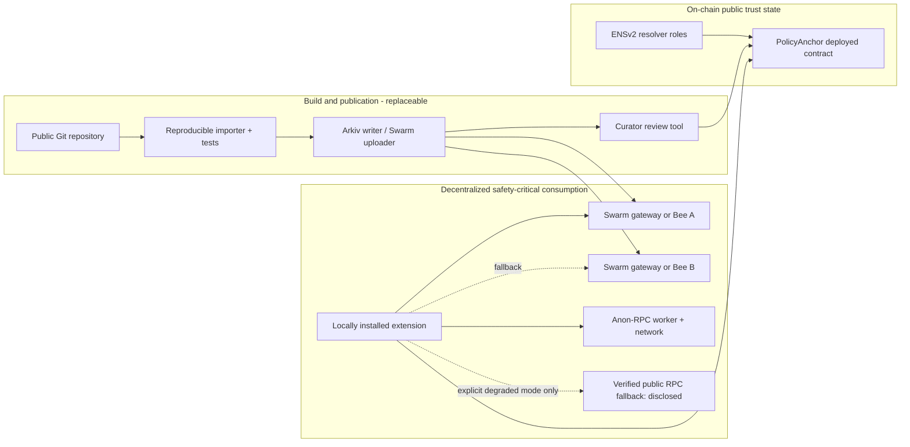

**No-go condition:** if the only copy of Safe Mode is on a central HTTPS backend, or every read silently falls back to a direct RPC, the product does not satisfy its strongest continuity/privacy claims.

---

## 6. Canonical registry and policy model

### 6.1 Five distinct records (do not collapse them)

| Record | Meaning | Who may create it | May it authorize signing? |
|---|---|---|---|
| `DescriptorObservation` | Upstream ERC-7730 file claims certain deployments, labels, URL | Any upstream contributor, imported by BOUND | **No** |
| `CandidateAssociation` | BOUND-normalized `site ↔ chain ↔ contract` hypothesis | Importer or contributor | **No** |
| `CuratorAttestation` | Specific evidence-backed acceptance/rejection with reviewer identity | Trusted curator(s) | Not alone; only once compiled into authorized root |
| `EffectivePolicyEntry` | Origin/action/address/limits accepted under policy epoch | Deterministic compiler + governed publisher | **Yes**, subject to freeze and runtime conditions |
| `PolicyFreeze` | Guardian veto on namespace/address/root/epoch | Separate guardian contract authority | **No** (always restricts) |

### 6.2 Typed canonical JSON schema (BOUND-specific; not ERC-7730)

```ts
// Conceptual TypeScript. Runtime validation should use Zod/JSON Schema.
type ChainAddress = { chainId: number; address: `0x${string}` };
type Origin = `https://${string}`;
type Confidence = 'community_observed' | 'curator_reviewed' | 'multi_attested';

type PolicyEntry = {
  id: string;                     // stable ID from canonical fields
  origin: Origin;                 // exact scheme://host[:port], lowercased/IDNA-normalized
  siteId: string;                 // protocol identifier, not display name
  chainId: number;
  to: `0x${string}`;               // EXTERNAL target, often a token or router
  actionKind: 'ERC20_APPROVE' | 'ERC721_APPROVAL_ALL' | 'ERC2612_PERMIT'
    | 'PERMIT2_ALLOWANCE' | 'PERMIT2_SIGNATURE' | 'ERC20_TRANSFER'
    | 'ROUTER_CALL' | 'EIP7702_DELEGATION' | 'SAFE_MODE_ACTION';
  selector?: `0x${string}`;
  spender?: `0x${string}`;         // never infer from `to` for token approval
  recipient?: `0x${string}`;
  token?: `0x${string}`;
  maxAmount?: string;             // decimal integer in base units
  maxDeadlineSeconds?: number;
  delegateCodehash?: `0x${string}`;
  proxyImplementationCodehash?: `0x${string}`;
  allowedCaller?: `0x${string}`;
  sourceEvidence: string[];      // immutable content hashes / attestation refs
  reviewTier: Confidence;
  validAfter: number; validUntil: number;
  policyEpoch: number;
};

type BoundSnapshot = {
  schemaVersion: 1;
  network: 'ethereum-mainnet' | 'sepolia';
  policyNamespace: string;       // ENSv2 name, e.g. policy.bound.eth
  epoch: number;
  generatedAt: number;
  expiresAt: number;
  sourceCommit: string;
  entries: PolicyEntry[];         // canonically sorted
  deletedEntryIds: string[];
  curatorAttestations: string[];  // signed, independently verified
};
```

**Privacy design:** this snapshot is **public protocol policy**, not user transaction history. Never upload individual wallet accounts, visited-site logs, IP addresses, or session identifiers to Arkiv/Swarm.

### 6.3 Origin canonicalization

Rules: canonicalize from `URL` produced using the extension's own navigation/tab context, not a string supplied by the page. Require HTTPS (except explicitly development/test origin). Normalize IDNA/punycode using a vetted library, lowercase DNS host, preserve non-default ports, strip default port 443, and ignore paths/fragments. For trusted origins, `https://swap.cow.fi` **does not match** `https://cow.fi.evil.example`, `http://swap.cow.fi`, or `https://foo.swap.cow.fi`. No suffix matching without an explicit wildcard delegation in the approved policy. ENS text records are **not** a DNS↔ENS cryptographic binding; such linkage must be separately authenticated via first-party proof/attestation and independently reviewed.

```ts
function canonicalOrigin(trustedTabUrl: string): string {
  const u = new URL(trustedTabUrl);
  if (u.protocol !== 'https:') throw new Error('Insecure origin');
  if (u.username || u.password) throw new Error('Unexpected URL userinfo');
  return u.origin; // production: IDNA normalization, policy on IPs/ports, tests
}

// NEVER do: if (pageHostname.endsWith('cow.fi')) allow();
```

### 6.4 Binding key and hashing

A lookup key is at least `(origin, chainId, contractAddress, actionKind, selector, spenderOrRecipient)`. Keep address lowercase binary/20-byte representation for hashing, EIP-55 checksum for display. Use a **versioned canonicalization standard** such as RFC 8785 JCS for JSON or a fixed ABI encoding; hash with Ethereum Keccak-256, not SHA3-256. Domain-separate leaf hashes with a constant `BOUND_POLICY_LEAF_V1` and include `chainId`, namespace, epoch, `validUntil` in the signed digest.

```ts
// Pseudocode; canonicalJson is RFC-8785 compatible, not JSON.stringify.
const leaf = keccak256(concat([
  keccak256(utf8('BOUND_POLICY_LEAF_V1')),
  keccak256(utf8(canonicalJson(entry)))
]));
// Snapshot root must be computed with an explicitly specified Merkle scheme
// (leaf order, duplicate handling, pair sorting, proof direction, empty root).
```

### 6.5 Policy status semantics

| Status | Exact meaning | UI and enforcement |
|---|---|---|
| `VERIFIED_BINDING` | Policy covers the decoded request and root/epoch is valid | Forward request, wallet still asks for confirmation |
| `CONSTRAINT_VIOLATION` | Known protocol but unauthorized spender/recipient/amount | Hold, show mismatch |
| `UNKNOWN_BINDING` | No approved policy covers request | Hold/warn, do not call it malicious |
| `UNDECODABLE` | Cannot prove full nested effects | Hold, no blind allow |
| `STALE_POLICY` | Root older than max age, invalid epoch, expiry or missing quorum | Hold protected actions |
| `FROZEN` | Guardian veto applies | Hard deny on mediated path, offer Safe Mode if Safe Mode itself not frozen |
| `NOT_MEDIATED` | Wallet path outside supported adapter | No protection claim; badge reports coverage gap |

### 6.6 Governance state machine

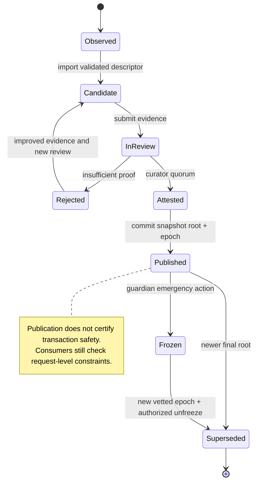

## 7. ERC-7730 importer, provenance and Arkiv mirror

### 7.1 What ERC-7730 really guarantees

**[DOC]** [ERC-7730](https://ercs.ethereum.org/ERCS/erc-7730) is a **structured clear-signing descriptor format** for calldata and typed data. It can contain `context.contract.deployments` with `chainId/address`, `context.eip712` constraints, owner and contract display labels, `metadata.info.url`, and `display.formats` describing function/field presentation. It can also describe proxy patterns and smart-account operations. The format and community registry explicitly **do not turn a submitted owner label into an authenticated authority over the deployed contract**. The upstream registry's README says inclusion is not an audit/endorsement and recommends independently vetted auditor attestations. The latest spec also discusses the need for cryptographically verified provenance, governance and revocation. [Registry](https://github.com/ethereum/clear-signing-erc7730-registry), [specification](https://ercs.ethereum.org/ERCS/erc-7730).

**[DESIGN]** BOUND adds its own verification and policy system *on top* of—not inside—ERC-7730. An upstream file `owner='ExampleSwap', url='https://example.com'` establishes only a **candidate association**, because a compromised registry contributor or an unrelated third party could write the same labels.

### 7.2 Ingestion and curation pipeline

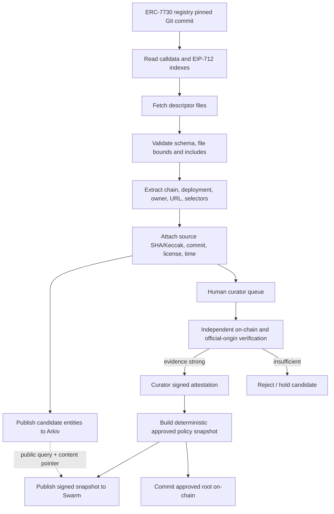

**Index detail [DOC]:** the upstream registry exposes `index.calldata.json` and `index.eip712.json`, keyed with CAIP-10-like `eip155:$chainId:$address`. These optimize targeted retrieval; they do not remove the need to validate each referenced descriptor. [Registry README](https://github.com/ethereum/clear-signing-erc7730-registry).

### 7.3 Importer pseudocode

```ts
// Proposed worker logic: no secrets in the mirrored descriptor.
async function importRegistry(commit: string) {
  const indexes = await fetchPinnedGitIndexes(commit);
  for (const path of uniqueDescriptorPaths(indexes)) {
    const raw = await fetchPinnedGitFile(commit, path, { maxBytes: 512_000 });
    const parsed = parseAndValidateERC7730(raw, { rejectRemoteIncludes: true });
    const provenance = {
      sourceRepo: 'ethereum/clear-signing-erc7730-registry',
      commit,
      path,
      contentKeccak: keccak256(raw),
      schema: parsed.$schema,
      license: 'CC0-1.0',
      importedAt: nowUnix(),
    };
    for (const candidate of extractCandidateBindings(parsed)) {
      await upsertArkivCandidateByDigest({ candidate, provenance });
      await enqueueReview({ candidate, provenance });
    }
  }
  await publishRunManifest({ commit, imported: countCreated(), errors: failures() });
}
```

**Hardening:** bounded file/recursive-include depth, path traversal guards, JSON schema by exact version, canonical address validation, URL normalization, duplicate/conflict tracking, upstream force-push/commit pinning, chain-ID separation, and ingestion idempotency. Import output must preserve evidence for skipped/broken files. Never execute code or arbitrary URLs included in descriptors. Data-license verification and per-file provenance are required for the mirror track.

### 7.4 Arkiv entity schema — proposed SDK sketch

**[DOC]** Arkiv's current TypeScript SDK supports `defineSchema(name, columns)`, typed/indexed attributes, `walletClient.createEntity(...)`, `publicClient.select().from(...).where(...).fetch()`, and `ExpirationTime.fromDays`. Public entity schema names are not access controls; verify the wallet owner and source provenance. See [schema definition](https://docs.arkiv.network/schemas/define/), [create](https://docs.arkiv.network/writing/create/), [filter](https://docs.arkiv.network/querying/filter/).

```ts
// Illustrative against @arkiv-network/sdk: pin SDK and testnet versions in repo.
import { defineSchema, str, u64 } from '@arkiv-network/sdk/schema';
import { ExpirationTime } from '@arkiv-network/sdk';
import { and, eq } from '@arkiv-network/sdk/query';

export const Bindings = defineSchema('bound.binding.v1', {
  origin: str().indexed(),         // normalized HTTPS origin
  chain: u64().indexed(),         // chain ID
  contract: str().indexed(),      // normalized 0x20-byte address
  ownerLabel: str(),              // untrusted raw descriptor claim
  sourceCommit: str(),
  descriptorHash: str().indexed(),
  reviewStatus: str().indexed(),  // 'observed' != 'approved'
  policyRoot: str(),              // empty until applicable
  swarmReference: str(),         // public content only
});

// Writer: walletClient is initialized with the authenticated Arkiv publisher.
const created = await walletClient.createEntity(
  Bindings,
  {
    origin: 'https://swap.cow.fi', chain: 1n,
    contract: '0x0000000000000000000000000000000000000001', // DEMO ONLY
    ownerLabel: 'Unverified candidate', sourceCommit: '<pinned git SHA>',
    descriptorHash: '0x...', reviewStatus: 'observed',
    policyRoot: '', swarmReference: '',
  },
  { expiration: ExpirationTime.fromDays(30) }
);
console.log(created.entityKey, created.txHash);

// Query demonstration: matches are still UNTRUSTED until verified.
const { entities } = await publicClient
  .select({ $key: true, $owner: true, origin: true, contract: true,
            descriptorHash: true, reviewStatus: true, policyRoot: true })
  .from(Bindings)
  .where(and(eq('chain', 1n), eq('origin', 'https://swap.cow.fi')))
  .fetch();
const publisherRows = entities.filter(r =>
  r.$owner.toLowerCase() === EXPECTED_PUBLISHER.toLowerCase()
);
// Then verify descriptor evidence, active on-chain policy root, freshness,
// Merkle membership and freeze state before using ANY row to allow signing.
```

**Practical SDK detail:** schema column types / required values are versioned; the complete sample must be compiled against the pinned installed SDK. The placeholder `0x000...001` is *not* a trusted CoW Swap contract and must never appear in a production allowlist.

### 7.5 Arkiv data model and expiry design

| Entity type | Indexed fields | Non-indexed evidence | Owner | TTL / action |
|---|---|---|---|---|
| `bound.descriptor.v1` | `chain`, `contract`, `descriptorHash` | source path, source commit, raw owner label | importer wallet | e.g. 30d; renew before expiry |
| `bound.binding.v1` | `origin`, `chain`, `contract`, `reviewStatus` | review IDs, source hash, snapshot reference | publisher wallet | e.g. 30d; old entries retained in archival snapshot |
| `bound.policypublication.v1` | `epoch`, `root`, `origin` | Swarm reference, curator manifest | publisher wallet | e.g. 90d, retained via Swarm + on-chain roots |
| `bound.freezeevent.v1` | `origin`, `entryId`, `epoch` | on-chain tx/ref | event mirror wallet | time-scoped mirror **only**, contract is authoritative |

**[DOC]** Arkiv entities disappear from the *query surface* when they expire. This is not the same as erasing independent historical Swarm or chain evidence. If an Arkiv candidate expires, BOUND must not infer that the source contract is malicious, nor may it keep approving based solely on a vanished row. A scheduled renew/republish process and a deterministic fallback to the latest *valid* Swarm snapshot are required. [Arkiv introduction](https://docs.arkiv.network/start-here/introduction/).

**PubSub freshness problem:** the importer can update candidates more frequently than EVM policy-root publication. That is intentional. Candidate updates never affect signing authorization until a reviewed snapshot is cryptographically anchored. Distinguish *observed_at*, *reviewed_at*, *effective_epoch*, *published_block*, and *expires_at*.

### 7.6 Useful query examples

```text
# Arkiv query language (conceptual direct RPC filter):
arkiv.schema = str('bound.binding.v1') AND chain = u64(1)
  AND origin = str('https://swap.cow.fi')

# Find all candidate descriptors for a deployment:
arkiv.schema = str('bound.binding.v1') AND chain = u64(1)
  AND contract = str('0x...')

# Always also constrain trusted `$owner` in production, and validate root.
```

**Why Arkiv over Postgres:** a public, directly-queryable signed-write mirror with on-chain owner identity, data lifetime and chain-state visibility can be consumed by independent wallets/curators without a BOUND-maintained REST API. This is meaningfully different from logging the same data to a private Postgres table, but it does **not** eliminate provenance validation or a canonical policy publisher. The source registry itself is already open; articulate Arkiv's filterable, address- and origin-centered indexing advantage, not a fictitious claim that ERC-7730 is otherwise inaccessible.

---

## 8. ENSv2 governance, on-chain anchors and emergency revocation

### 8.1 ENSv2 primitive boundaries

**[DOC]** ENSv2 contains (a) a hierarchical **Permissioned Registry** where registered names have owners/expirations and name-management roles, and (b) **Permissioned Resolvers** with fine-grained roles for text/data/contenthash record setters. Resolvers are per-account proxies and can share bundles of records between names. The resolver's `ROLE_SET_TEXT` is `1 << 4`, `ROLE_SET_DATA` is `1 << 24`; scoped `grantSetterRoles` uses a setter's argument (such as the *text key*). Grants are **not per-name inside the same resolver**. ENSv2's `ROLE_UPGRADE` and record-linking rights remain part of the trust boundary. Official references: [Permissioned Registry](https://docs.ens.domains/ensv2/permissioned-registry/), [Permissioned Resolver](https://docs.ens.domains/ensv2/permissioned-resolver/), [EAC](https://docs.ens.domains/ensv2/enhanced-access-control/).

**Design choice:** ENSv2 names provide discoverable *namespace identity and delegated publication permissions*, while a **BOUND-specific `PolicyAnchor` contract** enforces sequential root epochs, freezes and unfreeze procedure. ENSv2 by itself does not natively validate BOUND binding entries, perform Merkle proof checks, or implement a `freezeBadBinding()` domain method.

### 8.2 Proposed namespace layout

```text
policy.bound.eth                 -> isolated ENSv2 resolver
  text("bound.policy.anchor")     -> PolicyAnchor address + chain ID
  text("bound.policy.root")       -> 0x... canonical approved root
  text("bound.policy.epoch")      -> decimal monotonic epoch
  text("bound.policy.swarm")      -> bzz://<immutable snapshot ref>
  text("bound.policy.schema")     -> bound-policy-v1
  text("bound.policy.status")     -> informational, NOT authoritative freeze

curators.policy.bound.eth        -> optional discovery/profile for reviewer group
guardian.policy.bound.eth        -> optional guardian identity and transparency
```

Names are *examples*; their ownership is not assumed. For an actual demo, obtain names/subnames permitted by the deployed ENSv2 hierarchy, verify resolver addresses from the current ENSv2 network deployments, and ensure resolver rights are actually delegated on-chain.

**Caveat:** `bound.policy.root` on ENS is a **discovery pointer**; extension also reads the active root from `PolicyAnchor` and rejects discrepancy. A compromised ENS controller can repoint the resolver, hence BOUND must **pin** the expected governance contract address in the installed extension or a separately trusted update channel. A protocol name's ENS identity is not a certificate that an unrelated HTTPS origin belongs to that protocol.

### 8.3 Governance diagram

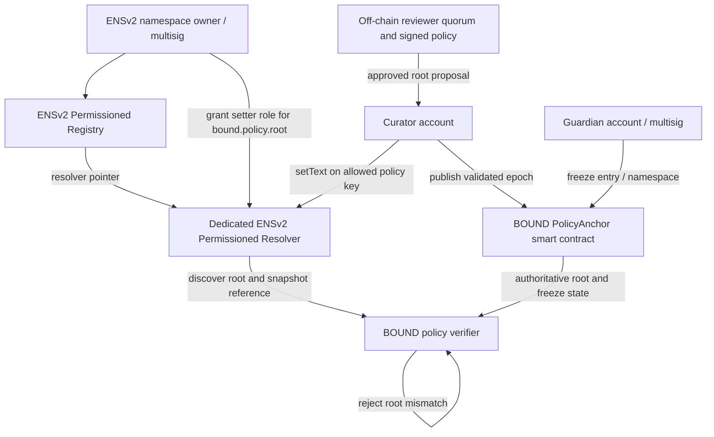

### 8.4 Contract-level reference design

```solidity
// SPDX-License-Identifier: MIT
pragma solidity ^0.8.24;

/** DESIGN SKELETON. NOT AUDITED. Add multisig, timelock, EIP-712
    signature quorum, replay protections, expiry, recovery and rigorous tests. */
contract BoundPolicyAnchor {
    address public publisher;
    address public guardian;
    uint64 public epoch;
    bytes32 public activeRoot;
    mapping(bytes32 => bool) public frozenEntry;
    bool public globalFreeze;

    event RootPublished(uint64 indexed epoch, bytes32 indexed root);
    event EntryFrozen(bytes32 indexed entryId, address indexed by);
    event GlobalFrozen(address indexed by);

    modifier onlyPublisher() { require(msg.sender == publisher, "not publisher"); _; }
    modifier onlyGuardian()  { require(msg.sender == guardian, "not guardian"); _; }

    constructor(address p, address g) {
        require(p != address(0) && g != address(0) && p != g, "bad roles");
        publisher = p; guardian = g;
    }

    function publishRoot(uint64 nextEpoch, bytes32 root) external onlyPublisher {
        require(nextEpoch == epoch + 1 && root != bytes32(0), "invalid epoch/root");
        require(!globalFreeze, "frozen");
        epoch = nextEpoch;
        activeRoot = root;
        emit RootPublished(nextEpoch, root);
    }

    function freezeEntry(bytes32 entryId) external onlyGuardian {
        frozenEntry[entryId] = true;
        emit EntryFrozen(entryId, msg.sender);
    }

    function freezeAll() external onlyGuardian {
        globalFreeze = true;
        emit GlobalFrozen(msg.sender);
    }
    // NO one-party unfreeze here: deliberate MVP one-way emergency brake.
    // Production: guarded proposal with multisig, time delay and event audit.
}
```

**This sample is intentionally less capable than a production contract.** It deliberately omits unfreeze to guarantee the publisher cannot bypass a guardian. To continue after a freeze, a real implementation needs a controlled recovery procedure (e.g., guardian + governance multisig after timelock and published new root), not `owner.unfreeze()` on the same key. The skeleton does not enforce `curator quorum`—a hardened version must verify or gate independent curator signatures before `publishRoot`. Deploying this alone is **insufficient** for the claimed full governance design.

### 8.5 ENSv2 record publishing — precise role surface

```ts
// Pseudocode; exact ENSv2 ABI imported from official deployed package.
import { encodeFunctionData } from 'viem';
import { packetToBytes } from 'viem/ens';
import { toHex } from 'viem';

const dnsName = toHex(packetToBytes('policy.bound.eth'));
const policySetterCall = encodeFunctionData({
  abi: permissionedResolverAbi,
  functionName: 'setText',
  args: ['0x', 'bound.policy.root', ''],
});

// Authorized resolver admin: grant curator control of THIS TEXT KEY
// on all names served by this resolver (use a dedicated resolver!).
await adminWallet.writeContract({
  address: resolverAddress,
  abi: permissionedResolverAbi,
  functionName: 'grantSetterRoles',
  args: [policySetterCall, curatorAddress],
});

// Curator: write actual approved root.
await curatorWallet.writeContract({
  address: resolverAddress,
  abi: permissionedResolverAbi,
  functionName: 'setText',
  args: [dnsName, 'bound.policy.root', activeRootHex],
});
```

**[DOC]** Record setters accept **DNS-encoded names**, not raw namehashes. Registry roles and resolver roles are different. A name's resolver pointer may change; discover/verify the resolver every time against the pinned trust anchor rather than blindly writing an outdated resolver. [App developer guide](https://docs.ens.domains/ensv2/tutorial-app-developers/).

### 8.6 Recovery, expiry and upgrade governance

- Names can expire, move in the registry hierarchy, change subregistry pointers, transfer ownership, or switch resolver instances. Monitor each; don't trust cached name resolution forever.
- Resolver proxies can upgrade; EAC `ROLE_UPGRADE` is a high-privilege key. Governance must record implementation versions/code hashes and monitor upgrades.
- `ROLE_LINK` can change shared record bundles, affecting many names. A correct freeze control must not rely on a writeable linked text record alone.
- Dedicated PolicyAnchor contract must use an unambiguous current root, version, epoch and freeze status; treat `latest ENS text` as discovery, not the actual authorization decision.
- A compromised policy publisher may propose malicious roots; require threshold attestation (M-of-N), code review and a separate immediate guardian veto.
- Root update delay should be short enough for legitimate upgrades but freezes should propagate faster. Extension polls contract state *before sensitive actions*, subject to a bounded staleness threshold; if disconnected, do not call the entry verified.

---

## 9. Browser extension interception and enforcement

### 9.1 The central security limitation

**[DOC]** Ethereum wallets generally expose an EIP-1193 `provider.request()` method, and modern wallets can announce separate provider objects through [EIP-6963](https://eips.ethereum.org/EIPS/eip-6963). EIP-6963 specifically notes unpredictable wallet injection order and provider collisions; `rdns` metadata is self-attested. Chrome's extension **MAIN world** can share JS objects with the page, but hostile same-origin scripts may tamper with them. [Chrome content scripts](https://developer.chrome.com/docs/extensions/reference/manifest/content-scripts), [EIP-1193](https://eips.ethereum.org/EIPS/eip-1193).

**Consequence:** an injected page-side wrapper is not a universal, authoritative security gateway. The hostile page might cache the original provider before BOUND's wrapper runs, use its own EIP-6963 provider reference, call the wallet's bridge directly, or use an unsupported signing flow. An ordinary independent Chrome extension **cannot simply force all other wallet extensions to route requests through its own security policy.** This is the main product risk and a potential demo-overclaim.

### 9.2 Enforcement strategies, ranked

| Strategy | Can it block? | Coverage | Honest status |
|---|---|---|---|
| A. **Wallet-native guard plugin/integration** | Yes, inside wallet approval pipeline | Wallet-specific but authoritative | Best long-term direction |
| B. **BOUND-selected EIP-1193 proxy provider** | Yes, for calls made through that proxy | Selected/cooperative path | Best implementable browser MVP |
| C. `window.ethereum` monkey patch at `document_start` | For requests using wrapper | Fragile; races and bypasses | Demo-only / best effort |
| D. BOUND-observed EIP-6963 announcements | Only if app chooses wrapped provider | Partial discovery | Coverage-instrumented MVP |
| E. HTTP/WebRequest/DNR network interception | Generally **not** a complete wallet signing boundary | Network traffic, not internal wallet IPC | Not a signature-blocking solution |
| F. WalletConnect v2 interception | Not from unrelated extension by default | Separate integration required | Future adapter |

### 9.3 Proposed Chromium MV3 module architecture

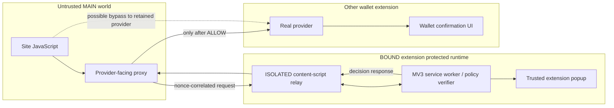

**The dotted bypass is real.** A security review must explicitly test whether the client can retain/use the raw provider and how the product signals unprotected paths.

### 9.4 Manifest example

```json
{
  "manifest_version": 3,
  "name": "BOUND (Prototype)",
  "version": "0.1.0",
  "permissions": ["storage", "scripting", "tabs", "alarms"],
  "host_permissions": ["https://*/*"],
  "background": { "service_worker": "background.js", "type": "module" },
  "content_scripts": [
    { "matches": ["https://*/*"], "js": ["relay.js"],
      "run_at": "document_start", "world": "ISOLATED", "all_frames": true },
    { "matches": ["https://*/*"], "js": ["page-hook.js"],
      "run_at": "document_start", "world": "MAIN", "all_frames": true }
  ],
  "action": { "default_popup": "popup.html" }
}
```

**Least privilege improvement:** `https://*/*` is wide. Prefer on-demand optional origins or user-enabled protected sites when possible; justify privacy and startup latency. All-frame injection requires frame-origin and top-frame policy; do not let an iframe trick the UI into using the top frame's trusted origin. `MAIN` scripts have **no trusted secrets** and are considered adversarial input. The example is a prototype, not a guaranteed correct production permission model.

### 9.5 Mediation contract (request/response)

```ts
type BoundRequest = {
  requestId: string;      // random, unique, short-lived
  tabId: number; frameId: number;
  trustedOrigin: string;  // determined by extension runtime, not page message
  method: string;
  params: unknown;
  observedAt: number;
};
type BoundDecision =
  | { kind: 'ALLOW'; policyEpoch: number; evidenceIds: string[] }
  | { kind: 'HOLD'; code: string; explanation: string; evidenceIds: string[] }
  | { kind: 'DENY'; code: 'FROZEN' | 'POLICY_TAMPERED' };
```

Important implementation rules:

1. The isolated content script obtains the browser's `sender.tab.id`, `sender.frameId`, and trusted `sender.url/origin` (or navigation data) rather than accepting an arbitrary `origin` claimed in `window.postMessage`.
2. Authenticate the *bridge session* using a random channel ID, pending-request map, strict `postMessage` origin/source checks, per-tab/frame tracking, max payload size, request limits and timeouts. A page can still forge arbitrary *wallet requests*; the bridge's job is to prevent forged trust context or decision injection.
3. No untrusted page code may call the protected `ALLOW` path using an invented policy result. The policy engine runs in extension-only code; do not put review keys or governance secrets in `MAIN`.
4. Revalidate `chainId`, account and policy epoch before forwarding. Cancel pending decisions on tab navigation, account/chain changes or wallet disconnect.
5. **Do not pop a page-controlled modal** to deliver the final verdict; use extension-owned UI because compromised JS can spoof/cover an in-page notification.
6. Explicitly record `mediationCoverage = mediated | bypass_possible | unsupported`, and never display an unqualified green protection badge when coverage is uncertain.

### 9.6 Request proxy pseudocode

```ts
// PRINCIPLE ONLY. Requires a real EIP-1193-compliant Proxy, event forwarding,
// proper EIP-6963 announcements, validation, timeouts and cancellation.
function createBoundProvider(realProvider: EIP1193Provider, bridge: Bridge) {
  return new Proxy(realProvider, {
    get(target, prop, receiver) {
      if (prop !== 'request') return Reflect.get(target, prop, receiver);
      return async ({ method, params }: { method: string; params?: unknown }) => {
        if (!SENSITIVE_METHODS.has(method)) {
          return target.request({ method, params });
        }
        // decision is made by isolated extension runtime, not page JS.
        const frozenParams = cloneWalletRequestWithoutGetters(params);
        // Send exactly these immutable serialized bytes for evaluation.
        const result = await bridge.requestDecision({ method, params: frozenParams });
        if (result.kind !== 'ALLOW') {
          throw Object.assign(new Error('Held by BOUND: ' + result.code), {
            code: 4001 // Prototype UI mapping; align wallet error semantics.
          });
        }
        // Forward the SAME captured payload, never live mutable page params.
        // For high-assurance protection, perform this check inside the wallet.
        return target.request({ method, params: frozenParams });
      };
    }
  });
}
```

**TOCTOU edge:** the `ALLOW` decision and forwarding are separate steps; hostile page JS can mutate shared object references (`params`, nested objects, providers) if BOUND does not deep-clone immutable request bytes and forward exactly those bytes. `cloneWalletRequestWithoutGetters` is an intentionally **unimplemented hardening helper** in this sketch, not a standard JS function: it must reject accessors, unsupported prototypes and oversized payloads, produce a canonical copy and verify the forwarded payload digest. Reparse and hash the immutable forwarded payload; do not validate object A then pass modified object B. A compromised page can also change chains between check and send; verify chain just-in-time and treat changes as cancellation.

### 9.7 EIP-6963 discovery instrumentation

```ts
// Instrument discovery; this does NOT force an untrusted site to use the proxy.
const announced = new Map<string, EIP6963ProviderDetail>();
window.addEventListener('eip6963:announceProvider', (event: Event) => {
  const detail = (event as CustomEvent).detail as EIP6963ProviderDetail;
  if (!detail?.info?.uuid || !detail?.provider?.request) return;
  // rdns/name/icon are self-asserted; never treat them as wallet-authentic.
  announced.set(detail.info.uuid, detail);
});
window.dispatchEvent(new Event('eip6963:requestProvider'));
// Explicitly expose and select the BOUND-mediated provider in the test dApp.
// A hostile dApp may retain and use any raw provider instead.
```

Record per-session whether a call used the selected BOUND proxy or a different provider. The extension cannot generally observe calls that skip its bridge, so **the denominator for real-world interception coverage is unknown** without a cooperating wallet or instrumented test app. For the demo, the dApp harness can report its own `totalCalls`; do not generalize those figures to arbitrary websites.

### 9.8 Wallet method coverage table

| Method | Risk type | MVP action |
|---|---|---|
| `eth_sendTransaction` | token approvals, NFT approvals, router calls, native transfer, arbitrary calldata | Decode and hold/allow |
| `eth_signTypedData_v4` | EIP-2612, DAI-style permit, Permit2, other typed auth | Parse domain and primary type; hold unsupported |
| `eth_sign` | blind raw hash signing | Hold, do not assert semantic decoding |
| `personal_sign` | off-chain messages, SIWE or malicious authorization | Preserve raw context; hold high-risk/unrecognized messages |
| `wallet_sendCalls` (EIP-5792) | batched mixed actions | Decode **every** call; atomic all-calls gate |
| `eth_sendUserOperation` | smart-account calldata wrapping | Decode userOp's account execution + nested calls, otherwise hold |
| `wallet_signAuthorization` / wallet-specific EIP-7702 API | delegation changes | Detect where exposed, otherwise unsupported |
| `wallet_requestPermissions` | account exposure / permission changes | Distinct privacy warning; not contract matching |
| `eth_requestAccounts` | account sharing with site | Permission/privacy UI; **not a chain transaction** |
| wallet-specific methods | hidden signing surface | Unknown handling; measure adapter coverage |

The method list is a **threat inventory**, not a claim that every wallet supports these exact RPC names.

---

## 10. Decoder library and nested authorization semantics

### 10.1 Typed intermediate representation (IR)

All wallet requests, including typed-data messages and nested routers, are converted to one or more **side-effect-relevant actions** with explicit *confidence/completeness*. The decoder must distinguish the contract **being called** from the token **being approved**, the **spender** receiving rights, and the **recipient** of any transfer.

```ts
type NormalizedAction = {
  chainId: number;
  origin: string;
  method: string;
  topLevelTo?: `0x${string}`;
  effectiveTo?: `0x${string}`;          // delegate/proxy/router target when provable
  kind: 'ERC20_APPROVE' | 'ERC721_APPROVAL_ALL' | 'ERC2612_PERMIT'
      | 'PERMIT2_ALLOWANCE' | 'PERMIT2_SIGNATURE' | 'TRANSFER'
      | 'ROUTER_CALL' | 'DELEGATION' | 'UNKNOWN';
  token?: `0x${string}`;
  owner?: `0x${string}`;
  spender?: `0x${string}`;
  recipient?: `0x${string}`;
  amount?: bigint;
  deadline?: bigint;
  nonce?: bigint;
  typedDomain?: { chainId?: bigint; verifyingContract?: `0x${string}`; name?: string; version?: string };
  selector?: `0x${string}`;
  innerCalls?: NormalizedAction[];
  reasons: string[];
  complete: boolean; // true only if all security-relevant fields understood
};
```

### 10.2 Security-critical decoder table

| Primitive | How to identify | Must inspect | Failure mode |
|---|---|---|---|
| ERC-20 `approve(address,uint256)` | selector `0x095ea7b3` at **token** contract | spender, exact amount, token, caller | Trusted token + malicious spender |
| ERC-721/1155 `setApprovalForAll(address,bool)` | selector `0xa22cb465` | collection address, operator, approved flag | Full collection operator takeover |
| ERC-20 `transfer(address,uint256)` | selector `0xa9059cbb` | token, recipient, amount | Asset sent to attacker via known token |
| ERC-20 `transferFrom(address,address,uint256)` | selector `0x23b872dd` | token, from, to, amount, caller | Delegate theft via allowance |
| EIP-2612 `permit` (EIP-712) | typed domain, Permit struct | token verifying contract, owner, spender, value, nonce, deadline | Invisible approval in off-chain signature |
| DAI-like permit | protocol-specific typed structure | holder, spender, allowed, nonce, expiry | Treating `bool allowed` as an amount |
| Permit2 AllowanceTransfer | Permit2 verifying contract + typed data | token, spender, amount, expiration, sig deadline, nonce | Known Permit2 address ≠ known spender |
| Permit2 SignatureTransfer | typed `PermitTransferFrom`, batch, witness | token, permitted maximum, nonce, deadline, caller/recipient context | Typed permit may not bind ultimate `to` |
| ERC-4337 account execute | userOp sender/account implementation | nested calls, paymaster permissions, account code | Top-level `EntryPoint` is not action recipient |
| EIP-5792 batch | bundle of calls | every `to`, value and data | Harmless + malicious call mixed in one batch |
| EIP-7702 authorization | authorization tuple `chain_id, address, nonce, signature` | delegate target, signer and code hash, chain scope | EOA delegates behavior to malicious code |
| Proxy / diamond | known proxy implementation or facet history | external proxy, implementation, selector, upgrade status | Same address, changed behavior |
| Unknown arbitrary calldata | unrecognized ABI, fallback, delegatecall | raw target/value; cannot infer inner effects | False 'safe' from address-only check |

**[DOC]** [Permit2](https://developers.uniswap.org/docs/protocols/permit2/overview) separates reusable `AllowanceTransfer` from one-time `SignatureTransfer`. For `SignatureTransfer`, the signed data constrains token/amount/nonce/deadline, but the final transfer's recipient may be specified in a separate `SignatureTransferDetails` at execution. Uniswap explicitly warns integrators to bind caller context. Therefore a Permit2 signature can be risky **even when the verifying contract is the legitimate Permit2 deployment**. [SignatureTransfer](https://developers.uniswap.org/docs/protocols/permit2/concepts/signature-transfer).

**[DOC]** [EIP-7702](https://eips.ethereum.org/EIPS/eip-7702) authorization is tied to a delegate address and may change EOA code behavior. A chain ID of `0` is special and broadens replay scope under the EIP; BOUND should flag and policy-check it, not silently treat it as a routine `chainId == currentChain` authorization. EIP-7702 signing surfaces vary by wallet.

### 10.3 ERC-20 approval decoder — actual viem-style code

```ts
import { decodeFunctionData, parseAbi } from 'viem';

const erc20Abi = parseAbi([
  'function approve(address spender, uint256 amount) returns (bool)',
  'function transfer(address to, uint256 amount) returns (bool)'
]);

function decodeERC20Call(tx: {
  to: `0x${string}`; data: `0x${string}`;
}) {
  const parsed = decodeFunctionData({ abi: erc20Abi, data: tx.data });
  if (parsed.functionName === 'approve') {
    const [spender, amount] = parsed.args;
    return {
      kind: 'ERC20_APPROVE' as const,
      token: tx.to, spender,
      amount: BigInt(amount),
      unlimited: BigInt(amount) === (1n << 256n) - 1n
    };
  }
  if (parsed.functionName === 'transfer') {
    const [recipient, amount] = parsed.args;
    return { kind: 'TRANSFER' as const, token: tx.to,
             recipient, amount: BigInt(amount) };
  }
  return { kind: 'UNKNOWN' as const };
}
```

**Security rule:** the `tx.to` of `approve` is the **token**. The spender is the **first calldata argument**. A naive registry lookup that approves a known token contract but ignores `spender` would miss the central demo attack.

### 10.4 EIP-712 / Permit2 decoding sketch

```ts
function parseTypedData(method: string, params: unknown): NormalizedAction[] {
  const typed = parseWalletSpecificSignTypedDataParams(method, params);
  const domain = validateEIP712Domain(typed.domain);
  if (!matchesWalletChain(domain.chainId)) throw hold('CHAIN_MISMATCH');

  if (domain.verifyingContract === KNOWN_PERMIT2_BY_CHAIN[walletChain]) {
    switch (typed.primaryType) {
      case 'PermitSingle':
      case 'PermitBatch':
        return parsePermit2Allowance(typed).map(x => ({
          ...x, complete: true,
          // MUST verify spender for every detail and expiry/nonce.
        }));
      case 'PermitTransferFrom':
      case 'PermitBatchTransferFrom':
      case 'PermitWitnessTransferFrom':
        return parsePermit2Signature(typed).map(x => ({
          ...x, complete: false, // recipient/caller may NOT be committed here
          reasons: ['Recipient/caller execution context not fully bound']
        }));
      default: throw hold('UNKNOWN_PERMIT2_TYPED_MESSAGE');
    }
  }
  if (isEIP2612Permit(typed)) return [parseAndValidate2612(typed)];
  return [{ kind: 'UNKNOWN', complete: false, reasons: ['Unknown typed message'] }];
}
```

Because Permit2's recipient can remain unbound in the signed payload, **do not solve this by inventing a recipient**. MVP default: **hold Permit2 signature transfers without an independently validated caller/recipient context**, or report an elevated risk even if known token/spender details match. A later simulation/protocol-specific verifier might permit narrowly proven cases.

### 10.5 EIP-7702 guard sketch

```ts
function check7702(auth: {
  chainId: bigint; delegate: `0x${string}`; nonce: bigint;
}, ctx: { walletChain: bigint; policy: PolicyEntry[] }) {
  if (auth.chainId === 0n) return hold('CHAIN_AGNOSTIC_DELEGATION');
  if (auth.chainId !== ctx.walletChain) return hold('DELEGATION_CHAIN_MISMATCH');
  const entry = ctx.policy.find(p => p.actionKind === 'EIP7702_DELEGATION'
        && equalAddress(p.to, auth.delegate));
  if (!entry) return hold('UNAPPROVED_DELEGATE');
  // Required: fetch/pin delegate runtime codehash and proxy/implementation
  // at an authenticated block and verify entry's constraints.
  return entry.delegateCodehash ? checkCodehash(entry) : hold('NO_CODE_ATTESTATION');
}
```

**Caution:** EIP-7702 signing concerns the *authorizing EOA*, recovered from the authorization signature. Inspect the wallet's exact implementation; a dApp may expose a wallet-specific signing method, and the authorization is not always visible as an ordinary `eth_sendTransaction` before the wallet's own internal flow. `delegate` checking alone is not sufficient for permissioning arbitrary code behavior.

### 10.6 Nested calls, proxies, and target derivation

A true call may look like `EOA → smart-account execute() → router multicall() → token.transferFrom()`. A decoder that recognizes only the top-level `to=SmartAccount` or `to=Router` cannot claim to understand the spender or ultimate recipient. Recursively parse a known ABI registry with explicit maximum recursion depth, maximum call count, gas/byte size limits, and cycle detection. A successful decode means every **authorization-relevant** branch is resolved, not just that some ABI function name was recognized.

**[DOC]** [ERC-1967](https://ercs.ethereum.org/ERCS/erc-1967) standardizes implementation (`0x360894...382bbc`), beacon (`0xa3f0ad...33d50`) and admin slots for common upgradeable proxies. A consumer can read proxy storage using `eth_getStorageAt`, inspect beacon `implementation()` if relevant, then `eth_getCode` for the resolved implementation. **This does not cover all proxy architectures** (diamonds, nonstandard slots, dynamic delegatecalls, metamorphic behavior); nor does an implementation address automatically establish source legitimacy. Pin reads to a specific block/hash when the RPC supports it; watch for intra-block upgrades and update races.

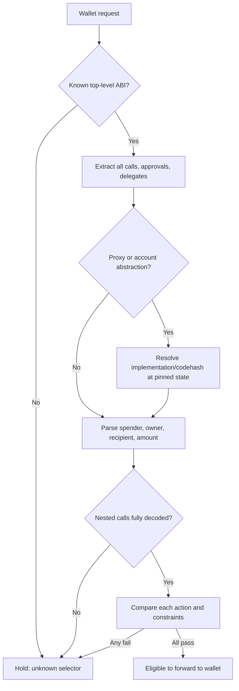

### 10.7 EIP-1967 proxy introspection sketch

```ts
import { keccak256 } from 'viem';

const IMPL_SLOT =
  '0x360894a13ba1a3210667c828492db98dca3e2076cc3735a920a3ca505d382bbc';
const BEACON_SLOT =
  '0xa3f0ad74e5423aebfd80d3ef4346578335a9a72aeaee59ff6cb3582b35133d50';

async function resolveImplementation(proxy: `0x${string}`, blockHash: `0x${string}`) {
  // Use EIP-1898-style pinned block state where supported by RPC.
  const raw = await rpc.getStorageAt({ address: proxy, slot: IMPL_SLOT, blockHash });
  const direct = addressFromLast20Bytes(raw);
  if (direct !== ZERO_ADDRESS) {
    return { kind: 'eip1967-direct', impl: direct,
             codehash: keccak256(await rpc.getCode({ address: direct, blockHash })) };
  }
  const beaconRaw = await rpc.getStorageAt({ address: proxy,
                                            slot: BEACON_SLOT,
                                            blockHash });
  const beacon = addressFromLast20Bytes(beaconRaw);
  if (beacon === ZERO_ADDRESS) return { kind: 'unknown-proxy' };
  const impl = await callBeaconImplementationAtBlock(beacon, blockHash);
  return { kind: 'eip1967-beacon', impl,
           codehash: keccak256(await rpc.getCode({ address: impl, blockHash })) };
}
```

**Implementation note:** the `BEACON_SLOT` constant is the full value from [ERC-1967](https://ercs.ethereum.org/ERCS/erc-1967). The snippet deliberately leaves `addressFromLast20Bytes`, `callBeaconImplementationAtBlock`, and error handling as helpers; enforce `getCode` nonempty, canonical block reading, chain consistency and unknown-proxy holds. For normal EIP-1967 proxies direct implementation state is not proof of all reachable execution paths.

### 10.8 Decoder completeness and panic safety

- Use positive parsers rather than heuristic string search for `permit`.
- Handle malformed calldata, ABI decode exceptions, 4-byte selector collisions, trailing calldata, JSON depth bombs, EIP-712 recursive struct references, dynamic arrays, and over-sized payloads with a `HOLD`, not a crash.
- Bytes, integer amounts and contract addresses must be represented exactly. Never use JS `Number` for 256-bit token amounts.
- Never identify a trusted contract by token symbol, `name()` return or explorer label.
- Never allow `eth_sign` as a routine ERC-7730-verified action; raw signed hashes can have unknown external meaning.
- For account abstraction, treat `EntryPoint`, account code, paymaster, factory and nested targets as separate entities.
- Simulations are **advisory**, not proofs: malicious contracts can branch on block number, caller, state or simulation environment.

---

## 11. Policy engine and deterministic decision process

### 11.1 Evaluation order

A critical property is that a local allow decision **never precedes** policy authenticity, freshness, freeze checks, and complete decoding.

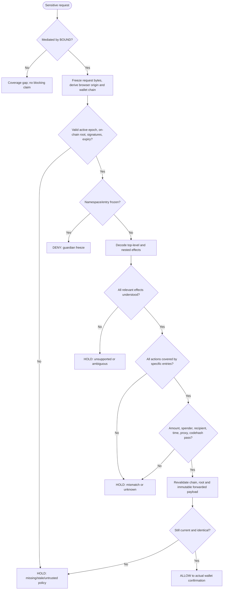

### 11.2 Core policy pseudocode

```ts
async function evaluate(req: BoundRequest): Promise<BoundDecision> {
  if (!isActuallyMediated(req)) return hold('NOT_MEDIATED');
  const bytes = deepCloneAndCanonicalizeWalletParams(req.method, req.params);
  const trustedOrigin = deriveOriginFromTrustedExtensionSender(req);
  const walletChain = await getAndValidateChainFromSelectedProvider();

  const state = await fetchFinalizedPolicyAnchorState();
  const snapshot = await loadPinnedSnapshot(state.activeRoot);
  if (!verifyCanonicalRoot(snapshot, state.activeRoot) ||
      !verifyCuratorQuorum(snapshot.curatorAttestations) ||
      snapshot.epoch !== state.epoch || isExpired(snapshot) ||
      isTooOld(state)) return hold('STALE_OR_INVALID_POLICY');
  if (state.globalFreeze) return deny('FROZEN');

  const actions = decodeAllActions(req.method, bytes, walletChain);
  if (!actions.length || actions.some(a => !a.complete))
    return hold('UNDECODABLE_ACTION');

  for (const action of actions) {
    const entry = findStrictPolicyEntry(snapshot, trustedOrigin, walletChain, action);
    if (!entry) return hold('UNAPPROVED_TARGET_OR_SPENDER');
    if (await isEntryFrozen(entry.id)) return deny('FROZEN');
    if (!checkAllConstraints(entry, action)) return hold('CONSTRAINT_MISMATCH');
  }
  if (!sameWalletChain(walletChain) || !samePayload(bytes, req.params) ||
      !(await rootStillCurrent(state))) return hold('TOCTOU_CHANGED');
  return { kind: 'ALLOW', policyEpoch: state.epoch,
           evidenceIds: actions.flatMap(a => findEvidenceIds(a)) };
}
```

**Pseudocode caveat:** a real wallet-native adapter can freeze the exact request the wallet signs. In a page-wrapped provider, `samePayload(...)` reduces mutation risk but **does not** prove that the underlying wallet cannot be called through another route. No untrusted API result may directly override `FROZEN`.

### 11.3 Conservative policy matching

- Exact chain and origin required; no fallback to `chainId=1` when wallet chain is unknown.
- The allowance target `spender` must match a curated spender entry; the token's address being valid is **not enough**.
- For `setApprovalForAll`, compare operator and collection, and treat `approved=true` as high risk.
- For `transfer`, compare recipient and, where feasible, amount; if transfer is merely called by a router, parse the router and verify path semantics.
- For EIP-712, compare `domain.chainId`, `domain.verifyingContract`, primary type, signer and all permission fields.
- For Permit2 SignatureTransfer, recipient may be unspecified. Default hold unless a validated execution-context binding exists.
- Check policy validity and codehash at the target chain state; a proxy implementation upgrade should invalidate a codehash-bound policy until reviewed.
- Unknown contract does not mean attacker-controlled. `UNKNOWN_BINDING` uses a neutral warning, not an asserted scam label.

### 11.4 User-facing explanation model

```json
{
  "status": "HOLD",
  "reasonCode": "SPENDER_NOT_APPROVED_FOR_ORIGIN",
  "siteOrigin": "https://swap.cow.fi",
  "chainId": 11155111,
  "operation": "ERC20_APPROVE",
  "token": "0x...", "spender": "0x...",
  "allowance": "MAX_UINT256",
  "policyEpoch": 12,
  "root": "0x...",
  "message": "This spender is not approved in BOUND's current policy for this website. The request has not been forwarded by the BOUND-mediated provider.",
  "confidence": "not-verified",
  "suggestedAction": "Review details or open independent Safe Mode"
}
```

**Truthful wording:** say “request was not forwarded **through BOUND's mediated provider**,” not “the attacker cannot access the wallet.” This distinction is essential until wallet-native integration exists.

---

## 12. Safe Mode, Swarm delivery and Anon-RPC

### 12.1 Why Safe Mode exists

A security system that only blocks the hacked site forces the user to return to that hacked site to revoke permissions. **Safe Mode** is a generic, minimal protocol interaction UI, independent of the dApp's normal frontend. The MVP should emphasize a few reliable, auditable functions rather than attempt to recreate the entire protocol's application logic.

### 12.2 Safe Mode trust architecture

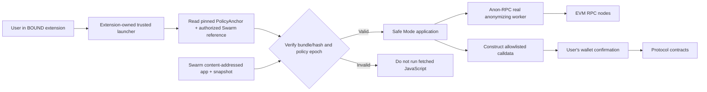

**Important implementation detail:** a Swarm gateway URL alone is **not** a secure execution sandbox. Browsers trust HTTPS to the gateway; they do not necessarily verify Swarm content hashes themselves. A trusted extension-side bootstrap should download, verify *exact* bytes using a reproducible manifest/root check, and only then present/execute the allowlisted app. Alternatively bundle the minimal emergency UI inside the extension and use Swarm as a verified recovery distribution/artifact path. Loading arbitrary remote JS directly into privileged extension pages is prohibited by browser extension security rules and should not be attempted.

### 12.3 Swarm deployment sketch

**[DOC]** Swarm can host a directory as a content-addressed manifest. `bee-js` supports `uploadFilesFromDirectory`; a Bee upload needs a valid postage stamp batch. Directory manifests map paths like `/index.html` to content. [Host a website](https://docs.ethswarm.org/docs/develop/host-your-website/), [manifests](https://docs.ethswarm.org/docs/develop/tools-and-features/manifests/).

```ts
import { Bee } from '@ethersphere/bee-js';
const bee = new Bee(process.env.BEE_URL ?? 'http://localhost:1633');
const batchId = process.env.SWARM_BATCH_ID!;
const result = await bee.uploadFilesFromDirectory(batchId, './dist/safe-mode', {
  indexDocument: 'index.html',
  errorDocument: '404.html',
});
const immutableReference = result.reference.toHex();
console.log('Swarm Safe Mode ref:', immutableReference);
// Publish this public reference in Arkiv & governed policy manifest.
// Trusted launcher independently verifies loaded content before use.
```

**Availability note:** Swarm content requires suitable postage validity, reachable peers/Bee gateways, and a way to bootstrap trust without the original website. A permanently available content address is not guaranteed by its hash alone. For a credible demo, seed/replicate across at least two Bee services, document the postage validity, and test switching gateways. A mutable ENS contenthash / Swarm feed is convenient for updates but must be constrained by an independently validated new release hash before executable code is trusted.

### 12.4 Safe Mode functions (MVP)

| Screen | Action | Safety gate | What it **cannot** promise |
|---|---|---|---|
| Approval inspector | ERC-20 allowance for known `(owner, token, spender)` | Read via Anon-RPC, exact chain | Can't enumerate all allowances without an external index/history |
| Revoke ERC-20 | `token.approve(spender, 0)` | Wallet confirmation; risk warning for nonstandard tokens | Doesn't revoke existing off-chain signatures or on-chain transfers |
| NFT operator inspector | `isApprovedForAll(owner, operator)` | Supported ERC-721/1155 contracts | Doesn't discover every NFT or approval automatically |
| Revoke NFT operator | `setApprovalForAll(operator, false)` | Wallet confirmation | Doesn't undo prior transferred NFTs |
| Permit2 inspector | `allowance(owner, token, spender)` | Known Permit2 deployment per chain | Does not enumerate unspent off-chain SignatureTransfer permits |
| Permit2 revoke | `approve(token, spender, 0, ...)` or supported lock-down | Correct module + chain | Does not fully revoke arbitrary signatures that remain usable |
| Selected protocol action | e.g. `withdraw` on pinned known contract | Exact ABI, vetted args, simulation if available | Not universal protocol clone |
| Account delegation inspector | Detect EIP-7702 delegation where supported | Code at EOA + account state | Undelegation/recovery needs wallet support; no generic immediate fix |

**Selection principle:** no arbitrary “paste address + calldata and sign” interface in MVP; that simply recreates the compromised site's dangerous freedom.

### 12.5 Read/write privacy separation

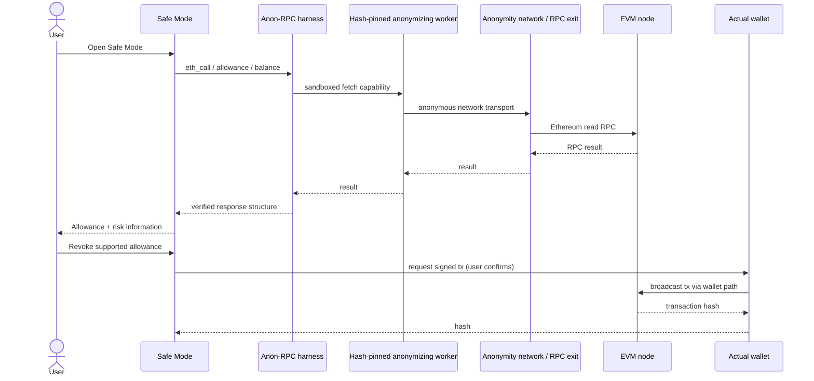

**[DOC]** Anon-RPC spec v0.4.0 describes an on-chain **worker specifier contract** that pins worker bundle bytes by hash; a harness fetches the bundle from untrusted resolvers and executes it inside a sandboxed Web Worker / null-origin iframe with constrained capabilities. The official browser harness can use a pre-existing RPC once to bootstrap `workerHash()` / `workerResolvers()`. The **reference minimal worker using plain fetch is not anonymizing**. A compatible real network/worker and privacy audit are required for claims of anonymous reads. [Spec](https://ethereum.github.io/anon-rpc/spec/), [wallet/app guide](https://ethereum.github.io/anon-rpc/wallets/).

### 12.6 Anon-RPC integration sketch

For the **extension itself**, also evaluate the official `@anon-rpc/browser-extension-harness` package linked from ETHGlobal's EF track resources; for a Swarm-hosted browser page, the `@anon-rpc/browser-harness` is the documented starting point. Test the actual extension Content Security Policy, sandbox lifetime and browser support rather than assuming the generic browser harness can execute in a privileged MV3 page unchanged.

```ts
import { AnonRpcWorker } from '@anon-rpc/browser-harness';

const worker = new AnonRpcWorker({
  // Replace with an independently verified, chain-correct specifier.
  address: ANON_RPC_SPECIFIER_ADDRESS,
  preExisting: {
    rpcProvider: {
      request: ({ method, params }) => bootstrapRpc.request({ method, params })
    }
  }
});
await worker.ready;

async function privateRead(method: string, params: unknown[] = []) {
  const response = await worker.fetch(DESTINATION_RPC_URL, {
    method: 'POST',
    headers: { 'content-type': 'application/json' },
    body: JSON.stringify({ jsonrpc: '2.0', id: 1, method, params }),
    anonOptions: { isolationKey: LOCAL_EPHEMERAL_SESSION_ID }
  });
  if (!response.ok) throw new Error('Anon-RPC unavailable');
  const json = await response.json();
  if (json.error) throw new Error('RPC read failed');
  return json.result;
}
```

**Correctness and privacy qualifiers:** the specifier must point to a **real anonymizing network worker**, not plain fetch. The `isolationKey` is network-dependent, not a guarantee. The bootstrap read can expose timing/metadata to its provider; using `eth_call` with wallet addresses exposes queried account addresses to the RPC exit regardless of IP unlinkability. The exit/entry network's adversary model and collusion assumptions must be documented. Wallet **writes** might be submitted by the wallet's own RPC transport and are public once included on-chain; neither BOUND nor Anon-RPC can erase that exposure.

### 12.7 Failure and fallback policy

| Failure | Read behavior | Signing behavior | User-facing disclosure |
|---|---|---|---|
| Original dApp offline | Safe Mode loads from verified independent bundle | Allowlisted Safe Mode functions only | “Original site unavailable; using independent Safe Mode” |
| Swarm gateway A down | Try gateway B / trusted bundled UI | No unverified remote JS | “Recovery artifact loaded from another verified source” |
| Swarm bytes fail hash | Refuse remote build | No action from suspect app | “App integrity check failed” |
| Anon-RPC network down | By default no private reads; optional explicitly consented direct fallback | Wallet can still approve narrowly supported tx | “Direct RPC may reveal your IP and queried addresses” |
| ENS resolver mismatches anchor | Hold policy verification | Do not display verified site status | “Policy provenance conflict” |
| PolicyAnchor unreachable | Cache bounded signed snapshot only if protocol allows, otherwise hold | No verified new action | “Policy status could not be refreshed” |
| Guardian global freeze | Disable affected actions even with locally cached policy | Deny mediated request | “Protocol policy frozen by guardian” |

---

## 13. End-to-end data flow, security flow and user journeys

### 13.1 Data flow (source -> candidate -> approved policy -> local enforcement)

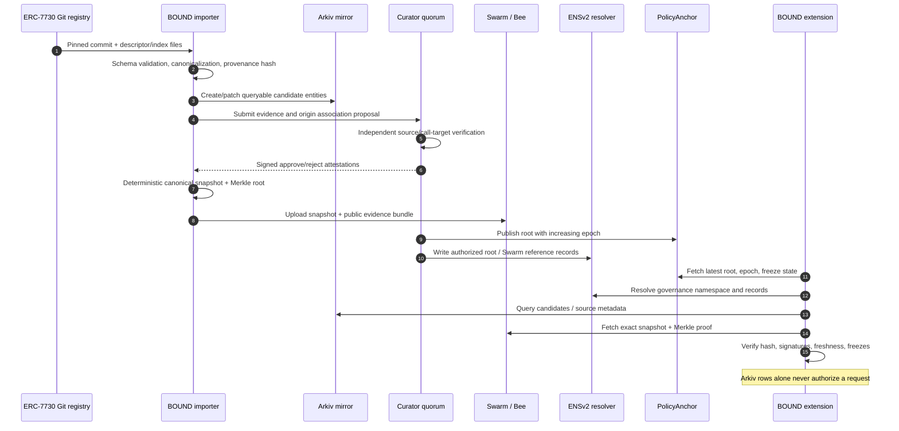

### 13.2 Normal protected user journey

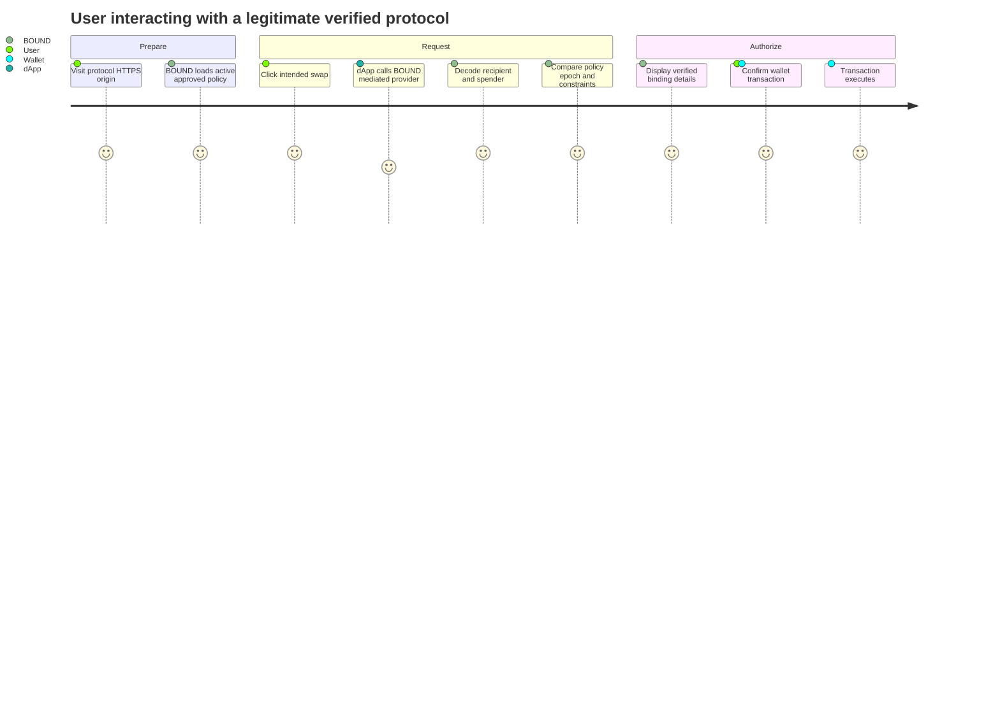

**Important:** “verified binding” is limited to **the specific policy match**, never a blanket “this swap cannot lose money” claim.

### 13.3 Live hijack / malicious approval journey

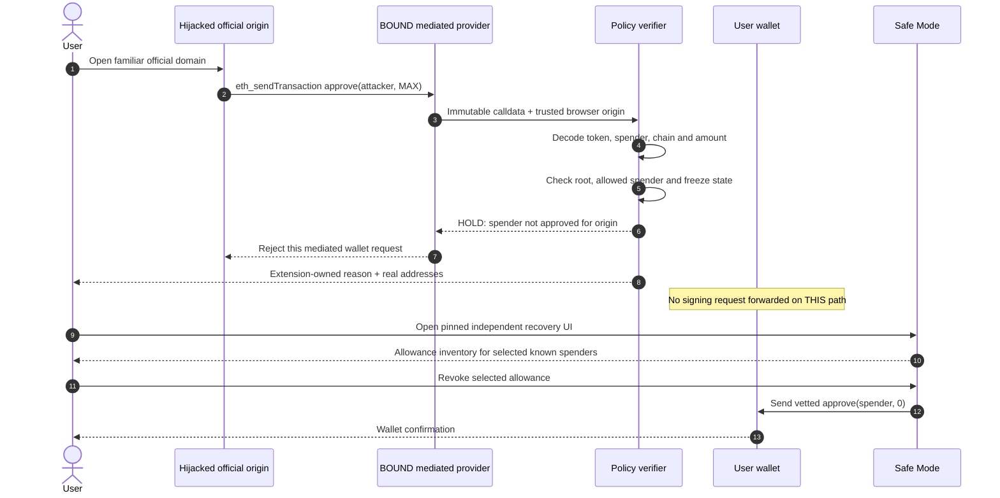

### 13.4 Emergency fallback journey (original website and backend offline)

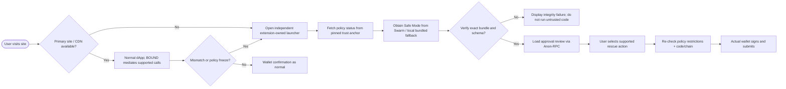

### 13.5 Guardian freeze and propagation

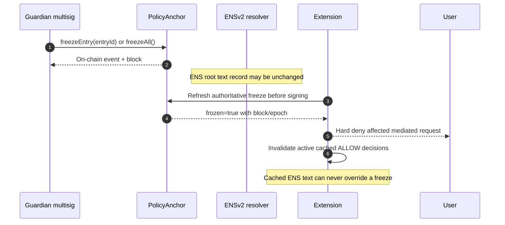

### 13.6 Formal data lineage

```text
upstream Git commit + descriptor bytes
  -> DescriptorObservation (source id, digest, license)
  -> CandidateAssociation (origin hypothesis, chain, contract)
  -> CuratorAttestation (reviewer id, exact candidate digest, validity)
  -> EffectivePolicyEntry (constraints and evidence ids)
  -> CanonicalSnapshot (epoch, entry list, deterministic root)
  -> Swarm immutable reference (snapshot and proofs)
  -> ENSv2 discoverability records / PolicyAnchor authoritative root
  -> ExtensionLocalDecision (exact wallet request digest, policy epoch)
```

Privacy note: the terminal `ExtensionLocalDecision` may be stored locally **only** by default. Keep wallet address, transaction digest, navigation history, and user identity off Arkiv/ENS/Swarm. An incident report may reveal only redacted hashes and public contract addresses after user consent.

---

## 14. Contracts, APIs, message schemas and repo layout

### 14.1 Suggested monorepo

```text
bound/
  apps/
    extension/
      manifest.json
      src/main-world/provider-adapter.ts
      src/isolated/relay.ts
      src/background/policy-service.ts
      src/ui/popup.tsx
      src/ui/warning.tsx
      src/safe-mode-bootstrap/
    safe-mode/
      src/approvals/erc20.ts
      src/approvals/erc721.ts
      src/approvals/permit2.ts
      src/protocols/approved-actions.ts
      src/rpc/anon-rpc.ts
    curator-console/
  packages/
    shared-types/
    decoder/
      src/erc20.ts
      src/erc721.ts
      src/eip712.ts
      src/permit2.ts
      src/eip7702.ts
      src/nested.ts
    policy-core/
      src/canonicalize.ts
      src/merkle.ts
      src/verify.ts
      src/evaluate.ts
    arkiv-schema/
    provenance/
    attestation/
    swarmed-build/
  services/
    erc7730-importer/
    arkiv-publisher/
    policy-compiler/
    snapshot-uploader/
  contracts/
    src/BoundPolicyAnchor.sol
    test/BoundPolicyAnchor.t.sol
    script/Deploy.s.sol
  fixtures/
    legit-approval.json
    malicious-approval.json
    permit2-recipient-unbound.json
    eip7702-delegation.json
    proxy-upgrade.json
  demo/
    test-dapp/
    hijack-server/
    replay-demo.sh
  docs/
    architecture.md
    threat-model.md
    security-invariants.md
    CROPS.md
    artifacts-and-chain-ids.md
  arkiv/
    schema.md
    friction.md
    reach.md
    why-arkiv.md
    data-quality.md
    swarm.md
  README.md
  LICENSE
```

### 14.2 Interface boundaries

```ts
interface PolicySource {
  readActiveState(): Promise<{
    chainId: number; anchor: `0x${string}`; epoch: number;
    root: `0x${string}`; globalFreeze: boolean;
    finalizedBlockHash: `0x${string}`;
  }>;
  loadSnapshot(expectedRoot: `0x${string}`): Promise<BoundSnapshot>;
  isFrozen(entryId: string): Promise<boolean>;
}

interface ActionDecoder {
  decode(method: string, params: unknown, context: {
    origin: string; chainId: number;
  }): Promise<NormalizedAction[]>;
}

interface PolicyEvaluator {
  evaluate(actions: NormalizedAction[], snapshot: BoundSnapshot):
    Promise<BoundDecision>;
}

interface RecoveryAction {
  id: string;
  chainId: number;
  target: `0x${string}`;
  expectedSelector: `0x${string}`;
  riskNotes: string[];
  buildCall(userInput: unknown): Promise<{
    to: `0x${string}`; data: `0x${string}`; value: bigint;
  }>;
}
```

### 14.3 Event schema / audit trail

```json
{
  "eventType": "POLICY_DECISION",
  "eventVersion": 1,
  "timestamp": "2026-11-06T00:00:00Z",
  "requestDigest": "0x<keccak_of_canonical_payload>",
  "origin": "https://swap.cow.fi",
  "chainId": 11155111,
  "method": "eth_sendTransaction",
  "normalizedAction": "ERC20_APPROVE",
  "bindingResult": "CONSTRAINT_VIOLATION",
  "policyEpoch": 12,
  "policyRoot": "0x<root>",
  "sourceEvidence": ["<descriptor-sha>", "<review-id>"],
  "coverage": "MEDIATED",
  "privatelyStored": true
}
```

**This is a local debugging schema, not a public Arkiv entity.** Logging a unique request digest + site + timestamp may still be linkable to a person, so minimize retention, avoid cloud telemetry by default, and support local deletion/export.

### 14.4 On-chain policy-contract APIs

| Method / event | Caller | Required validation | Consumer |
|---|---|---|---|
| `publishRoot(epoch, root)` | publisher / signed curator quorum | `epoch == previous+1`, nonzero root, proper authorization | extension verifies current snapshot |
| `freezeEntry(entryId)` | guardian | role; id normalization; emit event | local deny for entry |
| `freezeAll()` | guardian | role; emit event | global deny of protected actions |
| `recoverFromFreeze(...)` | multi-party recovery authority **[FUTURE]** | delay, new root, guardian quorum | extension updates trust state |
| `RootPublished(epoch, root)` | emitted by contract | block/finality | indexer and audit |
| `EntryFrozen(entryId, by)` | emitted by contract | immutable event provenance | extension invalidates cache |

**Design warning:** any privileged function capable of upgrading the `PolicyAnchor`, switching governance authority, or overwriting the root must be included in the threat model. A transparent proxy's admin is effectively a policy root authority. For the hackathon prefer a small immutable contract and an explicit later migration procedure over unnecessary upgradeability.

### 14.5 Internal API contracts (optional backend)

A curator/importer backend is an operational convenience, not the authoritative allow engine. It can expose:

```text
GET  /v1/candidates?chainId=<id>&address=<0x...>
GET  /v1/candidates?origin=<encoded https origin>
GET  /v1/snapshot/epoch/<n>
POST /v1/reviews              (curator authentication + signed review)
POST /v1/compile              (curator quorum / operator only)
GET  /v1/publication/<epoch>  (returns root, Swarm reference, tx receipts)
```

Extension may optionally use these APIs as *hints*; if absent, it should still retrieve the last valid anchored snapshot from Swarm and query ENS/contract directly. Do not make a private HTTP service the only route to a valid policy.

### 14.6 Supply-chain and reproducibility manifest

```json
{
  "product": "BOUND Safe Mode",
  "version": "0.1.0",
  "sourceCommit": "<git sha>",
  "nodeVersion": "<pinned version>",
  "lockfileHash": "0x...",
  "bundleFiles": [{ "path": "index.html", "sha256": "..." }],
  "swarmManifestReference": "<immutable ref>",
  "policyRoot": "0x...",
  "builtBy": ["<builder public key>"],
  "timestamp": "2026-11-06T00:00:00Z"
}
```

Use an explicit file-hashing scheme and separate signed build attestations; **SHA-256 of a file** and **Ethereum Keccak-256 policy roots** are different digest purposes. Reproducibility should be tested by re-running the exact package-lockfile build in a clean network-restricted environment and comparing the resulting artifacts.

---

## 15. Threat model and attack trees

### 15.1 Attack tree — draining via compromised dApp frontend

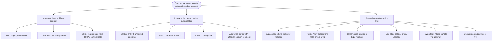

### 15.2 Detailed adversarial matrix

| ID | Attack | Exploit path | Required countermeasure | MVP disposition |
|---|---|---|---|---|
| T01 | Approved token, malicious spender | ERC-20 `approve(attacker,max)` | inspect first argument and per-origin spender | **P0** |
| T02 | Approved NFT, malicious operator | `setApprovalForAll` | operator/collection and bool scope | **P0** |
| T03 | Known Permit2, unknown spender | typed `PermitSingle` | parse token + spender + amount + deadline | **P0** |
| T04 | Permit2 SignedTransfer, recipient unbound | Valid typed signature later spent via attack router | reject/hold unless caller context is bound | **P0 conservative** |
| T05 | Legitimate router, attacker recipient | malicious swap calldata | protocol-specific recipient and min-out checks | **P0 for test router; P1 general** |
| T06 | EIP-7702 delegate to malicious logic | authorization list | chain+delegate+codehash validation | **P0 for known explicit flow** |
| T07 | Chain ID substitution | same address on different chains | exact chain ID and domain check | **P0** |
| T08 | Stored provider handle bypass | site calls raw wallet provider | wallet-native integration; coverage warning | **Cannot guarantee in MVP** |
| T09 | EIP-6963 provider impersonation | forged `rdns` / manipulated events | do not trust self-declared provider metadata | **P0 coverage test** |
| T10 | Fake descriptor claims victim owner | upstream PR `metadata.owner/url` | source is candidate, manual attestation and quorum | **P0** |
| T11 | Fake Arkiv row with same schema | attacker writes `arkiv.schema=bound.*` | filter `$owner`, root Merkle proof/signatures | **P0** |
| T12 | Replay old approved snapshot | freeze/root version rollback | contract epoch, monotonic state and expiry | **P0** |
| T13 | Guardian freeze overlooked | cached positive decision | check frozen flag at signing time | **P0** |
| T14 | ERC-1967 proxy upgraded | same `to`, different logic | codehash+slot/implementation watcher | **P1** |
| T15 | Diamond/nonstandard proxy | slot check gives false comfort | ABI/trace-specific support or hold | **P1** |
| T16 | Same-origin bridge message spoof | arbitrary JS posts fake ALLOW | isolated policy decision + nonce-correlated protocol | **P0** |
| T17 | TOCTOU payload mutation | validate params A, sign params B | immutable deep clone and final request hash | **P0** |
| T18 | Chain changed between lookup/send | provider changes network | just-in-time chain match | **P0** |
| T19 | SSRF / external include via ERC descriptor | importer fetches attacker URL | pinned repository only, no remote includes | **P0** |
| T20 | Swarm gateway serves altered JS | browser downloads wrong file | trusted hash-pinning; refuse invalid code | **P0** |
| T21 | Policy root signing-key compromise | authorizes attacker address | independent curator quorum; guardian brake | **P1 hardened** |
| T22 | ENS resolver/record relink | named root points elsewhere | pin anchor, check resolver + freeze state | **P0** |
| T23 | Anon-RPC direct-fallback leak | worker plain fetch or degraded mode | real network, observable read coverage, opt-in fallback | **P0 truthful** |
| T24 | Malicious RPC lies about allowance/code | poisoned eth_call / codehash | quorum or proof-backed reads; warn at disagreement | **P1** |
| T25 | Allowance inventory incomplete | only known spenders displayed | label “known approvals”; import verified index | **P0 disclosure** |
| T26 | User tricked by spoofed warning | in-page overlay hides alert | extension-owned popup / side panel | **P0** |
| T27 | iframe origin confused with top page | malicious child frame requests wallet | frameId / sender origin binding | **P0** |
| T28 | On-chain policy transaction pending/reorged | root used before finality | pinned block / finality gate | **P0** |
| T29 | Permit signed while disconnected | metadata absent; later utilized externally | fail closed on unknown signature type | **P0** |
| T30 | Trusted contract economically malicious | approved address drains via valid behavior | simulation, semantic allowlist, independent audits | **P1/P2** |

### 15.3 False-positive/false-negative taxonomy

- **False positive (coverage):** newly deployed legitimate router blocked because not yet curated; proxy upgrade temporarily blocked; site uses unsupported gasless flow; offline root can't refresh.
- **False negative (interception):** page bypasses wrapped provider; wallet handles a direct request; dApp uses WalletConnect with no integration; unsupported internal account signing.
- **False negative (semantics):** safe `to` but malicious recipient; multicall hides `delegatecall`; Permit2 signed transfer recipient not signed; canonical router can call attacker-controlled callback.
- **False negative (governance):** bad policy attested by reviewers; guardian compromised; chain RPC lies; root replay from stale network state.
- **Operational unavailable:** Swarm gateway unreachable or postage expired; ANON worker/network unavailable; ENSv2 RPC unavailable; browser MV3 service worker suspended mid-request.

The test suite should report *all* of these separately; a single “99% detection” score without naming the evaluated attack universe would be misleading.

---

## 16. Technical limitations and mitigation roadmap

### 16.1 Severity rubric

**Critical:** threat invalidates the main claim or can enable theft. **High:** enables serious bypass/poisoning or widespread denial. **Medium:** limits coverage, reliability or privacy. **Low:** developer UX or presentation issues. Severity is architectural, not an audit finding against deployed code.

| Severity | Limitation / failure mechanism | Why the naive approach breaks | MVP mitigation | Stronger future remediation |
|---|---|---|---|---|
| **Critical** | Independent extension cannot intercept every signing path | Another extension owns wallet transport; page may retain provider | Gate BOUND proxy path, measure coverage, show limitation | Wallet-native verification at pre-sign hook; explicit wallet SDK integration |
| **Critical** | Approved contract != safe operation | Attacker can route to allowed contract with harmful args | Verify full spender/recipient and selected router calls | Stateful simulation + protocol intent models + replayable execution traces |
| **Critical** | ERC-7730 owner/URL is not validated ownership | Community metadata is self-/third-party submitted | Observation-only importer; independent reviewer attestations | On-chain organization signatures, domain challenges, release attestations |
| **Critical** | Permit2 recipient may not be committed in signed message | `SignatureTransferDetails` lives at execution | Hold unbound signature transfers | Caller-context attestations / verified integrator code + simulation |
| **High** | Proxy upgrades keep external address | ERC-1967 implementation changes while `to` remains stable | Flag and version known proxies, manual hold | Block-pinned codehash, upgrade monitors, historical slot proof |
| **High** | ENS resolver and registry hierarchy can change | Name owner/relink/upgrade can rewrite policy pointer | Pin anchor address; resolver records informational | Tightly scoped governance, immutable anchor, on-chain identity continuity |
| **High** | One curator can poison policy root | Simple sample contract permits single publisher | Guarded demo review, separate guardian | M-of-N EIP-712 approval verified on-chain, timelock + monitoring |
| **High** | Guardian compromised or unable to broadcast | Freeze may be abused or absent | One-way freeze and documented key separation | Multisig guardian, backup signers and monitoring |
| **High** | Stale policy/root or split RPC view | Cache accepts revoked binding | Epoch/expiry check, conservative offline hold | Multi-RPC consensus / light-client proofs |
| **High** | Swarm gateway not a native bytecode verifier | HTTPS gateway controls served JS | Extension-backed hash validator and pinned ref | Browser-native trusted Swarm transport / reproducible integrity attestation |
| **High** | Unknown nested calls / arbitrary calldata | Router may contain hidden destructive call | Entire mixed batch held if unknown | Specialized decoders + EVM symbolic and simulation traces |
| **High** | Permission granularity misleading in ENSv2 | Scoped resolver roles apply by key across all names it serves | Dedicated isolated resolver | Per-name resolver or audited custom resolver deployment |
| **Medium** | Arkiv entities expire / public data can be spoofed | TTL and named schema are not authentication | Published mirror owner filter + renewable TTL | Checkpointed archive, on-chain proof verification |
| **Medium** | Unlimited allowance is a usability pattern | Blocking all max approvals breaks legitimate DeFi | Risk tier and explicit site constraints | User-configured spend budgets, ephemeral approval router |
| **Medium** | Direct RPC leaks despite privacy label | Example worker might use ordinary fetch | Require genuine worker and opt-in degraded fallback | Better anonymity network, traffic analysis resistance |
| **Medium** | RPC exit sees addresses in query payload | Network path anonymity does not encrypt endpoint business data | Disclose, batch/rate-limit, minimize reads | PIR / proof-bearing local state or private relay for selected reads |
| **Medium** | Approval enumeration incomplete | No standard contract enumerator across all tokens | Known-spender review and honest labels | On-chain event index scanning and verified third-party index adapters |
| **Medium** | 7702 delegations hard to classify | Signed authorization changes account code | Explicit delegate/codehash allowlist | wallet-native transaction simulation, smart-account permission analysis |
| **Medium** | Swarm content persistence depends on postage | A hash is not a perpetual hosting guarantee | Valid postage + replication + local fallback | Multi-node replication monitoring, feed health policy |
| **Medium** | Browser MV3 service workers suspend | Pending requests may time out or vanish | Idempotent request IDs, persisted minimal state, timeouts | Wallet-integrated synchronous guard |
| **Low** | Protocol UI friction / false alarms | Unknown contracts common | Contextual explanation and reason codes | Signed first-party self-service policy updates with independent review |
| **Low** | Registry/data import scale | Large source corpus, rate limits | Incremental commit diff and batch import | Distributed import, backpressure and caching |

### 16.2 The hardest unsolved problem: independent authority for protocol ↔ domain ↔ contract

BOUND wants a trustworthy relationship such as:

```text
approved website origin: https://swap.cow.fi
   belongs to protocol identity:  <authentic protocol organization>
   may use chain 1 contract:    <authenticated spender/router>
   may execute function:        <approved semantics + constraints>
```

Neither a valid TLS certificate, an ENS name, nor an ERC-7730 `metadata.info.url` alone proves all four statements. TLS authenticates a **connection to the origin**; it does not guarantee the page's JavaScript is unmodified. ENS establishes control of an ENS name/records, not automatic ownership of `cow.fi`. ERC-7730 describes clear signing and can be submitted by third parties. A secure policy needs at least **protocol-origin proof** (e.g., domain challenge plus signed release), **contract-deployment proof** (curated contract/source/governance data), and **curator verification** (multi-attested binding). Since the *very threat* is website compromise, a one-time DNS challenge or website-hosted `/.well-known/bound.json` must not be allowed to approve new spender contracts on its own during an incident.

**[DESIGN] Staged trust model:**

1. *Observed:* descriptor claims an owner/URL; never auto-allow.
2. *Verified origin/control:* organization proves historical control through ENS governance key + independent certificate/domain evidence + off-band review.
3. *Reviewed deployment:* exact chain/address/ABI/upgrade authority independently checked and approved.
4. *Allowed action constraints:* spender/recipient and parameters are explicitly documented and curators attest to this policy version.
5. *Continuously monitored:* proxy upgrades, signer rotations, ENS record changes, and site incidents trigger review/freeze.

**Research opportunity:** introduce an interoperable, signed, owner-attested **Origin Contract Policy Manifest** that wallets can independently consume and verify. It should be a **new BOUND policy format**, not misrepresented as a capability already supplied by ERC-7730.

### 16.3 Limitations of EIP-1967 introspection

The implementation slot is standardized and externally readable by `eth_getStorageAt`; users do not need a Solidity getter for it. But a proxy may use **beacons**, **UUPS**, **transparent proxies**, **clones**, **diamonds**, hand-written nonstandard storage, or runtime delegation based on calldata. Check both EIP-1967 implementation and beacon slots, resolve beacon implementation where applicable, and inspect code at a pinned block. Do not confuse proxy admin ownership with underlying protocol legitimacy; admin may be a multi-sig or timelock which itself can be compromised. Stronger solution: authenticated source/codehash binding + verified governance controls + upgrade event monitoring, with conservative hold on unsupported proxy forms.

### 16.4 The true limitation of ENSv2 publication

A resolver `setText()` can store a root; its bytes are not intrinsically validated as BOUND policy, and write rights may include broad `ROLE_LINK` or `ROLE_UPGRADE`. A guardian account holding a separate role **does not automatically freeze resolver text data**. BOUND's guardian semantics require a **custom freeze contract or explicit independent policy status**, checked by the extension, with a stricter control path than publisher updates. Prove the freeze on-chain in the demo and check it is reflected after policy refresh—not a toggle in the curator dashboard.

### 16.5 The true limitation of Safe Mode

A “decentralized UI” does not automatically reproduce dApp backend services, advanced order routing, off-chain signatures, solver auctions, order books, account APIs, pricing/quote infrastructure, or relayers. For CoW Swap specifically, generic contract calls alone cannot be assumed to complete the full normal solver-based trade lifecycle. The safe demo should use a **test protocol with clearly supported on-chain methods** (and ERC-20/ERC-721/Permit2 review/revocation); mention integrations with production protocols only when their recovery functions are independently verified.

### 16.6 Usability versus false positives

A restrictive policy will hold many legitimate new contracts, proxy upgrades, multisig flows, and unfamiliar EIP-712 signatures. The product should therefore offer **transparent graduated decisions**: `VERIFIED_BINDING`, `UNKNOWN_BINDING`, `CONSTRAINT_VIOLATION`, `FROZEN`, `UNDECODABLE`, each with exact reason and documentation. “Proceed anyway” is **not** a BOUND-verified allow; if supported at all, require a deliberately separate wallet-origin confirmation, prominently mark protection is bypassed, and never offer that override for a guardian freeze inside BOUND's protected flow.

---

## 17. Security invariants and test framework

### 17.1 Non-negotiable invariants

| Invariant | Automated test oracle |
|---|---|
| **I1.** No untrusted Arkiv candidate may directly authorize an action | Inject fake candidate matching malicious spender; decision remains HOLD |
| **I2.** Every decoded spender and recipient must be policy-matched | Mutate one spender inside otherwise valid request; HOLD |
| **I3.** All nested actions in a batch must pass | Mixed safe/malicious multicall; no forwarding |
| **I4.** Invalid or outdated policy root never grants `VERIFIED_BINDING` | Replayed epoch, wrong hash, expired root -> HOLD |
| **I5.** Guardian freeze dominates every positive policy entry | Freeze previously approved entry; next mediated request DENY |
| **I6.** No unknown sensitive selector may silently pass | Fuzz invalid ABI selectors; HOLD |
| **I7.** Chain ID is part of every trust decision | Same address, different network -> HOLD |
| **I8.** The actual forwarded bytes equal the bytes BOUND evaluated | Mutate nested params after evaluation -> detect, HOLD |
| **I9.** Site JS cannot manufacture a trusted `ALLOW` response | Forged bridge message, wrong nonce/frame/tab -> reject |
| **I10.** Swarm gateway cannot substitute executable UI | Serve altered JS at same expected reference -> refuse |
| **I11.** Read privacy claims require real anonymous worker | Plain-fetch worker detected and labelled not anonymous |
| **I12.** Policy decisions must not disclose a user's wallet history publicly | Scan Arkiv/Swarm writes for account/session identifiers |
| **I13.** `NOT_MEDIATED` paths must never show a green protection assertion | Provider-bypass test verifies coverage warning |
| **I14.** ENSv2 root text cannot override anchor freeze/root | Force resolver mismatch / relink; HOLD |
| **I15.** Revocation never bypasses normal wallet confirmation | Safe Mode sends tx through wallet, no private-key use |

### 17.2 Test pyramid

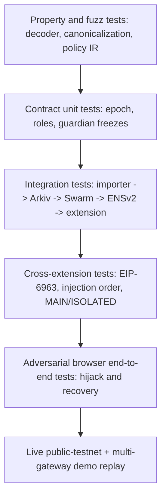

Recommended test tools [DESIGN]: Foundry for Solidity; Vitest/fast-check for parsers and property tests; Playwright + Chromium extension harness for browser behavior; Anvil for local EVM fixtures; Sepolia for ENSv2 policy/anchor; Arkiv Rabdi testnet for publisher/query; Bee local plus public gateway for Swarm validation. Pin tool versions and contracts per network.

### 17.3 Decoder property tests

```ts
import { describe, expect, it } from 'vitest';
import { encodeFunctionData, parseAbi } from 'viem';
const abi = parseAbi(['function approve(address spender,uint256 amount)']);

it('extracts malicious spender even when token is in a trusted list', () => {
  const attacker = '0x000000000000000000000000000000000000dEaD';
  const token = '0x0000000000000000000000000000000000000001';
  const data = encodeFunctionData({ abi, functionName: 'approve',
    args: [attacker, (1n << 256n) - 1n] });
  const parsed = decodeERC20Call({ to: token, data });
  expect(parsed.kind).toBe('ERC20_APPROVE');
  expect(parsed.spender.toLowerCase()).toBe(attacker.toLowerCase());
  expect(parsed.unlimited).toBe(true);
});

it('does not accept a mixed batch with one unknown inner call', async () => {
  const result = await evaluateFixture('safe-call-plus-unknown-calldata');
  expect(result.kind).toBe('HOLD');
});
```

These examples are adapted to the conceptual interfaces in this document. `evaluateFixture` is a test helper to implement; not a public package function.

### 17.4 Contract invariant examples

```solidity
// Foundry-style conceptual tests
function testGuardianFreezeDominatesPublishedRoot() public {
    vm.prank(publisher);
    anchor.publishRoot(1, keccak256("approved-root"));
    vm.prank(guardian);
    anchor.freezeEntry(TEST_ENTRY_ID);
    assertTrue(anchor.frozenEntry(TEST_ENTRY_ID));
    assertEq(anchor.epoch(), 1);
}

function testCuratorCannotPublishAfterGlobalFreeze() public {
    vm.prank(guardian);
    anchor.freezeAll();
    vm.prank(publisher);
    vm.expectRevert("frozen");
    anchor.publishRoot(1, keccak256("new-root"));
}
```

### 17.5 Mandatory adversarial demo cases

| Case | Setup | Expected user-facing result | Verification evidence |
|---|---|---|---|
| A. Normal operation | Mock site uses curated ERC-20 spender on Sepolia | Verified binding, wallet confirms | recorded policy root + transaction hash |
| B. Malicious approval | Replace site assets with same-origin drainer UI | HOLD before selected wallet provider sees request | extension bridge logs + absence of wallet popup |
| C. Wrong-chain approval | Same address on other chain | HOLD chain mismatch | screenshot + decoded chain |
| D. Permit2 bypass | Same legitimate Permit2 verifier, attacker spender | HOLD | decoded spender and typed domain |
| E. Unbound SignatureTransfer | Signed fields omit ultimate recipient | HOLD as insufficient context | parser completeness trace |
| F. Guardian freeze | Guardian calls `freezeEntry()` | DENY even if snapshot matches | freeze tx hash + extension policy refresh |
| G. Arkiv poisoning | Separate wallet publishes fake `bound.binding.v1` | Fake row is ignored | owner filter and root mismatch proof |
| H. DNS/origin attack | Official origin loads untrusted JS | Main drainer path held | test fixture and request bytes |
| I. Provider bypass | App uses cached original provider | BOUND reports *not guaranteed* coverage | reproducible negative result |
| J. Domain/server outage | Shut original app server down | Swarm-backed Safe Mode still loads | recorded outage + upload/query + recovery tx |
| K. Bad Swarm bytes | Deliberately alter served static JS | Hash verifier refuses execution | expected/actual digest |
| L. Anon-RPC privacy | Inspect Safe Mode network calls | Reads use real worker by default | network log and worker bundle hash |

**Key acceptance criterion:** case I must be honestly reported, even if it produces a bypass. A false guarantee is worse than documenting a real limitation.

### 17.6 Metrics, not marketing scores

| Metric | Definition | Evaluation approach |
|---|---|---|
| `mediated_request_fraction` | eligible wallet calls seen by BOUND / total known calls in harness | Instrument test dApp and wallet adapter |
| `true_positive_fraction` | held attack fixtures / attack fixtures in stated scope | Independent attack suite |
| `false_hold_fraction` | held legitimate fixtures / legitimate fixtures in stated scope | Protocol fixtures and human review |
| `policy_lookup_p50/p95` | time from request to verified policy decision | Cold/warm network and cache |
| `stale_snapshot_detection_rate` | stale/corrupted root cases correctly held | test against epoch/expiry mismatch |
| `anon_rpc_read_coverage` | eligible Safe Mode reads sent via actual anonymous worker / total reads | Instrument transport at RPC boundary |
| `recovery_independence` | Safe Mode actions complete after primary backend/domain outage | deliberately disable primary service |
| `guardian_freeze_latency` | finalized freeze to next enforced request block | measured blocks and local refresh |
| `reproducible_bundle` | rebuilt artifact bytes match published digest | clean isolated CI build |

**Do not supply numerical performance claims without measurements.** Select target thresholds after baseline testing and publish exact environment, sample size and failure distribution. Anon-RPC latency should be measured separately from the cryptographic policy-matching cost; the former may dominate.

---

## 18. Hackathon execution, demo and acceptance criteria

### 18.1 Deliver a believable, narrow security MVP

**P0 — must work end to end**

1. One instrumented **EIP-1193 test dApp** with legal/trusted and malicious variants served from the **same local/test HTTPS origin**, plus predictable transaction fixtures.
2. A working Chromium extension, explicitly using a **BOUND-selected mediated provider**. Implement `eth_sendTransaction`, ERC-20 `approve`, `setApprovalForAll`, EIP-712 permit/Permit2 minimum cases; unknown paths are held.
3. Versioned source importer reading real ERC-7730 registry files at a **pinned commit** with nonempty descriptor origin/deployment data and an Arkiv query by origin and chain/address.
4. A minimum **curator-reviewed policy**, exact schema, deterministic snapshot, Swarm upload, root anchor on Sepolia, real ENSv2 resolver record and EAC role action.
5. A **guardian freeze** transaction that changes the next browser policy decision.
6. Swarm Safe Mode reached without the original server; review and revoke a known test ERC-20 allowance and successfully execute one vetted test contract function.
7. Actual Anon-RPC anonymizing worker for Safe Mode reads, or explicitly position the EF entry as CROPS and say Anon-RPC support is experimental/incomplete. No anonymous claim from bare direct fetch.
8. A public open-source repository with reproducible scripts, chain addresses, uploaded Swarm reference, data licenses, and partner-specific evidence files.

**P1 — high-value upgrades if P0 is stable**

- Proxy EIP-1967 implementation/codehash pinning and deliberate upgrade attack.
- Multi-reviewer threshold signatures before root publish.
- Dedicated EIP-7702 authorization demonstration if supported by selected wallet.
- Safe Mode Permit2 allowance inspect/revoke; on-chain event indexing for known approvals.
- Complete EIP-5792 batch / ERC-4337 account `execute` recursion.
- Multi-RPC root check and provider health / gateway fallback.
- Merkle proof generation per Arkiv record rather than full-snapshot download for every policy match.

**P2 — post-hackathon research**

- Wallet-native SDK / wallet plugin integration (actual mandatory enforcement).
- Origin–contract signed manifest standard and deployment governance attestations.
- Stateful transaction simulation, token balance deltas, callee traces, output recipient intent.
- Light-client/proof-backed Ethereum state reads; stronger Anon-RPC threat model.
- Cross-wallet adapters and WalletConnect paths.
- Full production incident response, curated policies for major DeFi protocols, automated upgrade monitoring.

### 18.2 Recommended workstream dependencies

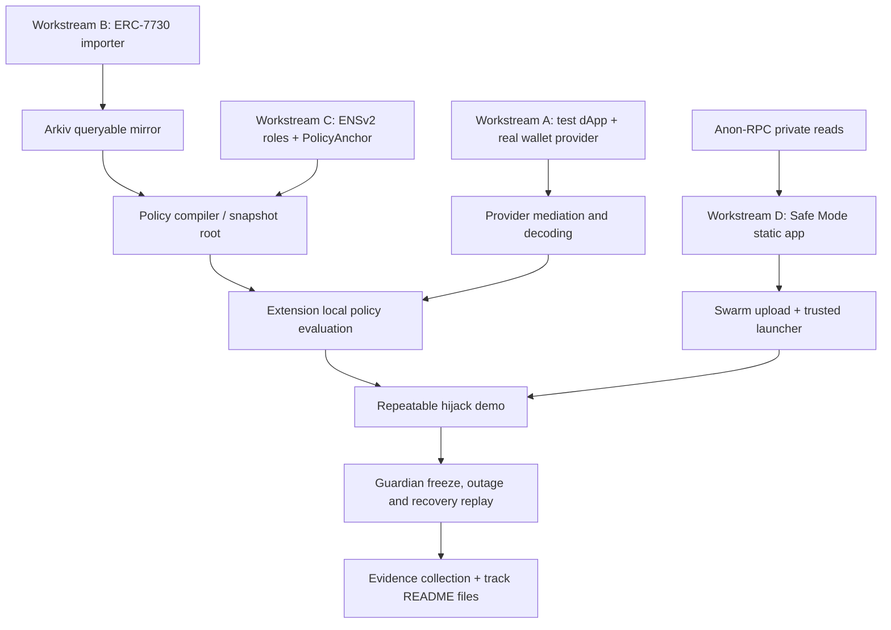

### 18.3 Critical path (recommended order)

| Milestone | Exit condition | Why it precedes the next |
|---|---|---|
| M0: One real mediated wallet call | test dApp's `approve` goes through BOUND before wallet | Browser gate feasibility dominates whole concept |
| M1: Decode and hold malicious spender | deterministic rejection without wallet confirmation on mediated path | Core security differentiation |
| M2: Arkiv candidates + query | real record key and reproducible public query | Mirrors must be real and useful |
| M3: ENSv2 + anchor governance | on-chain root, role-restricted publish, guardian event | Root trust separated from database |
| M4: Verify policy snapshot in extension | valid allow vs wrong root hold | End-to-end cryptographic control |
| M5: Swarm Safe Mode and revoke | original origin offline; user revokes test allowance | CROPS continuity demonstration |
| M6: Anon-RPC privacy evidence | eligible reads routed through real worker | Meaningful private-read claim |
| M7: Negative-path adversarial tests | reproducible bypass/failure cases documented | Credibility and security review |

### 18.4 Five-step live demo script

**Act 1 — the normal site.** Show official-looking test dApp with a real wallet. BOUND reports exactly which site policy epoch, token and spender are covered. Execute a small, benign test swap/approval. Do **not** call it safe merely because a green icon exists.

**Act 2 — hijack same origin.** Shut off/replace served JavaScript with malicious code while preserving the URL/HTTPS origin. The page asks for unlimited approval to a new spender. BOUND decodes and holds before forwarding to the instrumented wallet.

**Act 3 — independent recovery.** Open extension-owned launcher; display Arkiv key and the referenced Swarm Safe Mode build. Turn off the original server completely. Read known allowances, using Anon-RPC if configured. Revoke the test approval through the user's actual wallet and confirm on-chain.

**Act 4 — governance incident.** Show live ENSv2 curator-key text record update (delegated EAC role), an authenticated root commitment, and a different guardian key calling `freezeEntry`. Request an action that was previously allowed; the extension rejects because the authoritative freeze overrides cached policy.

**Act 5 — show evidence and limits.** Open public code and track documents; show upstream source commit, import CLI, Arkiv query, Swarm manifest reference, chain transactions and a “known bypass” test for page-level interception. Explain wallet-native future integration.

### 18.5 What judges should be able to replay independently

- Start the local test dApp and attach one supported wallet. Perform the non-malicious and malicious flow with no manual browser console cheating.
- Fetch Arkiv entity by key and issue one address/origin query from the documented public/test RPC.
- Verify a Swarm reference on a distinct Bee/gateway and independently compute file/snapshot digests.
- Inspect ENSv2 resolver, EAC role grant, PolicyAnchor contract, actual root and freeze transactions through an explorer.
- Revoke an approval on Sepolia and observe `allowance(owner, spender) == 0` from chain state.
- Stop original server and repeat the recovery flow.
- Inspect the Anon-RPC worker's pinned hash and actual network transport; demonstrate a read is not just direct `fetch`.
- Run negative tests and observe explicit `NOT_MEDIATED` or `UNDECODABLE` instead of optimistic green results.

---

## 19. Partner submission evidence and traceability

### 19.1 Arkiv deliverables, mapped to this implementation

| Required path | What to write / link | Evidence should be reproducible |
|---|---|---|
| `/arkiv/schema.md` | entity names, indexed columns, owner keys, expiration, query by origin/address | actual entity keys and SDK calls |
| `/arkiv/friction.md` | SDK/testnet hurdles, bug reproduction, what failed and why | error logs, minimal repro |
| `/arkiv/reach.md` | real users/builders who would use ERC-7730 mirror; proposed audience | grounded outreach, no invented adoption |
| `/arkiv/why-arkiv.md` | public filterability, wallet-owned signed writes, TTL, no private BOUND REST dependency | compare query against Git source files |
| `/arkiv/data-quality.md` | completeness, source SHA, update cadence, mismatches, expired entities | importer run stats and actual examples |
| `/arkiv/swarm.md` | Arkiv entity -> Swarm hash, postage batch, Bee provider, exact upload/read steps | live accessible `bzz` link |
| `README.md` | Arkiv publisher wallet, one sample query, AI-use disclosure, license | scripts run on clean machine |

**Submission nuance:** Arkiv counts as one partner prize even if combining a primary Arkiv track with the Swarm bonus, per official event page. This does not imply automatic eligibility; follow current ETHGlobal rules on maximum partner-track selection. [Event prizes](https://ethglobal.com/events/mumbai/prizes).

### 19.2 ENSv2 deliverables

- Public deployed **ENSv2** registry/resolver addresses for chosen name and chain, with a resolver controlled by the actual name authority.
- Explorer transactions for resolver setup, `grantSetterRoles()` scoped to BOUND policy key, curator's `setText()` update, independent guardian's PolicyAnchor `freezeEntry()`.
- Read-path code that discovers and verifies ENSv2 records and cross-checks PolicyAnchor root/epoch.
- Demonstration that curator **cannot** rewrite unrelated resolver record types and guardian **cannot** directly publish a policy root.
- Explanation that resolver records are not a replacement for `PolicyAnchor` guardian logic, and their role scoping is per key across the resolver instance.

### 19.3 CROPS README template (content to fill with evidence)

```markdown
## CROPS

- **C — Censorship resistant:** We remove dependency on the original
  dApp frontend by publishing hash-pinned Safe Mode on Swarm. These
  Bee/gateway and RPC dependencies remain: <measured/identified>.
- **O — Open source:** <license>, repo commit <hash>, clean-build steps,
  reproducible artifact results <link>.
- **P — Private:** Safe Mode reads use <real Anon-RPC worker/network>.
  Disclosures: bootstrap RPC, exit-node query access, wallet broadcasts,
  optional user-approved fallback; no third-party analytics.
- **S — Secure:** Privileged decisions use pinned PolicyAnchor state,
  separate curator/guardian roles, hash-verified snapshots and conservative
  decoding. Known bypass: unrelated wallets can bypass page wrapping.
```

**No fabrication:** fill placeholders with measured facts, not design intentions. Link the 3-minute max CROPS demo showing the original site disabled while Safe Mode works.

### 19.4 Anon-RPC evidence checklist

**Record:** target chain, specifier contract, worker bundle hash, selected anonymity network, harness package version, count of read calls, fraction routed through the worker by default, direct-fallback rule, bootstrap access pattern and documented metadata exposure. Count *actual* `eth_call`, `eth_getBalance`, `eth_getCode`, `eth_getLogs` etc., not merely the number of UI buttons.

### 19.5 Evidence provenance standard

For every live demo artifact store at least: source code commit, chain ID, deployed contract address, block number and tx hash, signer wallet (public), artifact content digest, Swarm manifest/reference, Arkiv entity key, policy epoch/root, run/test command, timestamp, and known limitation. Never include the user's wallet secrets or credential values.

---

## 20. Performance, privacy, operations and incident response

### 20.1 Startup and hot-path performance

The core policy verifier should be deliberately small. The expensive work—network access to Arkiv, ENS/EVM, Swarm and anon-RPC—should be **cached with bounded freshness**. A good runtime architecture has three layers:

1. **Fast local memory:** validated policy snapshot for known origins and chains; exact keyed lookup table; current root/epoch cached for a limited interval.
2. **Background validation:** periodically refresh active roots, signatures, frozen entries, byte hashes, codehash changes and Swarm references. Browser MV3 service-worker suspension must be handled.
3. **On-request mandatory checks:** origin, wallet chain, exact signing bytes, decoder completeness, rule constraints, and sufficiently fresh authoritative freeze state. If the user requests an action during a freshness gap, a `HOLD` is preferable to false verification.

Never use a cached `ALLOW` result across wallet account changes, chain changes, frame navigations, different calldata, or policy epochs. Cache **validated entries**, not approval verdicts divorced from request digests.

### 20.2 Privacy threat model by recipient

| Recipient | What they may learn | Mitigation and honest limit |
|---|---|---|
| Hijacked dApp page | Browser fingerprint, user wallet address once shared, requested signature data | BOUND does not retroactively hide data the page already saw |
| Arkiv public nodes/readers | queried origin, public registry candidate data, caller network metadata | no wallet history in public entities; optionally relay/rate-limit public queries |
| ENS/Ethereum RPC | queried policy anchor, IP at direct endpoint, transaction/account queries | Anon-RPC where possible; bootstrap and read disclosures |
| Swarm gateway | content reference requested, IP/timing at gateway | multiple gateways and independent content verification; transport privacy separate |
| Anon-RPC entry/network | connection/timing depending on transport | hash-pinned worker, network threat model and traffic analysis testing |
| Anon-RPC exit / destination RPC | query parameters (e.g., account addresses) unless independently protected | cannot promise full privacy; reduce sensitive queries, investigate PIR/light clients |
| Actual wallet RPC/bundler | public signed tx and often IP/account correlation | wallet/provider chosen transport; BOUND does not control it by default |
| BOUND publisher | registry record writes and publicly visible signer wallet | no end-user account data; separate key operational security |

### 20.3 Key management

- **Publisher key:** separate from curator reviewer keys and guardian; preferably dedicated transaction-sending key with restricted operational balance.
- **Curator keys:** quorum signers; hardware-backed where possible. Their private keys never live in extension bundles or site frontend.
- **Guardian key:** separate high-assurance multisig, emergency freeze capability; no automatic unfreeze.
- **Swarm postage funding key:** distinct from EVM governance key; postage costs and renewal documented.
- **User wallet:** remains controlled by the user; BOUND is **never** a custody service.
- **CI secrets:** short-lived tokens and protected environment; no key material in GitHub Actions output or `/arkiv/*.md`.

### 20.4 Incident response state machine

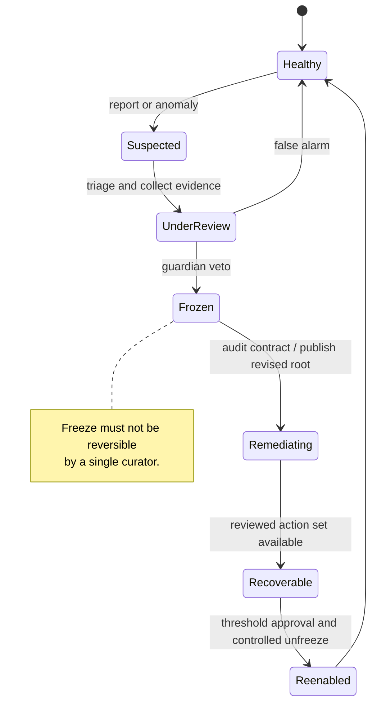

**Critical ops rule:** the emergency freeze route must function when the importer, BOUND central website, and original protocol frontend are unavailable. It relies on the chain and authorized guardian signing/broadcast route. If freeze events cannot be observed because RPC is down, an honest client cannot claim up-to-date verified policy.

### 20.5 Operational controls

Monitor: importer lag vs source commit, Arkiv entity TTL headroom, query success/rate limits, Swarm postage expiry/replica reachability, ENSv2 name expiry and resolver changes, proxy upgrades, PolicyAnchor root/epoch consistency, guardian key availability, Anon-RPC worker-specifier hash changes, and false-hold rate. Publish a signed **policy health digest** for transparency; do not attach per-user browsing metrics. Add release signing, dependency scanning, reproducible CI builds, testnet smoke tests, incident drills and explicit fail-closed behavior for critical dependency outages.

---

## 21. Competitive positioning and future research

### 21.1 Compared approaches

| Approach | Strength | Gap BOUND tries to address | BOUND still lacks |
|---|---|---|---|
| Wallet transaction simulation | Shows effects and predicted deltas | May not explain whether spender belongs to intended website | Broad simulation, adversarial execution semantics |
| URL/domain blocklists | Easy phishing warnings | Fresh same-origin hijacks can predate listings | Mature threat-intel feeds |
| Contract reputation lists | Fast known-risk lookup | Trusted contracts plus malicious params are still dangerous | Large proprietary labels and incident telemetry |
| Hardware-wallet clear signing / ERC-7730 | Interpretable calldata and typed messages | Owner URL and deployment descriptions not equivalent to origin authorization | Hardware signing-path enforcement |
| Approval revocation dashboards | Useful post-incident recovery | Might depend on a centralized frontend, and operate only after bad approval | Comprehensive approval inventory |
| Static IPFS/Swarm rescue UI | Frontend availability independent of a domain | Doesn't itself authenticate policy or understand signing requests | Hosting guarantees without network/availability assumptions |
| BOUND proposed architecture | Origin-linked, attested action policy + independent recovery | Can make certain mismatches visible before mediated signing | Wallet-universal enforcement, simulation and broad protocol integrations |

This comparison is architectural, **not** a benchmark or claim of superiority over any existing vendor. Mature wallets, simulators and approval inspectors may already cover substantial pieces of the workflow. BOUND's claimed differentiator is specifically the **site-origin-to-spender/action policy** plus independent recovery, with reproducible public governance.

### 21.2 Research roadmap

1. **Native wallet policy SDK:** offer `verifySigningIntent({origin, chain, rawRequest})` inside the actual wallet request pipeline. This solves the independent extension bypass boundary for participating wallets.
2. **Protocol-owned origin–contract manifests:** signed manifests controlled by audited release keys with ENSv2 discovery, domain proofs, deploy attestations and revocation semantics. Include governance-chain identity and contract implementation hashes.
3. **Transaction semantics graph:** recursively represent approvals, transfers, routers, callbacks, delegatecalls and smart-account execution as typed edges rather than flat `to` addresses.
4. **Trust minimization of queries:** verified state proofs/light clients to reduce reliance on one RPC provider's claimed codehash/freeze state.
5. **Portable Emergency Recovery SDK:** open-source Safe Mode templates allowing protocols to publish restricted critical-function descriptors and independently verifiable recovery interfaces.
6. **Privacy-preserving allowance discovery:** investigate private intersection queries, PIR, account-local event scans and indexer trust transparency; avoid claiming Anon-RPC alone makes addresses private.
7. **Policy-aware simulation and diffing:** simulate the exact call at pinned chain state; compare expected asset flows, approved codehash and min-out constraints. Handle time-dependent behavior explicitly.
8. **Governance safety proofs:** threshold signers, emergency one-way brake, policy epochs, timelock and formally specified invariants for upgrades and rollback resistance.

### 21.3 Credible pitch in one paragraph

A protocol's smart contracts may be secure while its website is compromised. BOUND proposes a browser-side check of **what the page is asking your wallet to authorize** against a publicly auditable, curator-reviewed origin policy. The policy is built from open clear-signing data, mirrored on Arkiv, rooted in ENSv2-governed authorization and verifiable snapshots, then evaluated locally. If a malicious spender appears, BOUND can hold **requests that actually pass through its mediated wallet adapter**. When the original site fails, users can open hash-verified Safe Mode from Swarm to review and revoke supported approvals, with Anon-RPC protecting network linkage for many read operations. The next step to truly universal protection is integration at the wallet's signing boundary.

---

## 22. Claims that must not be made

1. **“BOUND blocks all wallet drainers”** — incorrect; scope is mediated, decoded, policy-covered requests.
2. **“Every installed wallet is protected without integrating the wallet”** — not established by an independent browser wrapper.
3. **“ERC-7730 proves which protocol owns a contract or URL”** — metadata and repository review are not authoritative contract-ownership proofs.
4. **“ENSv2 automatically allows guardian freezes”** — BOUND-specific `PolicyAnchor`/governance logic is required.
5. **“A known router can never steal assets”** — approved call targets can still perform harmful actions with malicious parameters or upgraded code.
6. **“Swarm hosting guarantees the app can never go down”** — postage, node reachability, gateways and bootstrap still matter.
7. **“Anon-RPC encrypts or hides the user's public address from all parties”** — the RPC exit or destination can still read query payloads and the chain is public.
8. **“An approved Permit2 verifying contract makes every Permit2 signature safe”** — spender, token, nonce and caller/recipient context are critical.
9. **“Revoking an ERC-20 allowance cancels all previous off-chain permit signatures”** — signatures and nonce/replay rules require specific mitigation.
10. **“A site with valid HTTPS is authentic and uncompromised”** — TLS authenticates the connection to an origin, not the served code's honesty.
11. **“A Safe Mode UI can recreate every action of every dApp”** — many protocols depend on complex off-chain infrastructure.
12. **“This is audited / production-proven / 100% accurate”** — no such audit or measurement is presented in this design paper.
13. **“The Arkiv schema name proves the data is ours”** — anyone can write matching public attributes; owner signatures and canonical root are required.
14. **“No analytics and complete privacy are equivalent”** — third parties may still see DNS, gateways, RPC calls and blockchain data.

---

## 23. Glossary

| Term | Meaning in BOUND |
|---|---|
| **Origin** | Browser-verified `scheme://host[:port]` context, not page-provided brand string |
| **ERC-7730** | Open JSON standard for clear signing of smart contract calls and typed data |
| **Descriptor** | Upstream metadata object describing deployment and intent presentation; not a signed BOUND authorization |
| **Candidate association** | Unverified hypothesis linking a contract and website |
| **Curator attestation** | Signed review of a specific policy candidate and evidence digest |
| **Policy root** | Cryptographic commitment to sorted, versioned approved bindings |
| **Policy epoch** | Monotonically increasing approved policy version |
| **Guardian freeze** | Independent on-chain veto for high-risk entries or whole namespace |
| **ENSv2 EAC** | Enhanced Access Control roles for a permissioned registry/resolver |
| **Arkiv entity** | Wallet-owned, queryable, time-scoped public data record |
| **Swarm reference** | Content-addressed pointer to uploaded bytes/manifest |
| **Safe Mode** | Narrow, independently distributed emergency contract UI |
| **Anon-RPC** | Sandbox and worker protocol that can route RPC requests over an anonymity network |
| **EIP-1193** | Standard request/event interface for JavaScript Ethereum providers |
| **EIP-6963** | Multi-provider discovery via `announceProvider` / `requestProvider` browser events |
| **EIP-712** | Standard structured typed-data signing format |
| **Permit2** | Uniswap contract system for allowance and one-time signature-based transfers |
| **EIP-7702** | Authorization-based EOA code delegation behavior |
| **EIP-1967** | Standard proxy implementation, beacon and admin storage slots |
| **CROPS** | Censorship resistant, open source, private, secure |
| **Mediated path** | A wallet request actually seen and gated by BOUND before forwarding |
| **Fail-closed** | Withhold mediated protected request when essential verification is missing |
| **Abstention** | State of insufficient evidence; no malicious verdict implied |

---

## 24. Official sources and implementation references

**Primary official sources, consulted 6 November 2026:**

1. **ETHGlobal Mumbai 2026 — actual partner track requirements:** https://ethglobal.com/events/mumbai/prizes
2. **ERC-7730 Structured Data Clear Signing Format:** https://ercs.ethereum.org/ERCS/erc-7730
3. **Ethereum community ERC-7730 registry, index, auditor guidance and CC0 license:** https://github.com/ethereum/clear-signing-erc7730-registry
4. **Ethereum.org tutorial, example descriptors and registry validation:** https://ethereum.org/developers/tutorials/clear-signing/
5. **Arkiv overview / public entity and TTL semantics:** https://docs.arkiv.network/start-here/introduction/
6. **Arkiv schema API:** https://docs.arkiv.network/schemas/define/
7. **Arkiv entity writes:** https://docs.arkiv.network/writing/create/
8. **Arkiv query syntax and indexed filtering:** https://docs.arkiv.network/reference/query-language/
9. **Arkiv SDK query filtering:** https://docs.arkiv.network/querying/filter/
10. **Arkiv query via JSON-RPC:** https://docs.arkiv.network/json-rpc/querying-data/
11. **ENSv2 architecture/deployments:** https://docs.ens.domains/ensv2/overview/
12. **ENSv2 Permissioned Registry:** https://docs.ens.domains/ensv2/permissioned-registry/
13. **ENSv2 Permissioned Resolver / exact role semantics:** https://docs.ens.domains/ensv2/permissioned-resolver/
14. **ENSv2 Enhanced Access Control:** https://docs.ens.domains/ensv2/enhanced-access-control/
15. **ENSv2 application developer flow:** https://docs.ens.domains/ensv2/tutorial-app-developers/
16. **Swarm hosting of static websites and feed manifests:** https://docs.ethswarm.org/docs/develop/host-your-website/
17. **Swarm upload, postage stamps and Bee API:** https://docs.ethswarm.org/docs/develop/upload-and-download/
18. **Swarm manifest structure:** https://docs.ethswarm.org/docs/develop/tools-and-features/manifests/
19. **Anon-RPC normative draft spec v0.4.0 (2026-10-23):** https://ethereum.github.io/anon-rpc/spec/
20. **Anon-RPC wallet/app integration:** https://ethereum.github.io/anon-rpc/wallets/
21. **Anon-RPC reference implementation and worker/harness:** https://github.com/ethereum/anon-rpc
22. **EIP-1193 Provider JavaScript API:** https://eips.ethereum.org/EIPS/eip-1193
23. **EIP-6963 Multi Injected Provider Discovery:** https://eips.ethereum.org/EIPS/eip-6963
24. **EIP-712 typed structured data:** https://eips.ethereum.org/EIPS/eip-712
25. **ERC-2612 Permit:** https://eips.ethereum.org/EIPS/eip-2612
26. **ERC-1967 Proxy Storage Slots:** https://ercs.ethereum.org/ERCS/erc-1967
27. **EIP-7702 EOA code delegation:** https://eips.ethereum.org/EIPS/eip-7702
28. **EIP-5792 batch wallet calls:** https://eips.ethereum.org/EIPS/eip-5792
29. **ERC-4337 Account Abstraction:** https://eips.ethereum.org/EIPS/eip-4337
30. **Uniswap Permit2 overview:** https://developers.uniswap.org/docs/protocols/permit2/overview
31. **Permit2 AllowanceTransfer:** https://developers.uniswap.org/docs/protocols/permit2/concepts/allowance-transfer
32. **Permit2 SignatureTransfer (includes recipient/caller-context warnings):** https://developers.uniswap.org/docs/protocols/permit2/concepts/signature-transfer
33. **Chrome MV3 content scripts / MAIN vs ISOLATED worlds:** https://developer.chrome.com/docs/extensions/reference/manifest/content-scripts
34. **RFC 8785 JSON Canonicalization Scheme:** https://www.rfc-editor.org/rfc/rfc8785

**Original BOUND context provided by project author:** project description, goal, five-stage workflow, intended partner choices, and attack demo. Claims that include specific financial damages in the project pitch were **not independently re-verified** for this architecture paper and are deliberately excluded from its factual threat-model baseline. No text or project concepts have been borrowed from the attached Pravaha reference material; only general whitepaper organization (abstract, problem, system principles, technical subsystems, threat model, evaluation, prioritized roadmap, glossary, references) has been used as a presentation guide.

### 24.1 Document/reference status

- **Official documentation** is used to identify what existing standards, SDKs and tracks actually offer.
- **Proposed architecture** specifies BOUND-only policy schema, guardian contract, compiler, decision engine, UI and workflows; these are not pre-existing functions of ERC-7730/ENSv2/Arkiv.
- **Illustrative snippets** communicate target integration shapes; unpinned SDK versions, incomplete ABI imports and placeholders need implementation work and compilation.
- **External event terms** are accurate to the page checked on the research date, not a guarantee of later acceptance or prize outcome.

---

## 25. Final architecture verdict

**The BOUND concept is technically compelling only if its primary claim is scoped honestly.** The strongest near-term prototype is a **curated origin-aware decision layer for mediated wallet requests**, backed by a queryable community metadata mirror on Arkiv and a demonstrably real ENSv2 governance path, plus a hash-pinned Safe Mode application on Swarm. Its key security value is not another list of “bad contracts”; it is proving why the **specific spender, recipient or delegation** does or does not belong to the **site context and action** the user intended.

The two biggest engineering blockers are (1) **wallet-provider enforcement bypass** and (2) **establishing trustworthy origin-to-contract authority without simply trusting the compromised origin**. The two biggest product risks are (3) allowing a legitimate target with malicious parameters and (4) presenting Safe Mode/Anon-RPC as more autonomous or private than the underlying network actually supports. Attack these four problems directly in implementation and demo. A successful hackathon demonstration should show both **a stopped mediated attack** and **a repeatable, independent recovery**, alongside one honest failing/bypass case and a roadmap to native wallet enforcement.

> **Bottom line:** BOUND should verify *the authority chain behind an action*—not just whether an address appeared in a registry—and it should preserve a path to necessary on-chain operations after the original site is lost.

---

*End of proposed technical architecture and implementation bible. All Mermaid source is embedded above; render in a GitHub Markdown viewer or Mermaid Live without relying on external image links.*
