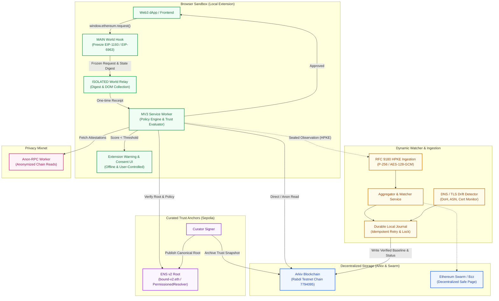
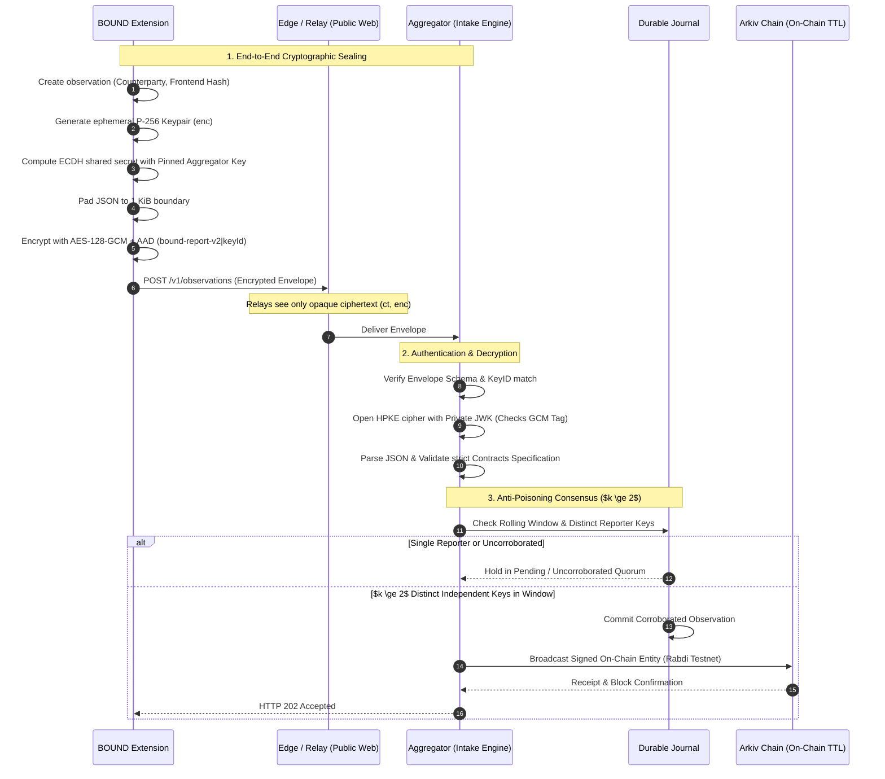

# BOUND: Technical Architecture, User Privacy & Anti-Poisoning Whitepaper

**Decentralized Origin-Aware Browser Firewall, Zero-Knowledge User Privacy & Resilient Consensus**

*Version 2.0 — November 2026*  
*Target: Public Release & Hackathon Architecture Specification*

---

## Abstract

BOUND is a client-side Web3 browser firewall engineered to protect decentralized finance (DeFi) users from frontend compromises, registrar hijacks, and DNS rerouting attacks (such as the real-world CoW Swap and Curve incidents). When an attacker compromises domain DNS or substitutes frontend scripts, TLS certificates and domain names continue to appear legitimate, leaving wallet signing prompts vulnerable to silent draining.

BOUND sits directly between the decentralized application (dApp) and browser-injected wallets (such as MetaMask or Rabby). It freezes incoming RPC requests, decodes calldata down to effective authorization semantics (e.g., ERC-20 `approve`, Permit2, batched executions), and verifies both frontend code integrity and contract destinations against independent, decentralized trust anchors—specifically **ENS v2**, **Arkiv**, and **Swarm**.

This whitepaper details:
1. **The End-to-End System Architecture** across extension client, curator, watcher, and on-chain storage.
2. **Absolute User Privacy Guarantees**: Demonstrating that user activity, wallet addresses, balances, amounts, and browsing history are never tracked, collected, linked, or broadcast.
3. **Aggregator Cryptographic Integrity & Anti-Poisoning Engine**: Demonstrating why adversaries cannot forge, spam, or poison community baselines due to **RFC 9180 Hybrid Public Key Encryption (HPKE)**, client-side origin restrictions, and multi-reporter corroboration ($k \ge 2$) consensus.

---

## 1. System Architecture

BOUND divides responsibilities cleanly across five distinct layers: client evaluation, curated trust anchoring, dynamic watcher monitoring, decentralized storage, and privacy mixnet routing.



### 1.1 The Client-Side Mediation Sandbox
* **MAIN World Hook (`hook.js`)**: Injected into the web page before application scripts execute (`document_start`). It wraps `window.ethereum` and `eip6963:announceProvider` proxies. When the dApp initiates an RPC call, the hook deep-freezes the request arguments, calculates a cryptographic SHA-256 payload digest and provider state digest, and pauses execution.
* **ISOLATED World Relay (`relay.js` & `frontend-collector.js`)**: Bridges communications between the untrusted page DOM and the privileged service worker via Chrome runtime messaging. It extracts current-document script hashes while strictly filtering out inline queries or user sensitive tokens.
* **Service Worker (`sw.js`)**: Evaluates the transaction against the local **Policy Engine** (`policy-core`). Computes connection confidence scores (0–100) and transaction risk bands (Green $\ge 70$, Amber $40-69$, Red $\le 16$).
* **Warning Window (`warning.html` & `warning.js`)**: Renders in an extension-owned dialog window. It exposes evidence, including site identity, script comparisons, connection checkmarks, and ENS attestations. The user retains complete authority: transactions are never silently dropped; low scores escalate warning severity up to typed confirmation (`I UNDERSTAND`).

### 1.2 On-Chain Trust & Decentralized State
* **ENS v2 Root (`bound-v2.eth`)**: Configured with a dedicated `PermissionedResolver` on Ethereum Sepolia. Holds `bound.root.v2`, committing to the curator's latest snapshot digest, network, epoch, and Arkiv entity key.
* **Arkiv Storage Network (Rabdi Testnet Chain 7794095)**: Houses immutable, expiring entities representing baselines, domain statuses (`normal`, `drift`, `incident`), script integrity registries, and historical incident records. All records use block-based Time-To-Live (TTL) timestamps, ensuring automatic garbage collection and preventing state bloat.

---

## 2. Comprehensive User Privacy Architecture

Web3 security tools often trade user privacy for protection by routing client addresses and transactions to centralized servers for simulation. **BOUND takes the opposite approach: zero user activity tracking is built into the protocol invariants.**

```text
+-----------------------------------------------------------------------------+
|                            USER PRIVACY MATRIX                              |
+--------------------------+-----------------------+--------------------------+
| Data Item                | Transmitted Remotely? | Where It Lives / Scope   |
+--------------------------+-----------------------+--------------------------+
| User Wallet Address      | NEVER                 | Kept in local wallet     |
| Wallet Balance / Assets  | NEVER                 | Local memory only        |
| Transaction Amount       | NEVER                 | Decoded inside sandbox   |
| Full URL Paths & Queries | NEVER                 | Stripped at origin root  |
| Web Browsing History     | NEVER                 | Injected only on dApps   |
| User Decision (Continue) | NEVER                 | Kept inside extension    |
| Observation Event        | YES (Sealed HPKE)     | Ephemeral rotated key    |
+--------------------------+-----------------------+--------------------------+
```

### 2.1 Complete Client-Side Evaluation
1. **Zero External RPC Dependency for Decision Making**: Calldata decoding, token approval checks, spender identification, and scoring calculations execute **100% locally** within the browser's JavaScript sandbox. The extension does not ask a remote server *"Is this transaction safe?"*.
2. **Unmodified Forwarding**: If the user confirms a transaction, the exact byte-identical payload frozen by the hook is released to the local wallet provider. No third-party relay or middleman receives or signs the transaction.

### 2.2 Traffic Analysis Resistance & Padding
Network eavesdroppers (ISPs, local Wi-Fi sniffers, or state proxies) can often deduce user actions by observing the size of encrypted payloads (traffic analysis). BOUND prevents this via deterministic buffer padding in [`integrations/report-crypto/index.mjs`](file:///Users/socrates/Personel/BOUND/integrations/report-crypto/index.mjs):
* Plaintext batches are padded to discrete **1,024-byte (1 KiB) multiples** using whitespace before encryption:
  $$\text{Length}_{\text{padded}} = \left\lceil \frac{\text{Length}_{\text{JSON}} + 1}{1024} \right\rceil \times 1024$$
* A batch reporting 1 counterparty produces the exact same ciphertext size as a batch reporting multiple contracts, eliminating packet-length side-channel attacks.

### 2.3 Ephemeral, Rotated Reporter Identities
* Observations sent to the aggregator contain a `reporterKey`. This key is generated client-side and automatically rotates on a rolling window.
* It is derived from an internal random seed that is completely detached from the user's Ethereum address, ENS identity, IP address, or Chrome profile identifier.
* Consequently, observations cannot be linked together to construct a persistent profile of a single user's browsing activity.

### 2.4 Anonymized Chain Lookups (Anon-RPC)
* When the extension queries chain status or resolves external protocol attestations, traffic is dispatched through the **Anon-RPC** mixnet/proxy interface.
* Origin headers, IP addresses, and user-identifying cookies are omitted, preventing public node providers (Infura, Alchemy, PublicNode) from mapping IP addresses to specific smart contract lookups.

---

## 3. Aggregator Anti-Poisoning & Cryptographic Integrity

A crowdsourced security aggregator is a high-value target: if attackers could inject false observations, they could either suppress alerts for a malicious contract or manufacture false incidents to take down a competing protocol.

BOUND deploys a multi-stage defense-in-depth model that makes poisoning mathematically and economically infeasible.



### 3.1 RFC 9180 Hybrid Public Key Encryption (HPKE)
All communication between the browser extension and the watcher intake uses **RFC 9180 HPKE** in Base Mode with the `hpke-p256-sha256-aes128gcm` ciphersuite:
* **Key Encapsulation Mechanism (KEM)**: `DHKEM(P-256, HKDF-SHA256)`
* **Key Derivation Function (KDF)**: `HKDF-SHA256`
* **Authenticated Encryption with Associated Data (AEAD)**: `AES-128-GCM`

#### Key Invariants & Tamper Resistance:
1. **Pinned Public Key**: The aggregator's uncompressed public key (`0x04 || X || Y`) is hardcoded into the extension build (`dist/score-settings.mjs`) during compilation. It cannot be altered by malicious dApps, settings pages, or rogue RPC nodes.
2. **Associated Authenticated Data (AAD)**:
   $$\text{AAD} = \text{"bound-report-v2"} \mathbin{\Vert} \text{keyId}$$
   The AAD binds the ciphertext directly to the 64-bit truncated SHA-256 digest of the expected public key. If an adversary attempts to intercept and replay the payload to a different receiver, or modifies the envelope header, the AEAD authentication tag verification fails with `OpenError`.
3. **No Plaintext Fallback**: The intake server outright rejects any unencrypted payload with HTTP 400. If the extension lacks the pinned public key, reports remain safely buffered in local storage.

### 3.2 Transport & Origin Isolation
* **CORS Restrictions**: The aggregator strictly enforces origin verification. Standard web origins (`https://`, `http://`) are rejected with HTTP 403. Only explicit Chrome extension origins matching `chrome-extension://[a-p]{32}` or local loopback test harnesses are granted CORS headers.
* **Payload Size Ceiling**: Requests exceeding 65,536 bytes (64 KiB) are disconnected at the socket stream before memory allocation, preventing denial-of-service memory exhaustion.

### 3.3 Multi-Reporter Corroboration Engine ($k \ge 2$)
Even if an adversary decompiles the extension and obtains the pinned public key, **they cannot poison the community baseline alone**:
1. **Threshold Quorum ($k \ge 2$)**: An observation (such as a new frontend script hash or observed counterparty) is not promoted to the published baseline upon receipt of a single report. It requires corroboration from at least $k$ distinct, independent `reporterKey` identifiers within a configurable rolling retention window (e.g., $k=2$, $T=24\text{ hours}$).
2. **Rate Limiting & IP Sliding Windows**: The intake enforces token-bucket rate limiting per client subnet, preventing a single IP address from flooding distinct reporter keys.
3. **Conflict Isolation (Conflict Wins)**:
   * If an observation conflicts with an established curated baseline or an active incident record, the aggregator **never** automatically replaces the trusted record.
   * Instead, conflicting observations trigger a quarantined **drift signal**, which raises warning severity on the client to the maximum tier without granting trust to the rogue contract.
4. **On-Chain Accountability on Arkiv**:
   * When observations achieve corroboration, they are committed to Arkiv using deterministic, content-derived entity keys signed by the watcher's exclusive on-chain wallet (`0xe63393558e36df643347326e7e03ad5fb0e6c867`).
   * Because every state transition is recorded on the public Rabdi testnet with immutable transaction hashes and block heights, any attempted administrative manipulation is immediately auditable.

---

## 4. Threat Model & Security Analysis

| Threat / Attack Vector | Traditional Web3 Vulnerability | BOUND Mitigation & Enforcement |
|---|---|---|
| **CoW Swap / Curve DNS Hijack** | Attacker repoints DNS to a clone server. SSL cert is valid; dApp requests signature for a drainer contract. | **Held in Warning Window**: The contract address fails baseline checks and triggers an immediate low confidence score / firewall screen. |
| **BGP / CDN Origin Server Takeover** | Attacker modifies upstream origin while keeping CDN intact. User visits authentic domain. | **Frontend Script Hash Mismatch**: Relay collects script digests; conflict with community baseline triggers high-severity warning or safe-page redirect. |
| **Aggregator Poisoning / Sybil Injection** | Malicious actor spams false observations to validate a drainer contract. | **Failed**: RFC 9180 HPKE sealing, origin isolation, $k \ge 2$ distinct reporter key corroboration, and conflict quarantine prevent unverified baseline modification. |
| **ISP / Network Surveillance** | Third parties log user visits and decode Web3 interactions to link wallets to real identities. | **Blocked**: Evaluation is 100% client-side; payloads use 1 KiB whitespace padding; chain reads travel via Anon-RPC mixnets. |
| **Provider In-Memory Tampering** | Malicious script attempts to overwrite `window.ethereum` after initialization. | **Object Deep Freeze & Proxy Isolation**: The MAIN-world hook binds non-configurable properties and uses isolated-world message passing with unique nonces. |

---

## 5. Verification & Implementation Metrics

The BOUND implementation has been verified through automated test suites and real-world network probes:
* **Unit & Integration Test Suite**: **739 tests** passing across decoder, policy-core, extension worker, and Arkiv contracts (`npm test`).
* **Live On-Chain Arkiv Verification**: Verified real-time write confirmation (153 ms) and query retrieval of 8 live entities on Rabdi testnet (Chain ID `7794095`, Block `315,592`).
* **Live Watcher Intake**: Validated end-to-end HPKE sealing, decryption, and 202 acknowledgment against production aggregator on Render (`https://bound-aggregator-0-1-1.onrender.com/v1/observations`).

---

## 6. Conclusion

BOUND establishes a new paradigm in Web3 security: **you do not have to surrender user privacy or centralize trust to defend against advanced infrastructure attacks.** By executing calldata decoding locally, anchoring trusted policies in ENS v2, publishing decentralized monitoring evidence to Arkiv, and sealing community reports with RFC 9180 HPKE, BOUND ensures that neither attackers nor aggregators can compromise user funds or track user actions.
