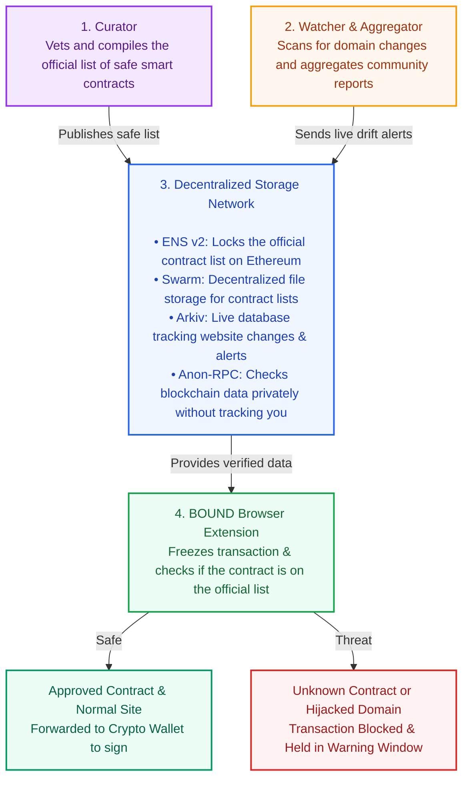

# BOUND

BOUND is an origin-aware browser firewall that protects Web3 users from hijacked frontends and DNS attacks.

When you interact with a dApp, BOUND intercepts the transaction before it reaches your crypto wallet. It decodes the calldata and checks the target contract against a verified, decentralized registry (anchored on ENS v2 and Swarm) while checking Arkiv for live DNS/TLS infrastructure drift. If an unauthorized contract or sudden domain change is detected, BOUND holds the transaction in a secure warning window—preventing wallet drains even when the domain name and SSL certificate look completely authentic.



## Repository Structure

BOUND is organized into independent components, each responsible for a specific part of the contract verification and domain monitoring pipeline.

```text
BOUND/
├── client/
│   ├── extension/              # Browser extension
│   ├── safe-page/              # Isolated warning and recovery page
│   ├── landing/                # Project website
│   ├── video/                  # Demo/video assets
│   └── demo/                   # Test dApp and frontend-switch sites
│       ├── test-dapp/
│       └── frontend-switch/
├── server/
│   ├── watcher/                # Domain monitoring and alert service
│   ├── curator/                # Trusted registry compiler and publisher
│   └── demo/                   # Local server fixtures
│       └── hijack-server/
├── shared/
│   ├── contracts/              # Shared schemas and contract evidence
│   ├── decoder/                # Transaction decoding
│   ├── policy-core/            # Shared policy evaluation
│   ├── snapshot/                # Registry snapshot logic
│   └── integrations/           # Arkiv, ENS, Swarm, and Anon-RPC adapters
├── scripts/                    # Rooted maintenance and integration scripts
├── fixtures/                   # Rooted test and evidence fixtures
├── .bound/                     # Local operational state and user data
├── Docs/                       # Project plans, guides, and evidence
├── package.json                # Root scripts and dependency/workspace policy
└── package-lock.json           # Root dependency lockfile
```

Use the root `package.json` scripts as the supported entry points where available. Examples:

```sh
npm test
node client/extension/build.mjs
node client/extension/browser-check.mjs
node server/watcher/run.mjs server/watcher/config-example.mjs
npm run demo:local
```

For component-specific setup, start with the README in that component directory. `scripts/`, `fixtures/`, and `.bound/` remain rooted.

*Directory names and subdirectories should reflect the actual repository layout.*

## Core Components

| Component | Responsibility |
|---|---|
| **Curator** | Maintains and publishes the official registry of trusted smart contracts. |
| **Watcher & Aggregator** | Monitors domain changes, collects community reports, and generates drift alerts. |
| **ENS v2** | Anchors the trusted registry's root hash on Ethereum. |
| **Swarm** | Provides decentralized storage for registry snapshots. |
| **Arkiv** | Stores live monitoring data, domain changes, and incident records. |
| **Anon-RPC** | Enables private blockchain lookups without exposing unnecessary user information. |
| **BOUND Extension** | Intercepts and freezes transaction requests, verifies contract authorization, and presents security warnings before wallet signing. |

## How the Components Work Together

1. **Registry creation:** Curator compiles the official list of trusted smart contracts.
2. **Continuous monitoring:** Watcher monitors domain changes and aggregates external reports.
3. **Decentralized verification:** ENS v2 anchors registry integrity, Swarm stores snapshots, and Arkiv maintains live monitoring records.
4. **Transaction evaluation:** The browser extension intercepts transaction requests and checks the target contract against the trusted registry.
5. **User protection:** Verified transactions are forwarded to the wallet, while unknown contracts or suspicious domain changes trigger a warning and block the request.

## Development & Security Notes

BOUND was built from scratch during ETHGlobal Mumbai, according to the team. The team used Claude and OpenAI Codex as AI coding assistants for development, debugging, and documentation; generated changes require human review and tests. There has been no independent security audit.

The GitHub Actions workflow is configured for local tests and Gitleaks but has not yet run on a hosted runner. Gitleaks Action requires a license for organization-owned repositories; no license or other secret has been provisioned here. Real-wallet and testnet runs are not part of the local suite. Browser end-to-end suites and the required metric reports remain to be integrated.

## Arkiv submission evidence

The testnet writer used for recorded entities is `0xe63393558e36df643347326e7e03ad5fb0e6c867` on Rabdi (chain 7794095). To query its unexpired BOUND records, run from the repository root after `npm ci`:

```sh
node --input-type=module <<'JS'
import {createArkivRpcReader} from './shared/integrations/arkiv/rpc.js';
const reader = createArkivRpcReader({url:'https://rpc.rabdi.db-chain.testnet.arkiv.network',schemaTag:'bound.record.v1'});
const records = await reader.query({owner:'0xe63393558e36df643347326e7e03ad5fb0e6c867'});
console.log(records);
JS
```

Results change as entities expire. A read on 2026-11-07 returned 10 records; this does not demonstrate the extension's user-facing live read. See [schema](arkiv/schema.md), [feedback](arkiv/friction.md), [reach](arkiv/reach.md), [why Arkiv](arkiv/why-arkiv.md), [how we use Arkiv](arkiv/how-you-use-arkiv.md), and [Swarm evidence and remaining gaps](arkiv/swarm.md).

## License

BOUND is licensed under the [MIT License](LICENSE). Third-party components may have their own licenses.
- BOUND is developed with AI-assisted tooling. Generated code and changes require human review and testing.
- Local integration fakes validate application behavior but do not establish that external services work correctly.
- Never commit private keys, funded wallet credentials, or real-user secrets.
- No independent security audit has been completed.
- Browser end-to-end testing, external integration verification, and required security metric reports are still in progress.

For implementation details, see the [implementation plan](Docs/plan.md), [Arkiv integration](shared/integrations/arkiv/README.md), [contract feasibility evidence](shared/contracts/feasibility.md), and [local hijack demo](server/demo/hijack-server/README.md).

## Financial-site registry

The [50-site candidate registry](fixtures/financial-registry/SITES.md) and [capture/ENS publication plan](fixtures/financial-registry/README.md) provide sourced financial-site discovery and public JavaScript hashes. Candidates are unreviewed and do not automatically enter BOUND's trusted snapshot.
